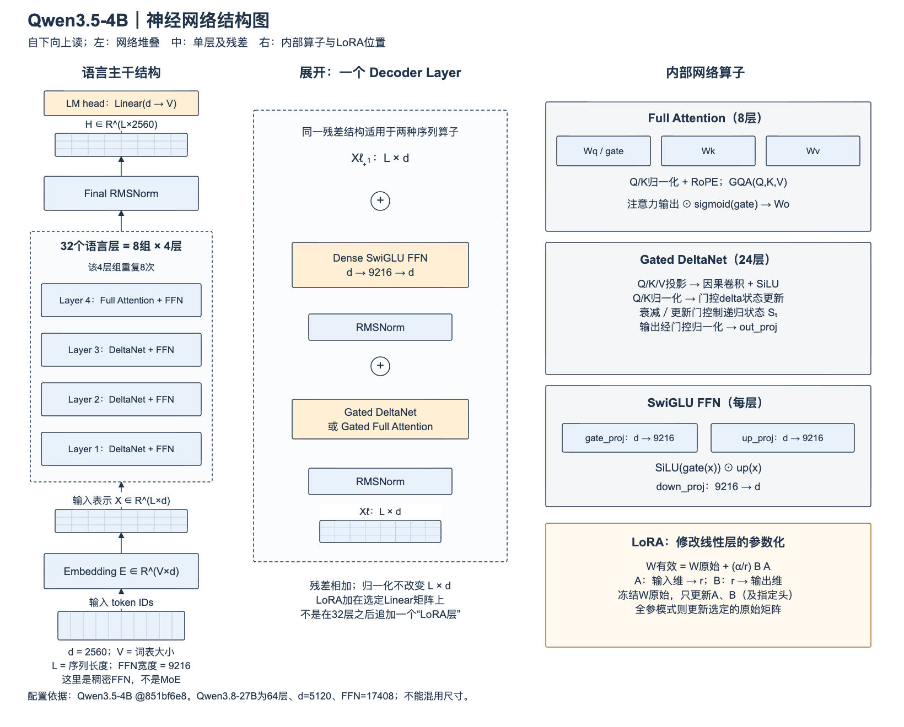
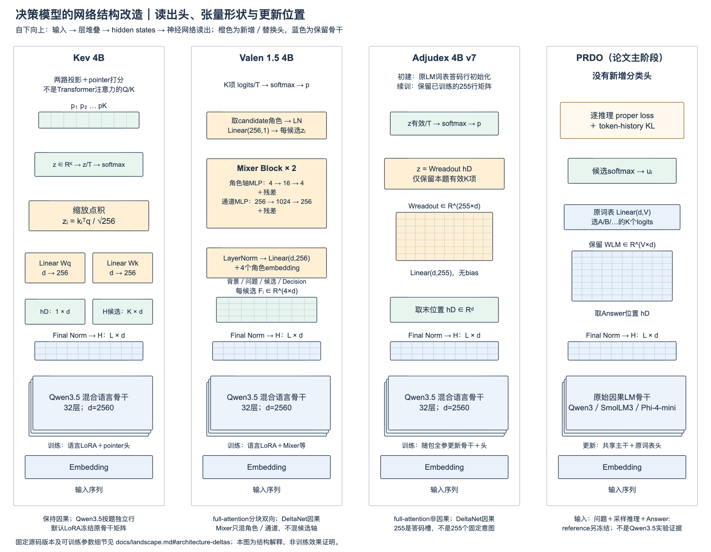

# 领域图谱：机制、生态与评测

更新：2026-11-21。本页回答“这个领域由哪些部分组成”。“该信什么”见 [problems/](../problems/)，“怎么落地”见 [playbooks/](../playbooks/)。逐模型事实见[模型卡](models.md)。

## 1. 六个层次，分开比较

同一个概率向量 API，背后可能是完全不同的系统。比较两个模型之前，先逐层对齐：

| 层次 | 要问的问题 |
|---|---|
| 输出合同 | 互斥单选、独立命题、有序等级，还是多标签？候选是否运行时给出？有没有 NONE？ |
| 读出 | 词表行（选项字母）、独立答码头（如 255 码）、pointer head、分类头，还是双塔相似度？哪些候选参与归一化？ |
| 注意力 | 提示部分是否双向？共享前缀能否复用？多题是共享状态并行，还是联合注意？ |
| 训练 | 改了哪些参数、用了什么数据和目标（CE、soft KL、RLCD、RLAF、PRDO）？训练代码是否真的公开？ |
| 计算策略 | 何时推理、重读、调用工具、补证据或转交？ |
| 验收 | 完整策略是否满足风险、覆盖、延迟和许可要求？ |

注意：一次读出不以 RL 为前提；训练名称不证明校准；API 兼容不代表语义等价。

### 读出范式与工程约束

读出范式决定的主要是工程约束（选项上限、能否零训练、多题能否共享一次前向、能否用现成推理框架），而不是准确率；联训时几种读出头的准确率差别不大（[Small Heads v4](https://arxiv.org/html/2611.15592v4)）。

| 范式 | 代表 | 选项 | 多题 | 训练 | 服务 |
|---|---|---|---|---|---|
| 词表 token 读出 | [SGLang `/v1/decisions`](https://docs.sglang.io/docs/supported-models/decision_models)、openjev-sglang、StartLux、LLM-as-Jev | 受单 token 标签数限制（A–Z、0–9；openjev-sglang 用验证过的组合扩到 64）；多 token 标签需按序列对数概率归一化；新增 special token 需同时改 embedding 与 lm_head | 每题一次 prefill，可复用前缀缓存 | 可零训练 | 现成推理框架 |
| 固定答码头（255 码） | D3、PPLX Decider、Drex Max、LemonDecider | ≤255，运行时可变；答码是位置，不是固定业务类别 | 多为每题一次前向 | 需训练读出头 | 自定义运行时 |
| pointer／动态候选头 | Kev、Strands v1、NanoJev | 动态候选 | 依实现 | 需训练 | 自定义运行时 |
| 联合 schema 头 | Clef、Unsloth `DecisionTrainer`、Intern（占位符监督） | 运行时可变 | 一条序列多题共享一次前向；字段顺序与相关性须另测 | 需训练 | 自定义运行时 |
| 双塔相似度 | CLM | 大候选库，候选向量可缓存 | 候选独立编码 | InfoNCE | 向量检索式 |
| encoder 分类器 | Laya、GLiClass、Verdict | 标签作为输入或候选 | 短上下文 | 小模型监督 | CPU 可跑 |

### 神经网络结构：先看层与矩阵，再看数据流

下面两张是模型结构主图，采用自下向上的层堆叠，表示神经网络模块、张量维度、矩阵和残差连接。每张保留PNG浏览版及可编辑SVG源；旧数据流图已移出当前目录，恢复依据见变更记录。

**结构图A：Qwen3.5-4B语言路径。** 左侧是embedding、32层及词表头，中间展开单个decoder layer，右侧列full attention、DeltaNet、SwiGLU及LoRA的参数位置。视觉前端为可选支路，本图不展开视觉encoder；其作用见下方说明。Qwen3.8-27B的尺寸差异写在图下注。

[可缩放、可编辑SVG](assets/decision-architecture/05-neural-network-backbone.svg)

**结构图B：四种网络读出与后训练更新位置。** Kev展开两路Linear投影与点积，Valen展开四角色投影及两层Mixer，Adjudex显示255×d权重矩阵；PRDO保留V×d词表矩阵，虚线指出loss更新共享主干和原词表头，reference及采样细节见下方PRDO说明及论文原图。矩阵网格是维度示意，格子数量不代表真实参数数量；三个4B网络共同d=2560，PRDO的d依实际论文基座而定。参数模式、注意力可见性及损失仍须结合下方固定版本表阅读。

[可缩放、可编辑SVG](assets/decision-architecture/06-neural-network-readouts.svg)

### 结构与后训练说明

核查于2026-11-25。**模型架构图（model architecture diagram）**描述模块及连接；**架构差异图（architecture delta）**突出改哪里；**训练计算图（training computation graph）**标出loss、冻结对象和梯度。三个概念不应混画成“换softmax”。本节图是按固定配置／源码重绘的解释图，不是厂商披露的Jev内部结构，也不是效果复现。

**原图入口：** [Qwen官方Qwen3-Next层结构PNG](https://qianwen-res.oss-accelerate.aliyuncs.com/Qwen3-Next/model_architecture.png)（[官方模型卡引用](https://huggingface.co/Qwen/Qwen3-Next-80B-A3B-Instruct-GGUF)）；[PRDO论文Figure1原SVG](https://arxiv.org/html/2609.38850v2/fig1_schematic.svg)。Qwen原图是Next的MoE层，不可直接当Qwen3.5-4B或Qwen3.8-27B：本节这两个具体模型的FFN为稠密结构。Qwen3.5页面的家族级MoE宣传不能覆盖具体config。

**Qwen基座。**

- 文本经tokenizer及embedding；图像／视频可先经视觉encoder和merger，变为与文本同维度的表示并按位置融合。纯文本请求没有实际视觉计算，不要把视觉模块存在误写成视觉已经训练。
- 语言骨干输出的是**每个位置的上下文向量**`H`。普通生成模型用`lm_head`将最后位置投到词表，采样下个token后再继续；决策模型可以在这里改读出，省去答案文字的逐token生成。
- 固定[Qwen3.5-4B配置](https://huggingface.co/Qwen/Qwen3.5-4B/blob/851bf6e806efd8d0a36b00ddf55e13ccb7b8cd0a/config.json)：32层、hidden=2560，8组“3×DeltaNet＋1×full attention”；固定[Qwen3.8-27B配置](https://huggingface.co/Qwen/Qwen3.8-27B/blob/37561816e66b5b9153b1b64c10968c18c1e6f4a0/config.json)：64层、hidden=5120，16组相同模式。它们都不是把FFN换为MoE的型号。

**单层网络及LoRA。**

`RMSNorm`控制数值尺度；序列混合算子让当前位置吸收其他位置的信息；`FFN`变换每个位置的特征；两个加号是残差相加。DeltaNet用门控递归状态汇总前缀，full attention显式比较可见位置的Q／K／V并门控输出，两者不是同一种算子。原生成骨干保持因果；把full层mask改双向，不会自动把DeltaNet递归改成双向。更多算子细节见[官方实现说明](https://huggingface.co/docs/transformers/model_doc/qwen3_5)。

LoRA是给选定线性矩阵增加低秩更新：`W_eff = W_frozen + (alpha/r) B A`。它改变**哪些参数更新**，不必改变推理模块的连接形状；全参训练则允许更新原有矩阵。图中不应把LoRA画成接在整个模型末尾的新分类头。

**三种直接决策改造。**

这三条路线均不执行原来的整词表生成头，但取hidden的位置与新头不同。用`hD`表示题末决策位置、`hi`表示候选i的端点；`T`为部署校准温度，以下是机制简式，不省略工程中的mask／类型映射。

| 改造 | Kev 4B路线 | Valen1.5 4B | Adjudex4B v7 |
|---|---|---|---|
| 取哪些hidden | `hD`及各候选结束marker的`hi` | 背景均值、问题均值、候选描述均值、Decision向量 | 最后位置`hD` |
| 如何评分 | `z_i = projection(hi) · projection(hD) / sqrt(d)`，pointer维度通常256 | 四角色先投影，再经过2层role/channel Mixer，从候选角色读一个分数 | `z = W_255 hD`，取本题有效K项 |
| 注意力 | Qwen3.5 hybrid走逐题因果row；普通attention-only底座另有packed block-causal路径 | 发布`bbox_blocks`：state不看问题；普通决策题在同一双向full块中互相可见；bbox题仅在full-attention mask中隔离；linear仍因果 | 每题完整prompt；full层非因果，linear保持递归；此路径拒绝KV缓存 |
| 共享与成本 | 推理可复用state的KV及DeltaNet状态；不能把一次HTTP说成一次全局前向 | 多题共享一次序列计算，但不能承诺增加另一问题不影响旧答案 | 每题一次row前向，可batch，不等于Jev式共享prefix缓存 |
| 原LM head如何处理 | 移除／不执行整词表头，新增pointer | 释放原词表头，新增Mixer；另有视觉定位头 | 从Qwen新建时取原词表答码行初始化独立255头，发布checkpoint续训则保留现有头 |

**三处最易误读：** Kev头里的两投影不是Transformer注意力的Q/K投影；Valen Mixer混的是四个角色和特征通道，**不是在头内混合不同候选**；Adjudex的255行是答码槽，不是写死255个业务意图。三者最后都有候选内softmax，这并不是它们差异所在。

**训练更新范围与目标必须和结构分开标。**

| 指定路线 | 实际可训练部分 | 学习信号／边界 |
|---|---|---|
| Kev默认4B LoRA续训 | 骨干选定投影LoRA＋pointer head，原主干权重冻结 | hard／soft CE；部分hard分支可选辅助项；soft分支不自动叠全部loss开关 |
| Valen joint-LoRA | 语言Linear LoRA＋Mixer；视觉merger可训，存在grounding时其头可训 | 分布CE；可选ordinal RPS／Brier。视觉transformer blocks冻结，纯文本batch仍不产生视觉输入梯度 |
| Valen joint-full | 语言与视觉backbone＋Mixer／grounding | 是另一种参数范围，不能沿用“所有视觉冻结”；是否实际学习视觉取决于batch |
| Adjudex随包全参路线 | 已加载backbone＋255 readout可训练 | 分布CE＋可选Brier；未核现成LoRA训练路径。不能因为模型类含视觉模块就声称该文本训练已更新视觉能力 |

固定证据：[Kev模型／pointer](https://github.com/jaredpalmer/kev/blob/556167b5b151152cb4101629e25d883e9ead5094/kev/model.py)、[Kev训练loss](https://github.com/jaredpalmer/kev/blob/556167b5b151152cb4101629e25d883e9ead5094/kev/train.py)；[Valen头](https://github.com/Valen-Team/Valen/blob/f6df4fdbc45bf44a4ffbebaeda53f5fe6e49b339/valen/modeling/qwen/heads.py)、[mask契约](https://github.com/Valen-Team/Valen/blob/f6df4fdbc45bf44a4ffbebaeda53f5fe6e49b339/valen/modeling/qwen/DECISION_1_5.md)、[训练builder](https://github.com/Valen-Team/Valen/blob/f6df4fdbc45bf44a4ffbebaeda53f5fe6e49b339/valen/modeling/qwen/builder.py)；[Adjudex模型](https://huggingface.co/newsbang/adjudex-4b-v7/blob/ff4677a23dff03c4fc21383c77cf5f626ec23108/source/src/autojev/model.py)、[loss](https://huggingface.co/newsbang/adjudex-4b-v7/blob/ff4677a23dff03c4fc21383c77cf5f626ec23108/source/src/autojev/loss.py)。

**PRDO：保留原网络，改变推理后的概率训练。**

PRDO主阶段对M条采样分别计算proper loss与token KL再平均；采样使用当前θ或同步数值副本，reference冻结，真正更新的是当前模型θ。**正确标签y只进入loss，不进入模型提示。**

- **网络未换头：** 原因果LM＋原`lm_head`；在`题目＋采样推理＋Answer:`处，选择候选标签的K个词表logit再softmax。实际标签须在模板中核tokenization，不能将任意中文多token标签当单token。
- **改的是训练信号：** 先无梯度生成推理token，再用可训练模型重算整段；逐推理计算Brier或负对数loss，并加推理历史上的**全词表**token KL，reference冻结。读出梯度反传共享主干及词表头；不是“只训一个概率头”。
- **不反传离散采样 ≠ 推理能力不变。** 主阶段没有对采样推理使用REINFORCE项，但共享权重更新仍可改变未来推理。论文采用全参，不是已经提供LoRA配方。
- **训练／部署分开：** 论文主配置每题采样M=4；单推理部署是生成一条推理再读概率，不是每次默认四次投票。可选第二阶段另加score-function项，没有新网络模块。
- **基座分开：** 论文主要用Qwen3-0.6B／1.7B、SmolLM3-3B、Phi-4-mini-instruct；不能把结构图A的Qwen3.5混合结构直接当论文已验证网络。

证据：[PRDO v2 Figure1及方法](https://arxiv.org/html/2609.38850v2#S3.F1)、[固定训练实现](https://github.com/ZimmyGao/openjev-rlcd/blob/5859d2b893314fb3581f06e4e36c303e372b3f48/openjev_rlcd/train.py)。主阶段有效锚定为token KL；`kl-beta`在此不贡献score-function梯度，但固定CLI仍以其正值启用reference，不能只凭概念图删除参数。实施细节沿用[PRDO流程](../playbooks/decision-pipeline.md#prdo)。

**阅读顺序：** 先看结构图A理解网络层与矩阵，再看结构图B比较读出改造；训练范围和PRDO梯度以本节说明为准。不把更多模块画成更高准确率，也不把架构图当企业适配成功的证据。

图源维护：当前目录仅保留两张结构图的SVG源及PNG浏览版。

## 2. 生态分布（2026-11）

**托管服务**：合同已趋同，差异在模态、版本冻结和数据边界。
- Jev（TypeSafe，1.14）；OpenAI Decisions API（GPT-6 Luna，10-22 GA）；Microsoft-Decision-1.1；Google Gemini Decision 1（11-11，覆盖文本、图像、音频、视频、PDF）；Cloudflare Clef（Workers AI）；Liquid d1.2；Ant LingDT；百炼 decision-model。
- 关键差异：能否客户微调（Jev 不能，GLiDE 和百炼可以）；版本别名是否冻结；confidence 的定义。

**开放权重家族**：35 族，大致分三类：
- 有可续训入口：Kev、Valen、Strands v2、RSI-Jev、Jeff、Mapika、SII（需特定字段）。
- 主要提供推理和服务：Drex、Mammoth、PPLX Decider、StartLux（权重非商用）、D3、Decisio、Span-02。
- 小模型和 encoder：Laya、GLiClass、GLiNER-Decide、Verdict、MNN-Pocket-0.3B、jevos（CPU）。

**训练与方法**：
- 直接监督（CE/BCE + LoRA）是共同底座。
- 变体：soft target 蒸馏、思考到读出的自蒸馏（SII）、RLCD／RLCD²（StartLux）、RLAF（Drex）、PRDO（逐推理 proper score）、CAPS（chosen-action 部分反馈）。

**相邻工具**：SetFit、Qwen3-Reranker、Outlines（结构化输出）、RouteLLM／LLMRouter（路由）、Vowpal Wabbit（bandit）、MAPIE（conformal）、Parlant（规则匹配引擎）。

## 3. 评测体系：协议不同，分数不混

| 基准 | 测什么 | 读法 |
|---|---|---|
| HF 社区 Decision Index（0.3.2 / 0.4.x） | 多任务汇总；0.4 文本 Full 全部私有 | 版本间评分规则不同，不能当作模型增益；0.9 分平局带 |
| [AA Decision Index](https://artificialanalysis.ai/articles/decision-index-v2) v1.0 / v2 | v2 = 50×(1+准确率−Brier)，45% 私有 | 校准进入主分；前三相差 1 分以内 |
| JEVal v2 | 中英多领域本地判断 | SII 作者评测自家模型；分母口径不同 |
| DecisionPivot | 13 个对比族的程序化标签 | StartLux 作者自建、自评 |
| TypedBench、[2610.00346](https://arxiv.org/html/2610.00346v2) | 校准、措辞敏感性、成本；对比训练分类器 | 第三方；出厂校准取决于模型×任务 |
| [To Jev or Not to Jev](https://arxiv.org/abs/2611.00505) | 用作 LLM 评审，含注入测试 | 第三方、预先声明协议；英文公开基准 |
| [Reading Right, Acting Wrong](https://arxiv.org/abs/2610.18579) | agent loop 中的读错与做错 | 初版；冻结的模拟状态 |

规则：零样本、任务微调、Best-of-N 回答的是不同问题；本地 GPU forward 时间和远程 API 往返时间是不同测量。本仓不制作混合排行榜。

## 4. 演进脉络

| 时间 | 阶段 | 标志 |
|---|---|---|
| 2026-09 | 合同确立 | Jev 发布（09-15），开源复现与小模型涌现（Laya、Kev、CLM、Nimble） |
| 2026-10 | 发布潮 | Clef、D3、Intern、StartLux、PPLX、Drex；OpenAI GA；HF DI 0.4 改为私有 Full；第三方校准审计出现 |
| 2026-11 上 | 托管收敛，评测转向 | Google Gemini Decision（11-11）；AA v2 把 Brier 计入主分（11-08）；judge 横评与 agent loop 诊断 |
| 2026-11 中 | 训练入口开放 | GLiDE 训练 API、Valen native 续训、Strands v2、Jeff 训练器；企业多轮意图线上比较（Amazon） |

下一阶段的看点：作为评审与评测层落地（[P09](../problems/P09-judge-layer.md)）；策略级风险认证（[P05](../problems/P05-policy-risk.md)）；部分反馈学习（[P10](../problems/P10-repair-actions.md)）；读出与推理的按需分配（[P03](../problems/P03-read-or-reason.md)）。
