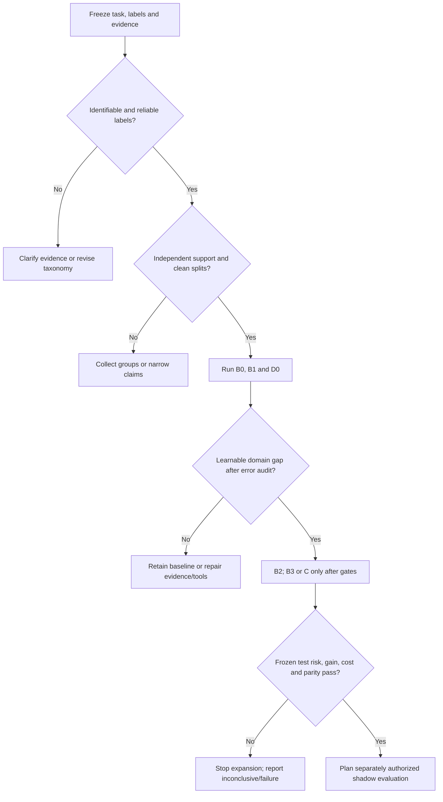

# Fine-tuning multimodal decision models: research and acceptance plan

[简体中文](multimodal-decision-finetuning.zh-CN.md) · [Home](../README.md) · [Selection guide](selection-guide.md#image-intent-adaptation) · [Evidence ledger](evidence.md)

Sources reviewed: 2026-10-28 (production evidence, research questions and diagnosis; earlier evidence retains its original dates). This is a testable research design for general multimodal customer-support intent recognition. No model was trained and no production benefit was demonstrated here. Public implementations, author reports and proposed experiments are distinguished below. Image understanding, intent, calibration and abstention policy are separate questions.

This is the maintained implementation plan: [Mac small-data route](#mac-implementation), [matched matrix](#experiment-matrix) and [research evidence](#7-minimum-research-deliverables). The [October 26 source audit](../updates/2026-10-26-multimodal-training-and-evidence.md) and October 22 survey remain historical references; no parallel implementation report is added.

**Research question.** With a few thousand manually labeled images, can a resource-bounded local system reduce per-case total decision cost while meeting critical-risk limits, and can controlled experiments distinguish data/scorer gains from a new learning mechanism? All implementation, training and acceptance steps below are pending execution.

<a id="quick-route"></a>
## One-page experiment route

Use this route to test whether domain post-training improves a defined decision. **No candidate is a proven winner, and adaptation can reduce quality.** The [reading list](#reading-list) separates peer-reviewed methods, preprints and engineering assets.

| Gate | Required artifact and pass condition | Fail / stop |
| --- | --- | --- |
| G0 · Contract | Rights, observable input/labels, independent groups, split manifest and owner-set error/review/latency/compute costs; [data](#data-schema). | Unidentifiable targets, missing rights or insufficient independent support: revise or stop that arm. |
| G1 · Technical smoke | A future authorized 32–64-example synthetic/non-sensitive pipeline check, including longest inputs/backward/save/reload; [Mac route](#mac-implementation). | Lost visual evidence, wrong masks, invalid gradients, memory pressure or reload mismatch: fix before scaling. |
| G2 · Baselines and bounded adaptation | Rules/OCR/frozen features, one small frozen VLM and its matched frozen-head/QLoRA arms; finite Dev search and at least three preregistered seeds; [matrix](#experiment-matrix). | If the inexpensive baseline meets the target, do not add model complexity merely to create a research story. |
| G3 · Frozen acceptance | Separate Cal-fit/Cal-policy, locked Test; paired per-case cost reduction above a minimum useful gain and acceptable critical risk; [acceptance](#6-accept-quality-risk-and-cost-together). | Inconclusive intervals, failing risk/cost/parity or test-guided selection: no success claim; keep negative findings. |
| G4 · Conditional external check | Only after separate authorization: shadow evaluation, human audit and rollback plan. | Offline success grants no permission to deploy or process real requests. |

All gates are planned work. This document authorizes no installation, weight/sample download, training, upload, production processing or deployment. Reuse identified completed checks when the artifact and question are unchanged.

<a id="six-principles"></a>
### Six principles translated into experiments

| Principle | Concrete experiment / artifact |
| --- | --- |
| Intent depends on evidence, not the screenshot category alone. | Independent annotation of visible facts, contemporaneous intent and sufficiency; same-image/different-context cases. |
| Typed outputs and direct logits are mechanisms, not accuracy guarantees. | D0 inference comparator; B2/B3 with the exact same base and explicit normalization/readout. |
| Domain supervision must add useful information. | Strong B0/B1 baselines first; grouped learning curves and one-factor adaptation, including ordinary replay. |
| More reasoning cannot supply missing evidence. | Deterministic arithmetic/rules; optional frozen hard-case AutoThink comparison only on evidence-complete inputs. |
| Probability, calibration and an acceptable policy differ. | Separate development/calibration/test roles, error costs and risk–coverage; no universal confidence cutoff. |
| Deployment is part of the model being evaluated. | Image/token/template, concurrent request, precision/device/calibrator regression and complete cost on the same frozen policy. |

Start at the [data schema](#data-schema), [split protocol](#split-protocol) and [minimal matrix](#experiment-matrix); finish with the [result template](#result-template) and [decision tree](#decision-tree). These are proposed procedures for a small domain-screenshot dataset, not a released dataset or an experimental result.

## 1. Freeze the question and comparisons

The starting data are **images plus manually labeled intents**; historical context can be added. The primary task is business image–text intent recognition, with image-only as a required comparator. Construct a versioned derived view from history visible in the business system **before the decision cutoff**: exclude later support conclusions, final handling outcomes, backfilled labels and facts learned only after investigation. Freeze history length and truncation rules, and group all turns/images from the same conversation/case into one partition. Access, redaction and historical joins remain pending execution authorization; preserve the original records.

Intent labels do not establish that every image identifies its label. Audit a representative sample plus enriched ambiguous/rare cases with two independent annotators and adjudication; if the visible evidence cannot determine the intent, mark the limitation or add valid prior context rather than force a label. Correct next actions and evidence-insufficiency labels have **not** been supplied: evidence spans, sufficiency/conflict reasons and policy-permitted actions are optional staged annotations with their own cost/rights, not existing gold. Separate normal known cases, missing image/context, conflicts, unknown intents and OOS wherever verified labels support that distinction.

The main output is a short label plus a defined score, with evidence location and optional concise explanation separate. Long chain-of-thought is not a substitute for evidence grounding. Changing prices/status/policies remain time-valid input evidence, as specified in [learned judgment](#learned-judgment).

### Preregister falsifiable hypotheses

| Question | Test that could refute it | Decision |
| --- | --- | --- |
| H1: the visible input identifies the requested target and images add information. | Independent annotation remains ambiguous, or context/OCR/frozen features explain all useful signal. | Revise the target/evidence; no image-learning claim from image labels alone. |
| H2: bounded adaptation improves the business decision. | Paired per-independent-case cost reduction versus the strongest frozen baseline has a confidence lower bound no greater than the preregistered minimum useful gain, or critical risk fails. | Keep the baseline, collect independent evidence or stop. More F1 alone is insufficient. |
| H3: a specified readout/training change adds value. | Same exact base, labels, visual processing and optimization/search budget explain the apparent gain; a frozen head or stronger post-hoc scorer closes it. | Report the useful system change, without attributing it to a representation breakthrough. |
| Research A: does compressed state still support low-loss actions after rule changes, and can bounded acquisition recover it? | Latest-turn/invalidation, stronger readers or same-cost active features explain the gain. | Diagnose the phenomenon/mechanism first; reserve harder joint-risk B. See the [research agenda](#research-agenda). |

**Business endpoint:** reduction in total expected error/review/latency/compute cost per independent case, with owner-set critical-risk limits and a minimum worthwhile effect fixed before selection. Useful coverage at the same risk, macro-F1 and probability quality are supporting endpoints. A separate research endpoint tests A with controlled diagnosis; neither endpoint is established here.

Training support determines which experiment is feasible, not which model wins. A matched unadapted/adapted small VLM tests adaptation; comparison with a released D3/Intern/Clef system tests complete systems with different training histories. Report label access, scale, quantization, visual resolution and total search/inference budgets; do not credit a readout for changing the backbone.

<a id="experiment-matrix"></a>
### Minimal matrix: required first pass, then gated extensions

Use one frozen task/split; all features, exemplars and heads fit only on Train. Complete finite model/prompt/scorer selection on Dev, then take only preregistered frozen baselines and final candidates into the same locked Test. Start with the inexpensive arms; one main candidate is enough initially. Prioritize validating 4B, with 2B only a conditional control/fallback; see the [selection rationale](#mac-implementation). On the context-augmented cohort, require image-only, context-only, OCR+context and image+context comparisons with the same frozen history window. Before that view is authorized and constructed, image-only results cannot be presented as a tested multimodal gain; do not fabricate history.

| Arm | Configuration | What it tests |
| --- | --- | --- |
| B0-R / B0-T | Existing deterministic rules; an ordinary supervised text classifier when real text exists | Operational floor and target separability; count rule failures. |
| B0-O | Frozen OCR plus the same context/text classifier | Increment from OCR; include OCR errors and preprocessing cost. |
| F0 | Frozen image/text encoder features plus regularized linear head | Low-cost supervised fusion without VLM adaptation; normalization/head choices stay within Dev. |
| B1 | The exact main candidate passing G1 (prioritize Qwen3.5-4B), zero-shot and separately Train-only few-shot short labels | Unadapted comparator; freeze template, image pixels/tokens and invalid-output handling. Retrieval/page guidance is a separate matched arm. |
| F1 | The same B1 backbone frozen, a supervised small head at a verified feature position | Whether a head suffices; this needs a separately validated feature/head implementation, not generic SFT CLI support. |
| B2 | The same quantized B1 base, image-conditioned language-side QLoRA, completion-only short-label SFT | Increment from adapter learning over B1/F1; frozen vision is still used. Use at least three preregistered seeds and a bounded Dev search. |
| B3-CE / B3-Brier, gated | B2's exact base/data/processor/adapter budget; candidate-subset CE, then the same implementation plus explicit Brier term | Readout/objective attribution; the first comparison also changes normalization, while the second isolates the added loss. |
| D0 / I0 / C, gated | Disclosed-size D3 or Intern inference; continue a decision checkpoint only after platform/image-training/export gates | Serious system comparators when the target resource/privacy budget permits. D3 has small variants; do not treat the whole family as 27B. CUDA training does not imply a Mac recipe. |

Match inputs, label access, quantization and image processing wherever a causal comparison requires it; disclose remaining differences and the same finite tuning budget. Compare each trained system under preregistered maximum-softmax/temperature, energy and Mahalanobis-style scorers where their outputs/features support them. Fit centroids/covariance on Train only, choose regularization/feature position on Dev, calibrate/freeze subsequently, and count scorer memory/latency. Do not invent energy from verbal confidence or apply it across incomparable dynamic candidate sets.

Record seed IDs before running; retain every attempt and never select the best Test seed. Report between-seed variability separately from uncertainty over independent cases; seeds and repeated screenshots are not additional independent cases. A baseline already meeting the business target is a valid stopping result. AutoThink, distillation and A method extensions are optional, budgeted hypotheses rather than first-pass requirements.

## 2. What the public evidence supports

Read the [MIRE competition case](mire-case-study.md#tasks) for complete labels, actual IO/code, [official final prizes versus online scores](mire-case-study.md#finalists) and top-three method boundaries; it is a sourced case, not a new domain result.

| Source and fixed revision | Inspected finding | Limit |
| --- | --- | --- |
| [MIRE official repository](https://github.com/liujunwen23/MIRE/tree/d101287af90d114c5bf0cbfbd56fe9c52358e3bb) | WWW 2025 challenge covers image scenes and multi-turn intent; the [Qwen2-VL-7B baseline configuration](https://github.com/liujunwen23/MIRE/blob/d101287af90d114c5bf0cbfbd56fe9c52358e3bb/mire_baseline/configs/qwen2_vl_full_sft.yaml) uses full SFT | No evidence for a decision readout or LoRA effect; public accessibility does not establish commercial dataset rights |
| [EcomMIR author paper](https://zhoushengisnoob.github.io/papers/WWWComp.pdf), [DOI](https://doi.org/10.1145/3701716.3718371) | CN-CLIP scene classification and MiniCPM-V 2.6 intent LoRA, plus cleaning, hierarchical labels, confident pseudo-labels, augmentation and scene model soup | [E28](evidence.md#e28): Round 2 intent F1 0.9420 and scene F1 0.8278 are author-reported combined-system results, not a LoRA-only ablation or a claim of 1,000-example-only training with untouched evaluation-round data |
| [ezjev training code](https://github.com/everettjf/ezjev/tree/8b3d88957c0795bea160c8fbc9c6d2a54b051136) | Separate text prompt per question, option-letter CE + Brier, hard/ordinary replay and development-set temperature fitting | Tokenizer, input IDs and attention mask are used without an image processor/visual training tensors; loading a multimodal class alone does not establish image fine-tuning |
| [Intern-Decision training configuration](https://github.com/InternLM/Intern-Decision/blob/3572c8a68b5df5dafe02d0e093989ba8ec0183bc/configs/training/qwen35.py) and [compiler](https://github.com/InternLM/Intern-Decision/blob/3572c8a68b5df5dafe02d0e093989ba8ec0183bc/src/inputs/schema.py) | Actual multimodal input path; frozen vision tower/projector, language-backbone training, masked answer-token CE | Configuration is not an existing LoRA recipe; original full training data are unavailable; multiple fields do not imply logical consistency |
| [Decision 3.0 wrapper](https://huggingface.co/vllm-sr/d3/blob/225be8b1e2270becab69c5fe05b26f99cbbdd66b/modeling_d3.py) | Official wrapper `train(True)` raises an inference-only error; custom readout/noncausal attention | Generic Trainer/PEFT cannot simply be assumed to work. Its 255 answer codes are not 255 fixed business classes or evidence of a public multimodal LoRA recipe |
| [Vis Decisions 0.6.1 text training](https://github.com/Blockether/vis-decisions/blob/d73768e3c18d89d11f6b9a774b87d64ccd55f27d/src/blockether/vis_decisions/_d3_trainer.py) | Separate D3 text-model implementation; full text-backbone training or LoRA adapters **plus a trainable 255-code readout**, candidate CE and merged FP32/ONNX export code | Edge/Lite guide; code also accepts Nano. `from_local` keeps text weights and discards vision; only token IDs enter the model. This establishes an inspectable text adaptation path, not out-of-box multimodal training or an independently reproduced result |
| [decision-pacman training](https://github.com/grapeot/decision-pacman/blob/593ed1f59f4f97ad0bda7287ff304e9667360089/training/train.py) and [report](https://github.com/grapeot/decision-pacman/blob/593ed1f59f4f97ad0bda7287ff304e9667360089/README.md) | Textual game state, teacher/simulator labels and option-distribution LoRA distillation; author reports specialization gains alongside generic-task decline | No screenshot-training or support-domain transfer evidence; teacher-only future simulation must not enter student inference; complete data are absent from the inspected code |

The official inference wrapper is a packaging boundary, not proof that D3 cannot be fine-tuned. [Vis code](https://github.com/Blockether/vis-decisions/blob/d73768e3c18d89d11f6b9a774b87d64ccd55f27d/src/blockether/vis_decisions/_d3.py) reconstructs a separate `Qwen3_5TextModel`; its training path has no image/video tower or visual tensors. A proposed image adaptation must retain or restore the matching visual path/processor, verify pixels and grid metadata, and recheck gradients, readout and multimodal export/serving parity. Source inspection here did not run training/export; community speed or quality claims are not imported.

The newer [Intern-Decision paper v1](https://arxiv.org/html/2610.22131v1) reports 17,880 training samples, including 5,500 image-bearing samples, with full language-backbone tuning and frozen vision/projector. This is evidence of image-bearing training, not a LoRA quality result. Its seven-suite numerical comparison is on text tasks; visual demonstrations are qualitative, public Jevbench informed development, and matched-data ablations are missing. The reviewed paper does not provide a matched multimodal D3 comparison or establish release of the full raw training data.

The [October 17 mechanism review](decision-readout-and-reasoning.md) adds StartLux v1.1: a public inference/server package and archived v1 text LoRA example, not a verified complete multimodal v1.1/RLCD² training recipe. The weights are non-commercial; use it as a conditional comparator after checking rights and the exact runtime.

ezjev's MIT code license does not license its weights or training data. Its [model card](https://huggingface.co/everettjf/ezjev-4b-s3/blob/a2faa581dc5e48c0c41ce388d056fed8e8fa6b4d/README.md) warns that some training sources are non-commercial or have unstated terms. Historical author compute spending is not a current training quote. Likewise, reading MIRE/EcomMIR does not replace checking dataset, base, code and weight rights separately. All entries above are source reviews, not reproductions.

<a id="candidate-gates"></a>
### Candidate adaptation gates

| Candidate | Currently inspected starting point | Gate before image adaptation |
| --- | --- | --- |
| Native Mac VLM | [Pinned MLX-VLM](https://github.com/Blaizzy/mlx-vlm/blob/2ceff4c14b991370a459d14eb49d1bedf4fb9e84/docs/training.md) has local-image completion-only SFT and quantized-base language adapters. | Validate Qwen3.5-4B directly in G1; retain 2B as control/fallback, freeze vision by default, verify real pixels/masks/gradients, longest-input memory and reload. Source support is not a local run. |
| D3 classic / Turbo | Classic Vis adaptation is text only; Turbo shares state across independent question branches and its official wrapper rejects training. D3 has nano/mini/flash as well as larger releases. | Keep exact model/runtime identity; API alias and inference capacity do not verify a native Mac image-training recipe. |
| Intern-Decision | Image-bearing full-language tuning with frozen vision/projector exists in the CUDA/XTuner path. | Not an existing Mac LoRA recipe; preserve its placeholder/answer-code contract and separately verify any port/export. |
| Qwen2/2.5/3-VL and Qwen3.5 | Official QwenVL and separate ms-swift recipes remain inspectable image-training references; Mac uses its own verified MLX model/processor path. | Do not transfer CUDA/Transformers support to MLX or transfer Qwen3-VL dispatch to Qwen3.5 by name. B2/B3 use the same exact base and evidence. |
| Decider / Clef | Decider image inference and experimental Clef community training remain separate. [MLX-VLM Clef](https://github.com/Blaizzy/mlx-vlm/blob/2ceff4c14b991370a459d14eb49d1bedf4fb9e84/mlx_vlm/models/clef/README.md) supports image/video decision inference. | Clef's [call contract](https://github.com/Blaizzy/mlx-vlm/blob/2ceff4c14b991370a459d14eb49d1bedf4fb9e84/mlx_vlm/models/clef/clef.py) needs question/option spans and qtype; ordinary shifted-SFT CLI does not certify training its joint head. |
| mlx-decision / mlx-lm | mlx-decision rejects media in training; mlx-lm text support is a different scope from mlx-vlm. | Neither restriction nor text support establishes MLX-VLM image/head trainability. Keep framework, inference and training path explicit. |

## 3. Resolve data and label uncertainty first

<a id="data-schema"></a>
### A minimal local data schema

Starting schema: image + intent; historical context is a planned addition. Evidence-insufficiency and correct-action targets require additional annotation and are not assumed present. The following is invented notation, not a real record, usable prompt or public-data upload request. Store actual assets, text, identities and labels in an authorized local/private system; opaque IDs alone do not anonymize screenshots. Keep the label taxonomy/candidate definitions in a versioned sidecar. Separate annotation-only later outcomes from model-visible evidence, and verify evidence timestamps before feature extraction.

```json
{
  "record_id": "synthetic-001",
  "image_ref": "LOCAL_ONLY",
  "visible_text": "SYNTHETIC_PLACEHOLDER",
  "evidence_cutoff": "SYNTHETIC_TIMESTAMP",
  "guidance_version": null,
  "conversation_group": "GROUP_A",
  "user_group": "GROUP_B",
  "near_duplicate_group": "DUP_A",
  "leakage_component": "COMPONENT_A",
  "ui_family": "UI_A",
  "ui_version": "v0",
  "language": "und",
  "label_schema_version": "labels-v1",
  "task_mode": "single_intent",
  "intents": ["INTENT_A"],
  "observable_evidence": ["SYNTHETIC_REGION_A"],
  "evidence_status": "sufficient",
  "permitted_next_step": null,
  "unknown_reason": null,
  "annotation_status": "independently_reviewed_and_adjudicated",
  "rights_status": "LOCAL_REVIEW_REQUIRED",
  "split": "unassigned"
}
```

Audit readability at the actual inference resize/crop/compression, not just the original resolution: can annotators read the decisive text and distinguish the UI state, and does OCR retain it? Separate blur/small text/missing regions/redaction loss from semantic confusion. Freeze permissible preprocessing; a crop or flip that removes evidence or reverses a UI relation is not label-preserving augmentation.

If a record contains only an image category, leave absent context/intent/action fields unavailable; no synthetic conversational history is gold. Define `task_mode` before modeling. Single-intent uses an agreed primary-label tie rule; multi-intent uses a set target and per-label precision/recall (plus exact-set score when useful), not an exclusive softmax. `unknown` means the taxonomy cannot assign a known class; `out_of_scope` means a known scope mismatch; `insufficient`/`needs_clarification` concerns missing evidence. They may coexist with a partial intent. State their precedence and annotation/output rules explicitly. A model's low-confidence abstention is a **policy output**, not automatically one of these gold labels.

Have at least two annotators independently assess an agreed audit subset, enriched with ambiguous/rare cases and a separate representative sample. Record label-wise agreement, disagreements and adjudication, rather than only a pooled agreement score. Expand the audit where disagreement concentrates. Historical operator actions and teacher labels are provisional evidence, not automatic gold. If the same visible image/text admits multiple plausible intents, request context or revise the contract before training.

<a id="learned-judgment"></a>
### Learn judgment while supplying changing facts as evidence

Intent-only supervision is the starting arm. If additional sufficiency/reason and permitted-next-step annotations are authorized and obtained, supervise them separately and evaluate joint consistency; until then, mark those targets/metrics unavailable. Keep user goal distinct from image category and from a guess about a missing fact. Use matched same-image/different-goal cases, readable/unreadable evidence, contradictions and genuine unknown intents with independent adjudication. Suggested routing labels do not authorize execution.

Changing prices, entitlements, order status, policy dates and taxonomy descriptions belong in versioned, time-valid retrieval/tool evidence. Train how to use the supplied evidence, recognize absent/stale/conflicting facts and ask a discriminating question; do not make recall of mutable facts the learning objective. Hold out fact values and later policy versions, and compare a frozen retrieval baseline to adaptation. A missing fact calls for retrieval, a missing user goal for clarification, and an unknown intent for open-set handling; low confidence alone does not identify which one.

[Rep2Act/VAD-R](https://arxiv.org/html/2609.32653v1) motivates testing answerability and actual abstention separately; [VLTest](https://arxiv.org/html/2610.30794v1) motivates matched image/text controls with re-adjudicated answers. Current execution design is maintained in [§5](#mac-implementation) and [§6](#6-accept-quality-risk-and-cost-together); the [October 26 audit](../updates/2026-10-26-multimodal-training-and-evidence.md) retains its historical source scope.

<a id="output-contract"></a>
### Short-label scores must be defined before calibration

Chinese class names can have different token lengths. Do not use only their first-token probability or a generated verbal confidence as a class score. Prefer fixed short IDs mapped to versioned labels, with explicit unknown/insufficient definitions where the task warrants them; verify the actual tokenizer and full template prefix rather than assuming an ID is one token. If single-token IDs are unavailable, specify complete candidate-sequence log-probability and any length normalization, compare the scoring convention on Dev, or implement a separately verified classifier head.

Constrained decoding guarantees a valid label format, not OOS recognition. Candidate-subset softmax always normalizes the listed choices; combine it with an independently evaluated evidence-sufficiency/rejection/distance score when needed, and calibrate the actual complete policy. Keep the short business output separate from evidence spans and concise explanation. Ordinary completion-only SFT sees gold answer text only in the supervised continuation; Intern's marker-only labels and Clef's schema spans require their own training contracts, not a copy-paste into shifted SFT.

<a id="split-protocol"></a>
### Leakage-resistant split protocol

1. **Inventory before allocation.** Count usable images and independent conversations/users, exact/near duplicates, UI/template families, dates, labels and missing evidence. Audit exact hashes plus visual/OCR similarity and manually inspect suspicious pairs; a perceptual hash alone neither proves identity nor catches every near duplicate. Record excluded/corrupt assets and reasons.
2. **Form leakage components.** Link records sharing the chosen independence unit (same conversation/user) or an actual duplicate/near-identical rendered instance; take connected components so transitive links cannot cross partitions. Derived crops, augmentations and paraphrases inherit the parent's component and split. A giant component is a limitation to resolve, not a reason to break the grouping rule. Keep abstract UI family separate from instance-duplicate grouping.
3. **Declare populations.** For expected traffic, keep representative prevalence with no component overlap. Also freeze a later-time and/or previously unseen UI/page-family holdout when those generalization claims matter; report it separately, not as a representative mixture. A familiar-UI split cannot demonstrate new-page generalization. Enriched rare/error stress sets have their own denominators. Temporal splits do not automatically enforce user/duplicate isolation: check both constraints.
4. **Lock roles and membership.** A data steward may use labels to allocate per-class support before model selection, then hide final-test labels/content from prompt/model/hard-case development. Train fits weights/features/augmentation; Dev selects checkpoint, schema, prompt, rank, learning rate, epochs, Brier weight and routing design. Cal fits the frozen model's probability mapping/policy; Test measures frozen acceptance once. No test content or errors feed retrieval examples, pseudo-labels, synthetic hard cases, calibration or model selection.
5. **Use CV only inside development.** When a fixed Dev split is unstable, use group-aware folds (optionally stratified when feasible), or forward-time folds if the target is future traffic; never sacrifice group/time isolation for label balance. Keep outer Test and final Cal untouched. Preprocessing and generated examples are fitted within each training fold. Report fold/group counts, missing classes and selection variability. OOF predictions from several models are not automatically a valid calibrator for a refitted model; recalibrate the final artifact or use a justified cross-fitting procedure. See [official grouped/time CV guidance](https://scikit-learn.org/stable/modules/cross_validation.html).
6. **Version changes.** Fix split IDs/hashes and a leakage audit before the first comparison. If a Dev hard case moves into Train, retire that development measurement and replace/version Dev. Inspect final-test errors only after freezing/reporting acceptance; once those errors guide changes, that test is development history and a new untouched acceptance set is needed.

Retain a predeclared separate stress set: rare/confusable intents, same image with different text, missing/wrong images, tiny text/blur, unseen UI/languages, negation/exceptions/contradictions, all-wrong candidates and malicious instructions embedded in images. Adjudicate expected behavior per case. Enrichment is not traffic prevalence, and final-test errors never generate training hard cases.

<a id="sample-size"></a>
### Small-sample support and uncertainty

For a few thousand manually labeled images, first count independent cases/conversations/users, labels, duplicate families and genuinely observable targets. Image count is not independent sample count. The following is **only an invented 3,000-record annotation budget**, not a prescribed ratio or evidence that every class/risk has enough support:

| Role | Illustrative count | Exclusive use |
| --- | --- | --- |
| Train | 1,500 | Fit features/heads/adapters; derive augmentation only after original groups are assigned. |
| Dev | 300 | Finite model/prompt/hyperparameter/scorer selection and early stopping. |
| Cal-fit | 300 | Fit a probability map for the final frozen artifact. |
| Cal-policy | 300 | Select only a finite preregistered policy/threshold family with an applicable multiple-testing/risk procedure. |
| Locked Test | 600 | Confirm the frozen comparison once; no checkpoint, seed, prompt, scorer or threshold search. |

Allocate whole groups, not individual images. Same case, conversation, near-duplicate instance and every derived crop/paraphrase stay together; combine transitive links into leakage components. Define new-customer, unseen-template and later-time targets separately, with distinct test populations/counts. An abstract template key need not connect every case into one giant component; do not create that component and then split it arbitrarily. Label balance cannot override independence/time boundaries. For small Dev, group CV belongs inside development; it does not replace the independent locked Test or make cross-fitted scores automatically valid for a refitted artifact. [Leakage and reproducibility](https://arxiv.org/html/2207.07048v1) motivates a model/data information sheet, not a certificate that this split is safe.

Before training, publish an internal class/group count table across all five roles, separately for known/unknown/OOS/insufficient/conflicting inputs and each claimed shift. Mark absent-class recall as not estimable; combine classes only for semantic reasons. Enriched stress tests do not estimate traffic prevalence. If independent support is inadequate, narrow claims, collect independent labels or report exploratory results; no fixed split fraction solves it.

**Risk-denominator check, invented iid arithmetic only:** for one preregistered frozen policy with zero errors among `n` independent accepted cases in the relevant risk population, the one-sided 95% exact binomial upper bound is `1 - 0.05^(1/n)`. At `n=100` it is about 2.95%; a bound below 1% needs at least 299 zero-error accepted opportunities, and below 0.1% at least 2,995. The denominator is neither all 600 Test cases nor repeated seed predictions; it is the applicable independent accepted subgroup. Cluster dependence, selected thresholds, multiple subgroup claims and distribution shift invalidate a naive application of this simple example. An apparent zero-error result can therefore remain uncertifiable. See the [interval reference](https://www.itl.nist.gov/div898/handbook/prc/section2/prc241.htm).

Freeze the checkpoint/template/candidate handling before Cal-fit; do not turn Cal-policy into a second Dev. When support cannot sustain the separate roles, use only a justified procedure accounting for joint selection or label the policy exploratory. Evaluate final probability quality and policy outcomes on untouched Test.

## 4. Verify the visual path and objective before training

An image reference is not an image feature. Use the checkpoint's matching processor/chat template; inspect actual `pixel_values`, grid/position metadata, visual tokens and attention masks reaching the correct model. Check whether truncation removes decisive evidence. Frozen visual parameters still require visual encoding. Compare image removal, image swaps and text-only ablations; unchanged outputs may mean either the question needs no image or the image path is broken, so diagnose the cause.

A possible single-choice objective is:

\[
p_\theta(k\mid x,C)=\frac{\exp(z_k/T)}{\sum_{j\in C}\exp(z_j/T)},\quad
L=-\log p_\theta(y\mid x,C)+\lambda\sum_{k\in C}(p_\theta(k)-\mathbf{1}[k=y])^2.
\]

This is an objective to test, not an established optimum. Brier weight, temperature and training budget need development/calibration protocols. Probabilities or a Brier term do not establish empirical calibration. A single positive temperature preserves argmax for the same candidate set and cannot repair label ordering. Multilabel tasks require their own target/output specification rather than a mutually exclusive softmax.

Distinguish candidate-subset CE, full-vocabulary answer-token CE and a separate classification head: normalization, competing outputs and export paths differ. Intern-Decision's reviewed configuration uses standard XTuner CE with supervision retained only at answer-code positions: full-vocabulary answer-token training, unlike ezjev's candidate-subset CE. Its compiler places `<decision>` placeholders in the input; target codes enter labels only. Later causal fields see preceding placeholders, not preceding predictions/gold answers. This is neither an autoregressive chain of completed answers nor proof of field independence.

Check answer-code tokenization in the actual complete prompt, answer positions, legal candidates and padding. Remap labels when shuffling options and test order sensitivity. B2 supervises the agreed answer portion; B3 computes loss at its agreed readout. Do not leak targets or silently discard overlength inputs, broken images or unmappable labels.

<a id="preflight"></a>
### Training preflight: retain a pass/fail record

- Freeze task/labels/rights and split hashes; verify zero group/duplicate overlap and no later-context/target leakage. Record per-class support and the primary risk/cost/useful-gain limits before scores.
- Pin model/weight identity, processor/template, code, trainable module names/counts, dtype/device and optimizer settings. Inspect which LoRA/readout parameters actually receive gradients; frozen vision must still supply image features.
- Decode several training batches with image dimensions, visual grids/token counts, thinking/template prefixes, answer positions/masks and label-to-code mapping; targets must be in supervision only. Report length distribution and every truncation/exclusion instead of silently dropping difficult examples.
- Fit a tiny Train subset as a debugging check; compare image removal/swaps on adjudicated image-essential examples, option permutations with label remapping, padding and unknowns. Tiny-fit success does not establish generalization or a correct visual path by itself.
- Predeclare finite search/seed/step/token/compute budgets, early-stopping rule, development metric and regression cases. Keep augmentation label-preserving and inside Train; record ordinary-versus-hard sampling rather than optimizing only selected hard cases.
- Confirm a supported multimodal training/merge/serving path. Failure at the D3/Intern gate means retain inference baseline or stop C; do not bypass an inference-only wrapper by assumption. No commands in this document have been tested as a training recipe.

<a id="evidence-ablations"></a>
### Evidence ablations before architecture expansion

On the same predeclared independent groups with the authorized historical view, require image-only, context-only, OCR+context and full image+context. Freeze the decision cutoff, history length and truncation for all arms; missing-history cases form a separate reported slice. Keep candidate definitions/guidance and preprocessing budgets fixed. OCR is derived visual evidence, not a no-image-information control. Test logo/template shortcuts with semantics-audited removal or changes; if the changed region is necessary evidence, relabel sufficiency/intent rather than demanding invariance.

For matched visual-change/text-change four-cell tests, adjudicate original, image-only edit, text-only edit and joint edit. A random swapped image can change the correct answer; it must not blindly inherit the label. Distinguish valid meaning-preserving changes from meaning/evidence-changing ones. Add missing/conflicting modalities, natural unknowns/OOS, unseen-template/time challenges and grouped training-size curves. Representative natural-frequency Test and deliberately enriched stress sets keep separate denominators and costs. A synthetic black-box mask is not a complete model of missing evidence.

Run these checks before adding graphs, another encoder, reasoning or an A method extension; reuse valid controls for unchanged artifacts while testing genuinely new combinations. Image-invariant outputs can mean either that the task needs no image or that the path is broken; use adjudicated image-essential cases to distinguish them.

## 5. Experiment order and stopping rules

<a id="mac-implementation"></a>
### MacBook M5 Pro 48 GB: validate 4B first; retain 2B as control or fallback

**Selection: prioritize the native `Qwen3.5-4B` VLM for image-conditioned language-side QLoRA, starting with its own G1 gate.** The planned target is M5 Pro with 48 GB unified memory, a few thousand images with intent labels, and optional pre-decision history. No training ran on that machine here. Previously fixing B1 to Qwen3-VL-2B over-weighted inexpensive debugging without sufficiently justifying the business candidate; this corrects that selection. A successful 2B smoke run is not a prerequisite for considering 4B. Neither 4B superiority nor capacity is established.

| Rationale / candidate role | Current evidence | Falsification / next step |
| --- | --- | --- |
| Main candidate: Qwen3.5-4B | The [official card](https://huggingface.co/Qwen/Qwen3.5-4B/blob/851bf6e806efd8d0a36b00ddf55e13ccb7b8cd0a/README.md) describes a VLM and author OCR/document/vision evaluations; the MLX path below contains actual visual fusion and training branches. | Public scores establish neither domain intent/calibration nor Mac capacity. Diagnose G1 failures; only then open matched, bounded experiments. |
| Continuity with Qwen3.5 decision research | [Intern-Decision-4B](https://huggingface.co/internlm/Intern-Decision-4B/blob/0e5e6aa7d6d750e2b1504ba11a8136cb58aeb3cd/README.md) and [d3-mini](https://huggingface.co/vllm-sr/d3-mini/blob/97dd054df4b3e0b3beb6af23ab8c82b7c0052e0e/README.md) are same-family 4B image/text decision precedents. | Separately trained decision checkpoints do not establish native 4B plus this QLoRA plan. Intern handles multiple fields in one forward; classic d3-mini still performs question-wise forwards inside a multi-question call, unlike Turbo. |
| Qwen3-VL-2B also has a precedent | [Jev-Decision](https://github.com/yeyan00/Jev-Decision/blob/811bf5083a12622b0e63a98084312a91ac119b80/README.md) exposes image processing/collation → final hidden-state pointer head → loss/LoRA backward in [data](https://github.com/yeyan00/Jev-Decision/blob/811bf5083a12622b0e63a98084312a91ac119b80/src/jev_decision/data.py), [model](https://github.com/yeyan00/Jev-Decision/blob/811bf5083a12622b0e63a98084312a91ac119b80/src/jev_decision/model.py) and [training](https://github.com/yeyan00/Jev-Decision/blob/811bf5083a12622b0e63a98084312a91ac119b80/src/jev_decision/train.py) code. | No public checkpoint/evaluation-result artifacts were found in the inspected tree, and the README gives no numerical result. PyTorch/CUDA code is not an MLX port. MIT code does not override NC/SA terms of mixed datasets such as ScienceQA. This is a newly checked precedent, not a retrospective justification of the earlier choice. |
| Limited 2B role | For a resource failure, consider same-family Qwen3.5-2B first; for Qwen3.5 implementation incompatibility, consider the separate Qwen3-VL-2B path. | Lower parameter count is a cost hypothesis; repeat G1. Add only an arm justified by the budget/question, not a full three-model matrix. |

**Minimal comparison:** on one exact quantized Qwen3.5-4B artifact, compare B1 zero/few-shot → F1 frozen head → B2 language-side QLoRA. Open B3/custom heads only after their implementation gates, retaining scorer/calibration controls. Comparing 4B with Qwen3-VL-2B changes backbone, scale, pre/post-training, template and vision together: it is a whole-system comparison, not a pure size/readout gain. Even a same-family 3.5-2B size control has checkpoint-training differences. Select candidates within the bounded Dev budget and freeze preregistered comparison/fallback rules; use locked Test only for one cost/risk confirmation, never to keep switching models until one passes. Retain the cheaper system under those rules if strong baselines or 2B meet the target and 4B adds no meaningful gain.

**Resources and execution:** start G1 directly with 4B 4-bit, one image, microbatch 1 and gradient accumulation while preserving necessary image/context evidence. Measure representative longest-input backward/save/reload before expanding. Neither 48 GB nor quantized file size guarantees capacity; no 8B fit, duration or throughput is promised. Record peak memory, pressure/swap and step/wall time. [Other memory configurations](https://www.apple.com/macbook-pro/specs/) need a separate resource gate.

Pin the original and community conversion repositories, processor/template/config, adapter targets and code together. Revisions identify source/artifact snapshots, not an independent weight-byte audit:

| Role / candidate | Original HF revision | MLX 4-bit HF revision |
| --- | --- | --- |
| Main: Qwen3.5-4B | [851bf6e8…](https://huggingface.co/Qwen/Qwen3.5-4B/tree/851bf6e806efd8d0a36b00ddf55e13ccb7b8cd0a) | [0e7ffd5c…](https://huggingface.co/mlx-community/Qwen3.5-4B-4bit/tree/0e7ffd5c629ef7719d4cbc04069232580bfa9d9c) |
| Same-family resource control/fallback: Qwen3.5-2B | [15852e8c…](https://huggingface.co/Qwen/Qwen3.5-2B/tree/15852e8c16360a2fea060d615a32b45270f8a8fc) | [674aaa72…](https://huggingface.co/mlx-community/Qwen3.5-2B-4bit/tree/674aaa7240b91e8012fcad5d791b7dfe5ba90207) |
| Separate small-model path: Qwen3-VL-2B-Instruct | [89644892…](https://huggingface.co/Qwen/Qwen3-VL-2B-Instruct/tree/89644892e4d85e24eaac8bacfd4f463576704203) | [9c4f5209…](https://huggingface.co/mlx-community/Qwen3-VL-2B-Instruct-4bit/tree/9c4f5209e57b31f4b9dfba735de3fb983739c9cc) |

Official Qwen3.5-4B declares Apache-2.0. The pinned community 4B tree has no README/LICENSE and its API metadata returned no license declaration; neither the official terms nor the earlier two 2B-pair checks are a complete audit of it. Its config retains vision_config and affine 4-bit/group-64 quantization. G0 must trace provenance/distribution rights and retain official LICENSE/NOTICE; stop using that artifact if unresolved. A controlled conversion of official weights is a possible later, separately authorized branch, not a download/conversion performed here. [MLX-VLM code](https://github.com/Blaizzy/mlx-vlm/blob/2ceff4c14b991370a459d14eb49d1bedf4fb9e84/LICENSE) is MIT; dependencies, data and artifacts have separate rights.

At pinned MLX-VLM `2ceff4c14b991370a459d14eb49d1bedf4fb9e84` (Oct26 2026 23:23:46 UTC), [the entry](https://github.com/Blaizzy/mlx-vlm/blob/2ceff4c14b991370a459d14eb49d1bedf4fb9e84/mlx_vlm/train.py) is `python -m mlx_vlm.train`, not obsolete `lora.py`. The inspected path is [VisionDataset](https://github.com/Blaizzy/mlx-vlm/blob/2ceff4c14b991370a459d14eb49d1bedf4fb9e84/mlx_vlm/trainer/vlm/sft/dataset.py) → pixels/grid → [shifted completion loss](https://github.com/Blaizzy/mlx-vlm/blob/2ceff4c14b991370a459d14eb49d1bedf4fb9e84/mlx_vlm/trainer/vlm/sft/runtime.py) → [Qwen3.5 visual fusion](https://github.com/Blaizzy/mlx-vlm/blob/2ceff4c14b991370a459d14eb49d1bedf4fb9e84/mlx_vlm/models/qwen3_5/qwen3_5.py) → [gradient engine](https://github.com/Blaizzy/mlx-vlm/blob/2ceff4c14b991370a459d14eb49d1bedf4fb9e84/mlx_vlm/trainer/common/engine.py). [Adapter preparation](https://github.com/Blaizzy/mlx-vlm/blob/2ceff4c14b991370a459d14eb49d1bedf4fb9e84/mlx_vlm/trainer/peft/utils.py) freezes the base and selects language layers. This supports **image-conditioned language-side adaptation with frozen vision in source**, not an end-to-end M5 Pro reproduction, Intern placeholder supervision or a Clef head.

Qwen3.5 [language.py](https://github.com/Blaizzy/mlx-vlm/blob/2ceff4c14b991370a459d14eb49d1bedf4fb9e84/mlx_vlm/models/qwen3_5/language.py) sets `use_kernel=False` in training; [gated_delta.py](https://github.com/Blaizzy/mlx-vlm/blob/2ceff4c14b991370a459d14eb49d1bedf4fb9e84/mlx_vlm/models/qwen3_5/gated_delta.py) dispatches to chunked/reference ops. DeltaNet architecture alone is not grounds to call it inference-only; actual gradients still require G1. Language linear modules include DeltaNet `in_proj_qkv/z/b/a` and `out_proj`; do not mechanically copy a Qwen3-VL q/k/v/o target list. Save/audit actual trainable modules, counts and gradient coverage. MTP predicts multiple tokens; it is not a classification decision head.

**Short-label template gate:** freeze thinking mode, the full processor/chat template and scoring prefix. Qwen3.5 generation defaults to thinking markers; short gold labels, empty thinking sections and inference prefixes must align. Inspect full/prefix token sequences, completion masks and label positions token by token. The inspected generic training CLI has no dedicated thinking switch: do not invent one. Verify/version processor/template or Python configuration wiring when needed; remain at G1 until it passes. Account for long-thought generation separately from short decision interfaces.

| Stage | Planned work and required artifact | Pass / fail / stop |
| --- | --- | --- |
| G0 | Rights/task/annotation audit, independent-group and cost manifests; [split](#sample-size) and [output contract](#output-contract). | Ambiguous/unavailable target or rights: stop that arm before samples are processed. |
| G1 | After execution authorization, 32–64 non-sensitive synthetic/authorized examples for pipeline smoke; a separate 16–32-example Train overfit check; batch/mask/gradient and reload report. | Nonzero visual inputs and expected image-sensitive behavior; finite loss/gradients, changed adapters, unchanged frozen weights and reload parity. These debugging examples establish no business gain. |
| G2 | B0/F0, B1/F1 and bounded B2, at least three fixed seeds; grouped learning curves and error analysis. | No residual learnable gap or no worthwhile gain: retain baseline/stop. Do not implement all research branches at once. |
| G3 | Freeze one selection on Dev, then Cal-fit/Cal-policy and one locked Test; paired business and risk report. | Cost-gain lower bound exceeds `delta_cost`, critical risk and parity pass; otherwise fail/inconclusive. |
| G4 | Only under separate authorization: natural-traffic shadow evaluation with real review costs, user nonresponse and failure accounting. | Offline success does not grant live-data/deployment authorization. |

**Unexecuted G1 example only.** `/local/...` paths are invented placeholders for already pinned local artifacts. No installer, downloader or sample upload is included. `validation.jsonl` contains a Train/Dev-authorized smoke subset or Dev, never Cal/Test. The stable label ID below is synthetic; verify its tokenization in the exact full prompt before choosing it.

```json
{"images":["images/synthetic-status.png"],"messages":[{"role":"user","content":"Infer intent from this synthetic image and the pre-decision message: Please check this status. Labels: L0=status inquiry; L1=other."},{"role":"assistant","content":"L0"}]}
```

```sh
python -m mlx_vlm.train \
  --model /local/pinned-model --data /local/derived-data \
  --train-type lora --train-on-completions --seed 0 \
  --batch-size 1 --gradient-accumulation-steps 4 \
  --lora-rank 8 --lora-alpha 16 --learning-rate 1e-5 \
  --grad-checkpoint --max-seq-length 2048 --iters 100 \
  --cache-size 4 --steps-per-eval 25 --val-batches -1 \
  --adapter-file /local/run/weights.safetensors
```

These are smoke starting settings, not optimal hyperparameters or a ready-made classifier-head trainer. This version counts `iters` as microsteps: 100 with accumulation 4 gives 25 optimizer updates. Accumulation does not reduce the peak of one microbatch. Inspect actual visual tokens, retained text and completion targets before applying the 2048 limit; never lower resolution until decisive text disappears merely to fit memory. Measure peak MLX/process memory, memory pressure/swap, step/wall time and save/reload on representative longest inputs; 4-bit file size is not training memory, and averages hide length outliers.

Save model/processor/template IDs, dependency lock, split/data hashes, seed, trainable-module list and `adapter_config.json` with the adapter. This version restores weights with a **fresh optimizer and no saved RNG state**, so continuation is not exact resume. Reload the same artifact and compare scores/outputs under predefined tolerances; changed quantization/fusing/export/backend needs a separate parity and calibration gate. Hard-case collection, replay, distillation and feedback remain later, rights-checked options after a diagnosed benefit.

<a id="serving-regression"></a>
### Serving regression after every trained/exported/backend change

| Case | Frozen comparison and failure rule |
| --- | --- |
| Isolated versus concurrent requests | Interleave deliberately different state/questions/options; compare each request with its isolated output at a prespecified numeric tolerance. Check answer-token offsets, row order and cache isolation; another request must never alter option identity. |
| Short/long and image/text mixtures | Verify processor, pixels/grid, truncation side and actual retained evidence; batch padding, missing/corrupt images and near-limit inputs must have explicit counted outcomes. |
| Train/eager, merged/exported and serving artifacts | Same cases/candidate mapping; record logits/probability and label differences, especially near ties. Never assume an adapter merge/export preserves the visual/readout path. |
| Device/precision/quantization/backend | Record each combination independently; dtype/kernel changes can change logits. Revalidate its matched calibrator/policy rather than reusing a temperature silently. |
| Calibration/gates | Pin calibrator ID, fit population, candidate set, entropy/max-probability definition, rejection and reasoning policy; reject mismatched artifacts. |
| Load and failures | Record concurrency/batch/context/image budgets, cold/warm cache, sample count, p50/p95, throughput, memory, timeout/invalid-output rate and retries. Include failures/clarifications in the population and complete cost. |

The [Oct18 runtime review](../updates/2026-10-18-weekly-review.md) documents why request-local offsets and serving/eval preparation matter. This checklist is proposed regression coverage, not a claim that any listed backend passes it. Small timing samples give unstable p95; report counts and workload, not a universal speedup.

## 6. Accept quality, risk and cost together

The primary business measure is total expected cost per independent case: error severity/correction, human review, waiting/latency and compute, with an explicit unit/weight convention that avoids double counting. Define `Delta_cost = mean(C_baseline - C_candidate)` on paired cases. The owner preregisters a minimum useful gain `delta_cost` and critical-risk limits. Success requires the confidence lower bound of `Delta_cost` to exceed `delta_cost` **and** every required high-risk constraint to pass. If review quality/cost or downstream outcomes are assumed rather than observed, disclose sensitivity scenarios and call the result an offline cost proxy, not demonstrated production benefit.

| Dimension | Predefined reporting |
| --- | --- |
| Business, primary | Per-case error/review/latency/compute cost components; paired net reduction and interval versus strongest frozen baseline; minimum worthwhile effect and stop decision. |
| Task, supporting | Macro-F1, each class recall/precision, critical confusions, joint intent/sufficiency/action correctness only where additional gold is available; multilabel/unknown/OOS/insufficient separate. |
| Selective policy | Cost/risk–coverage curves, useful coverage at the same critical-risk ceiling, accepted errors/accepted independent cases, false refusals and review/clarification burden. |
| Uncertainty | Paired cluster bootstrap at the preregistered case/conversation/user unit when support permits; seed variability reported separately, not pooled as independent cases. |
| Probability / OOS | Frozen-Test Brier/NLL/ECE and defined bins, OOS AUROC/operating point and scorer costs; independent probability fitting and policy selection. |
| Shift / system | New customer, template, time, language and evidence conditions separately; complete P50/P95, peak memory/pressure/swap, failures/retries, cold/warm cache and hardware/batching. |

At least three preregistered training seeds expose instability; select any single deployable candidate or fixed ensemble using Dev before calibration, never the best Test seed. Apply the same paired case resamples across systems; do not multiply sample size by seeds, paraphrases or repeated screenshots. Predeclare the primary contrast, interval level and finite exploratory comparison family; adjust confirmatory multiple comparisons or mark them exploratory. Report rare-group support and sensitivity to the clustering choice. Bootstrap uncertainty for average cost does not automatically certify a high-risk tail or shifted population.

Use Cal-fit only for the frozen artifact's probability mapping, Cal-policy for its finite preregistered policy/threshold family, and locked Test for one confirmation. [Learn then Test v5](https://arxiv.org/html/2110.01052v5) frames risk control as valid hypothesis tests plus family-wise error control; an applicable loss/risk definition, valid p-values, independence/data assumptions and accounted-for selection are required. It does not license arbitrary threshold search or certify future template/time shift. Choose the method and its failure fallback before seeing Test. The [zero-error count example](#sample-size) is an adequacy check, not a calibration certificate.

Stop scaling when targets/rights are unresolved, the visual/label path fails, parity differs, critical risk is unsupported or cost gain fails the minimum. Keep negative/inconclusive results. Any later shadow evaluation or deployment needs separate authorization and a new operational protocol; no real requests were processed here.

Treat calibration, error ranking and classification quality as separate measurements. [Guo et al.](https://proceedings.mlr.press/v70/guo17a.html) fit temperature on held-out calibration data; a common positive temperature preserves the fixed-candidate argmax. The [UAI 2024 confidence study](https://proceedings.mlr.press/v244/cattelan24a.html) motivates separate risk–coverage/AURC evaluation, but its ImageNet score choices are not validated defaults for dynamic-candidate VLMs. D3/API `confidence >= 0.9` does not imply error <= 10% on accepted domain cases; check the actual statistic and returned policy.

The [pinned D3 package](https://huggingface.co/vllm-sr/d3/blob/225be8b1e2270becab69c5fe05b26f99cbbdd66b/d3_runtime.py) defines choice/score confidence as one minus normalized entropy for multiple candidates, not an estimated probability that the selected label is correct. Other backends can use different definitions. Separate probability-map fitting from threshold certification, or use a procedure accounting for adaptive choices; repeatedly choosing models, temperatures and gates on one calibration set does not inherit an untouched-calibration guarantee.

[Conformal Risk Control](https://proceedings.iclr.cc/paper_files/paper/2024/hash/f3549ef9b5ff520a7e41ff3cc306ab2b-Abstract-Conference.html) controls expected risk under exchangeability and bounded monotone-loss conditions. It is not a per-item or arbitrary fixed-calibration-set high-probability guarantee. Accepted-set error can be non-monotone in a threshold, so standard CRC cannot be attached automatically. Choose a method matching the risk definition and data dependence; validate again after routing, candidate reduction or distribution shift.

Final comparisons keep the preregistered per-case cost endpoint and risk constraints above; lower ECE, ONNX parity or a favorable seed alone is not acceptance.

The Oct14 [risk-budgeted System One preprint](https://arxiv.org/html/2610.19811v1) studies binary policies: score `s(X)` predicts a positive event, Action 0 on `s(X) < tau` has `FOR = P(Y=1 | s(X)<tau)`, and Action 1 is the conservative fallback. Its fixed-sequence LTT result requires a frozen scorer/ordered threshold family derived from Fit independently of iid Cal from the same deployment population. With error level delta, the probability over calibration samples of certifying a population-risk-violating policy is bounded by delta. This is not each answer's probability of correctness, a promise that every finite test estimate stays below budget, or an automatic multiclass/image/shift guarantee. No certificate means fallback for the policy, distinct from per-input abstention. Six English-text datasets/single seed are author evidence; no local replication or numeric gain is claimed.

## 7. Minimum research deliverables

<a id="research-agenda"></a>
### Narrow the question from production requirements

**Status: research selection and execution design reviewed Oct28 2026; no established original top-conference problem or experiment result.** Known facts are inspectable sources/code, mechanism interpretations are our inferences, and A/B are falsifiable candidates. Engineering reproduction, rigorous application evidence and potential mechanism contributions remain separate. Running LoRA or adding schemas, provenance fields, rules and routing does not establish novelty.

| Production requirement | What a judgment interface alone cannot establish |
| --- | --- |
| Correctness | Audit visual facts, object binding, current intent and action loss separately; a valid label is not a correct action. |
| State validity | Time-valid evidence/rules/dependencies; new information invalidates conflicting old conclusions. |
| Permissions | Trusted identity, scope, allowed actions and confirmation come from independent controls, not a model probability. |
| Response time | End-to-end deadlines, failures and fallback; forward latency is not complete P95. |
| Total cost | Count image encoding, OCR, summaries, cache construction/refresh, queries, retries, review and correction. |
| Traceability and recovery | Versioned evidence/state, execution receipts, idempotency and rollback/replay; tracing images/tools is not transaction recovery. |

These issues recur in stateful chatbots/agents with tools and consequences; they are neither Jev-specific nor literally present in every chatbot. Jev is a replaceable tool. The research object is **how multimodal evidence supports changing decisions and under what conditions it deserves trust**. Wrong upstream input, stale state and high local confidence are not repaired automatically by a downstream interface.

### Original evidence and its limits

All three papers below are author-reported v1 preprints, not independently reproduced here. Compare protocols/limits rather than import a new leaderboard or combine scores.

| Source | Useful design | Boundary |
| --- | --- | --- |
| [MMShopBench](https://arxiv.org/html/2607.29002v1), Jul31 2026 | 289 fixed target turns, Chinese multimodal histories, 100K frozen products; img_idx/crops/retrieval/EGVS. | Judge@3 means any qualifying top-three item, not all three; unsatisfiable requests are excluded. [Pinned EGVS](https://github.com/H-cool/MMshopbench/blob/069571a969a34c953e621a029861cdaa0458490d/opencode_searchagent/mmshopbench_ask_ai_eval_pipline/src/mmshopbench_eval/steps/egvs_self_verify.py#L274-L304) loads annotated constraints/intent when mandatory-from is supplied unless infer-constraints is enabled, unlike the paper's inferred-only protocol; this does not establish actual paper leakage. No live inventory/payment/account-authorization/recovery validation. |
| [RealWorldShop](https://arxiv.org/html/2609.38974v1), Sep30 2026 | 3.28M frozen real catalog, synthetic profiles, simulated users/model judges; Clarify/Retrieve/Verify/Compare/Recommend/Confirm plus state/flow/evidence/guards. | Simulated success is not payment conversion; guards are not account authorization and the backbone still chooses actions. Module ablations do not isolate a new mechanism or validate full production P95/cost/recovery. |
| [SeLMRoute](https://arxiv.org/html/2609.34736v1), Sep28 2026; [code](https://github.com/Indigma-Innovations/SeLMRoute/tree/ec42fdbad3d30320679f0a25a7f7df335d379f1d) | Sixteen Jev probes produce forty probability features for CatBoost candidate-performance learning. | Original-fold direct comparisons differ from grouped evaluation. The grouped probability/hard difference interval crosses zero; strict CostSave has no positive result and some undefined cases, excluding Jev costs. Risk is oracle-selected score regret; safe_model is the strongest fixed model, not a safety certificate. |

**Jev boundary as reviewed Oct28 2026:** [models](https://docs.typesafe.ai/models) lists 1.14 as current and no customer self-service weight tuning; state/instruction customization is not LoRA. [Images](https://docs.typesafe.ai/images) are experimental, off by default and require `TypeSafe-Danger-Zone-Images: true`; 1.13/1.14 accept them, while Box needs 1.14. Separate default text, experimental images and self-hosted VLMs. Read full distributions and [confidence](https://docs.typesafe.ai/confidence) definitions, test CJK separately and never treat local confidence as action correctness. Not consuming one another's answers within a request does not imply statistically independent errors.

The [Pocos author account](https://medium.com/@geo.lomidze/jev-in-production-how-we-turned-our-ai-phone-assistant-into-a-fast-predictable-jev-gated-system-4a1b1a85de6c) diagnoses wrong ASR words feeding downstream judgments; [Taritas](https://taritas.com/blog/semantic-turn-detection-jev) reports voice turn detection and [Agora's example](https://github.com/AgoraIO-Community/convoai-jev-vad) demonstrates integration. Small smoke/synthetic-speech checks are not KPI A/B evidence. No independently auditable large randomized production A/B was found in this review; that is not evidence of no applications.

### Two candidates: diagnose A first; reserve B

**A: decision sufficiency under rule changes and costly evidence acquisition.** A price-only summary may omit image port/dimension details that become necessary after a compatibility requirement arrives. Predeclare a realistic rule grammar/family: attributes, thresholds, logical combinations and constraint types. Distinguish unseen compositions from new constraint families, and rule changes from user-goal changes. Supply the new rule explicitly to every method; arbitrary new tasks or invisible rules would make failure trivial.

Let `H` be complete accessible pre-decision evidence, `Z=g(H)` a compression, `r∈R` a rule, and `Y` the outcome/facts, with the same action domain and trusted permissions. One **proposed estimand** is:

\[
\Delta_r(Z)=\inf_{\pi_Z}\mathbb E[L_r(\pi_Z(Z,r),Y)]-\inf_{\pi_H}\mathbb E[L_r(\pi_H(H,r),Y)].
\]

Fix the task distribution, rule family and normalized bounded loss before asking when this gap exceeds `ε`, and which accessible evidence reduces it at bounded acquisition cost. A finite-model difference is not this optimal-risk gap or a proof of mathematical sufficiency; a full-context model is not factual truth. Preregister the empirical paired achievable-loss difference and interval for specified readers separately from theoretical `Δ`; failure to detect a gap does not certify ε-sufficiency. Predeclare loss-plus-acquisition cost or constrained objectives, also reporting raw cost/latency. Information discarded without an accessible source cannot be recovered by a module.

Prioritize **representation collisions**: the same `Z` and rule require different low-loss actions, with no shared low-loss admissible choice other than paying for clarification/deferral/review. Absence of found collisions does not prove sufficiency; latent neighbors are not automatically exact collisions. Distinguish facts omitted, facts retained but not used by the reader, and genuinely non-unique correct actions.

| Prior art that must be surpassed | Relation and unproven increment |
| --- | --- |
| [Le Cam meets LeCun: Deficiency and Generic Feature Learning](https://arxiv.org/html/1402.4884v1), 2014 preprint | Deficiency/Blackwell comparisons already relate features to decision risk. Renaming sufficient statistics, information bottlenecks or state abstraction is insufficient; a new restricted-family failure/recovery bound, minimum information cost or transferable law remains to be demonstrated. |
| [EDDI](https://proceedings.mlr.press/v97/ma19c.html), ICML 2019; [Towards Cost Sensitive Decision Making](https://proceedings.mlr.press/v258/li25h.html), AISTATS 2025 | Partial VAE/information-gain acquisition and Active-Acquisition POMDP cost/decision trade-offs precede this proposal. Evidence acquisition alone is not new; compare latent compression plus active acquisition. |
| [Smart Predict, then Optimize](https://arxiv.org/abs/1710.08005v5) | Decision-focused learning (DFL) already uses downstream decision loss. Compare conditional expected-loss prediction and small DFL models rather than call a new head a new principle. Only its abstract was reviewed here. |
| [Calibrating Predictions to Decisions: A Novel Approach to Multi-Class Calibration](https://papers.neurips.cc/paper_files/paper/2021/hash/bbc92a647199b832ec90d7cf57074e9e-Abstract.html), NeurIPS 2021; [Robust Decision-Making with Partially Calibrated Forecasters](https://proceedings.iclr.cc/paper_files/paper/2026/hash/b8b6df58745740e54f00d84534bd182d-Abstract-Conference.html), ICLR 2026 | Restricted-decision calibration and minimax actions under partial calibration already exist. B must exceed rediscovering that marginals do not identify joint action risk; [CRC](https://arxiv.org/html/2208.02814v4) average-risk guarantees are not per-instance correctness. |

**B: what additional statistics connect local judgments to joint action risk under shared errors?** Even true .9/.9 event marginals on one population only bound their intersection to .8–.9, a classical result. Conditional subgroup marginals given locally calibrated scores need separate justification. Potential increments include testable dependence/shared-source information, nontrivial identification bounds or matching control methods. The theory is crowded and demanding; this is not the first experiment. Image+intent labels alone lack action/admissible-set, dependency, permission and verifiable-outcome evidence. Do not multiply scores or call chain consistency safety.

<a id="research-diagnostic"></a>
### Staged A experiment: establish the phenomenon before a method

| Stage / artifact | Minimal comparison and decision |
| --- | --- |
| R0: phenomenon and adjudicability | Freeze a public/synthetic contract now. Only after separate authorization, preserve original images, pre-decision history, real rule versions, original operational records and outcomes. Estimate natural errors before constructing paired stress cases; report separately. Gold may be an admissible-action set including clarification/deferral/review. Use independent blind review/arbitration, retain disagreement and never infer a unique intent from the eventual outcome. |
| R1: mechanism | With a fixed reader, pair original compressed state, corrected-read state, restoration of only omitted necessary facts, same-cost irrelevant information and complete accessible evidence. Repeat with another reader. Separate visual recognition, object binding, stale-state and decision errors. Human oracle perception/state only diagnoses; rule replay does not prove visual facts/intent. If full evidence remains undecidable, attribute task/reader limits rather than compression failure. |
| R2: method and strong controls | First beat latest-information precedence plus dependency invalidation (retaining nonconflicting history), task summaries/retrieval/full context. Then select residual-driven comparisons: OCR/natural-language descriptions/structured fields, original images plus structure, cached visual embeddings plus action-loss head, direct conditional expected-loss prediction, small DFL and latent compression plus active features. Do not run a giant matrix initially. |
| R3: transfer and independent evidence | Freeze candidate generator/catalog/rules, group objects/conversations/time/near-duplicates and additionally hold out rule families. Report grammar-group support/action mix/difficulty. Combine independent blind review, executable state/rule replay and external-data/model replication before a separately authorized shadow study; LLM judges alone are insufficient. |

Initially permit one acquisition from a frozen finite menu (targeted original-image review, history retrieval or one attribute clarification), counting failures/nonresponse. Goal/world changes form a separate setting, not static recovery. A full-evidence reference exceeding the budget is only an information/capability diagnostic, not a matched-budget competitor.

Every method receives the same new rules, accessible evidence and interfaces: no stale-summary baseline against a method reading everything for free. Count preprocessing, encoding, state maintenance, cache construction/refresh, queries/retries/escalation; separate first-session versus reuse costs and training. Final prompt length is not the budget. Structured text may merely be easier to read or add OCR/crops/compute: compare **same-fact JSON with natural language** for format effects and separately control information in image/compressed-representation comparisons.

Keep topic-exploration samples separate from Dev/Cal/locked Test; split original groups before variants. Without R0 action-set/loss gold, diagnose representation/intent rather than report action risk. Preregister **one primary action-loss/risk endpoint**, `ε`/minimum meaningful gain, stopping conditions, finite budgets and statistics. Reuse [grouped splits](#split-protocol) and [acceptance](#6-accept-quality-risk-and-cost-together) for paired cluster bootstrap, calibration and locked testing. Seeds are not independent cases. Report risk–coverage–cost/latency curves and four failure strata; small zero-error samples do not certify high reliability.

Plan cached representations/small heads first on the M5 Pro 48 GB for R1; diagnosis need not start with tuning, and encoding/capacity/speed have not been run here. When adaptation is justified, retain [Qwen3.5-4B validation priority and conditional 2B fallback](#mac-implementation). The former H4 becomes an optional post-R1 treatment within A: semantic-preserving/necessary-evidence-changing supervision, equal-volume ordinary augmentation, components versus combination, fixed-scorer/training and frozen-representation/scorer controls, strong calibration and budget-matched Rep2Act. Relabel evidence-changing cases and avoid black-rectangle shortcuts. Rep2Act/VLTest/text-OOS/decomposition precedents and limits remain in the [reading list](#reading-list); do not claim these as firsts.

### Continue/stop and reproduction checklist

Expand only through **phenomenon → mechanism → method → unseen-rule transfer/business value**. If latest-turn/invalidation solves it, gains come only from extra evidence/compute, rule-family transfer fails, independent scale/business value is absent or prior art covers the core, downgrade to engineering or reject the topic while retaining negative results. A failure of A does not automatically justify harder B. The [Oct22 protocol](multimodal-decision-research-protocol.md) remains historical exploration, not an additional parallel priority.

A reproduction package must reconstruct: (1) original references/access rights and private exclusions; (2) evidence cutoffs, bindings, rule grammar/versions/holdouts, admissible actions and adjudication disagreements; (3) compression/reader/acquisition interfaces, exact model/code/template/cache/dependencies; (4) partitions/derivative parents, exploration/search and seeds; (5) paired predictions, loss/intervals, failure strata, first/reuse full costs and failed/stopped runs. Reuse the result table below and leave unmeasured fields blank. Publish only plans, non-sensitive synthetic examples and specially authorized aggregates; images/labels/logs/adapters remain private by default. Derived summaries do not replace original evidence; [E01–E36](evidence.md) retain historical status.

<a id="result-template"></a>
### Copyable experiment/result record

One row per run and population; fill planned fields before running, leave unmeasured values blank, and retain rejected/failed arms. All placeholders below are generic; store real artifacts privately unless explicitly publishable.

| Field | Required content |
| --- | --- |
| Identity / plan | Run ID, hypothesis, parent comparator, sole changed factor, intended population, owner-set maximum critical risk/complete cost, minimum useful cost reduction and supporting coverage target, stop rule and search budget |
| Data / labels | Local manifest/split hashes, label version/mode/definitions, evidence cutoff, rights, group/duplicate audit, per-partition class/group counts and annotation disagreements |
| Artifacts / training | Exact base/weights/code/processor/template/readout; trainable modules, LoRA rank, loss/Brier normalization/weight, seed, optimizer/LR/steps/examples/tokens, sampling/replay and used label access |
| Policy / calibration | Frozen candidate order/reduction, probability/confidence definition, Cal-fit/Cal-policy membership, calibrator/gate/threshold IDs and fit time; assumptions and certificate status (or no certificate) |
| Quality | Macro-F1 with label list/undefined rule; each class TP/FP/FN/support/recall interval, confusion matrix; multilabel/unknown/OOS/insufficient and critical errors separately; format/timeouts included |
| Selective behavior | Accepted errors / accepted count, accepted / all eligible requests, clarification/handoff and failure fractions; grouped paired difference and interval versus the frozen baseline; representative/stress/shift results separate |
| Probability | Test NLL/Brier conventions/ECE bins; if an arm lacks usable class probabilities, mark not available rather than fabricate them from its verbal confidence |
| Cost / regression | Hardware/dtype/device/backend, batch/concurrency/image/context budgets; complete p50/p95/throughput/cost/memory/counts, queue/retries/OCR/review; serving-regression pass/fail and parity tolerance |
| Outcome / limits | Predefined pass/fail/inconclusive decision, limiting classes/groups, failed checks, next single-factor change, review date and new holdout requirement after test-guided changes |

Aggregate all images/turns, model calls, evidence processing and retries/review/correction to the independent case before comparing total cost; fix the rule for multiple errors within a case beforehand. Show measured counts/unit prices and assumed-cost sensitivity separately. Report intent quality and the frozen accept/clarify policy; higher macro-F1 alone does not establish net business gain. Keep seed/fold variability distinct from case-sampling uncertainty; an interval is not a deployment guarantee.

<a id="decision-tree"></a>
### Continue, collect, repair or stop



Training stops early for leakage, ambiguous targets, broken visual/readout paths, non-finite loss or serving mismatch. Expansion stops when the preregistered useful-gain/risk/cost criteria fail or are not estimable. After the finite Dev search, do not keep trying models on Test until one passes. If B2 adds no useful gain, retain the stronger baseline; B3, C, distillation and reasoning are optional hypotheses, not an obligation to keep increasing complexity.

<a id="reading-list"></a>
## 8. Layered reading list and what to borrow

Publication status and evidence strength are separate axes. Peer review does not make results independent of model authors or prove transfer to this domain. This repository reviewed sources and did not run these models. Use the papers for testable design choices, not a combined leaderboard.

### Peer-reviewed papers

| Formal title / venue | Useful implementation question | Evidence boundary |
| --- | --- | --- |
| [Organizer competition overview](https://doi.org/10.1145/3701716.3719642) — WWW Companion 2025 | Task/resource definitions, three-team methods and composite award table; full text now reviewed. | Organizer report, not an independent ablation; exact online values come from the stage-specific official board, not an inferred final score. |
| [EcomMIR: Towards Intelligent Multimodal Intent Recognition in E-Commerce Dialogue Systems](https://doi.org/10.1145/3701716.3718371) — WWW Companion 2025 (Companion Proceedings of the ACM Web Conference 2025), four-page challenge solution | CN-CLIP scene classification with Greedy Soup; MiniCPM-V 2.6 intent LoRA, hierarchical labels/cleaning and pseudo-label selection. | Author combined-system competition report, not a WWW main research-track study or isolated LoRA effect. Round 1 unlabeled test inputs enter training: a transductive component, not a 1,000-example-only supervised protocol. This does not establish Round 2 leakage. See [E28](evidence.md#e28). |
| [MIntRec2.0: A Large-scale Benchmark Dataset for Multimodal Intent Recognition and Out-of-scope Detection in Conversations](https://openreview.net/forum?id=nY9nITZQjc) — ICLR 2024; [official repository](https://github.com/thuiar/MIntRec2.0) | Intent/OOS labels and multi-party, multi-turn text/audio/video context; in-scope and outlier-exposure objectives. | Television conversations are not support screenshots or a LoRA experiment. Repository body inspected; OpenReview verification blocked full-paper access in this review. |
| [RLAIF-V: Open-Source AI Feedback Leads to Super GPT-4V Trustworthiness](https://openaccess.thecvf.com/content/CVPR2025/html/Yu_RLAIF-V_Open-Source_AI_Feedback_Leads_to_Super_GPT-4V_Trustworthiness_CVPR_2025_paper.html) — CVPR 2025 | Visual factuality checks, AI preference construction and DPO-style preference learning; audit teacher feedback before distillation. | Author alignment results concern visual response trustworthiness, not domain intent utility. Later repository LoRA support does not make every paper result LoRA. Dataset NC/research-use notices and base/API terms require review. |
| [LLaVA-Critic: Learning to Evaluate Multimodal Models](https://openaccess.thecvf.com/content/CVPR2025/html/Xiong_LLaVA-Critic_Learning_to_Evaluate_Multimodal_Models_CVPR_2025_paper.html) — CVPR 2025 | Fine-tune LLaVA-OneVision with pointwise/pairwise critic instructions and CE over judgments/justifications; inspect GPT-4o-assisted label bias. | A generative visual critic is not a direct candidate-logit classifier or domain-outcome validator. Do not infer uninspected adapter/full-parameter settings or use its own teacher agreement as gold. |
| [VL-RewardBench: A Challenging Benchmark for Vision-Language Generative Reward Models](https://openaccess.thecvf.com/content/CVPR2025/html/Li_VL-RewardBench_A_Challenging_Benchmark_for_Vision-Language_Generative_Reward_Models_CVPR_2025_paper.html) — CVPR 2025 | Check whether a judge detects visual evidence failures on curated, human-verified preference cases. | A benchmark, not a training recipe. Source pools include RLAIF-V/RLHF-V: audit example/image/source overlap before treating it as held out. Benchmark-author evaluation is distinct from this repository reproducing it. |
| [On Calibration of Modern Neural Networks](https://proceedings.mlr.press/v70/guo17a.html) — ICML 2017 | Fit temperature on separate calibration data and assess probability quality. | Fixed-candidate argmax/top-1 accuracy does not improve from a common positive temperature; deployment/shift calibration remains empirical. |
| [How to Fix a Broken Confidence Estimator: Evaluating Post-hoc Methods for Selective Classification with Deep Neural Networks](https://proceedings.mlr.press/v244/cattelan24a.html) — UAI 2024 | Distinguish accuracy from error ranking and evaluate risk–coverage/AURC. | The 84-ImageNet-classifier study does not establish the best confidence score for dynamic labels or VLMs. |
| [Conformal Risk Control](https://proceedings.iclr.cc/paper_files/paper/2024/hash/f3549ef9b5ff520a7e41ff3cc306ab2b-Abstract-Conference.html) — ICLR 2024 | Match bounded-loss, monotonicity and exchangeability assumptions to a precisely defined risk. | Expected-risk control is not a per-decision correctness promise; arbitrary accepted-set conditional error is not automatically covered. |
| [Small Models, Big Results: Achieving Superior Intent Extraction through Decomposition](https://aclanthology.org/2025.emnlp-main.949/) — EMNLP 2025 | Structured interaction summaries before small-model intent extraction are prior work, not a novel decomposition here. | Metadata/abstract reviewed; UI trajectories differ from single screenshots. No numerical result or complete artifact audit imported. |

### Preprints and engineering assets

| Source / status | What it establishes | Open question |
| --- | --- | --- |
| [Calibration and Risk-Budgeted Decisions with System One Models](https://arxiv.org/html/2610.19811v1) — arXiv v1, 2026-10-14 | Specify binary FOR, fixed scorer/threshold family, independent Fit/Cal/Test and conservative fallback before LTT certification. | Author-reported six English-text datasets/single seed; calibration-sample population-risk control is not per-item correctness or an image/multiclass/shift guarantee. |
| [Intern-Decision: Efficient Multimodal Decision Making with Autoregressive Masked Language Modeling](https://arxiv.org/html/2610.22131v1) — arXiv v1, 2026-10-15 | Image-bearing full-language training and a multi-field causal masked readout, with frozen vision/projector. | Text-suite metrics and qualitative visual examples do not supply a matched D3 multimodal comparison or a LoRA result; full raw training-data release not established. |
| [StartLux-Decision: AutoThink Decision Models with Reinforcement Learning for Calibrated Deliberative Decisions](https://arxiv.org/html/2610.17309v1) — arXiv v1, 2026-10-12 | Candidate probabilities, adaptive reasoning and policy-aware calibration; [mechanism audit](decision-readout-and-reasoning.md). | Public DI development selection, author-built DecisionPivot and NC weights constrain interpretation and use; not a demonstrated domain image-training recipe. |
| [MIRE: Multimodal Intent Recognition for Dialogue Systems challenge baseline](https://github.com/liujunwen23/MIRE/tree/d101287af90d114c5bf0cbfbd56fe9c52358e3bb) — WWW2025 challenge engineering repository | Qwen2-VL-7B **full SFT** baseline for scene/intent tasks. | This is not EcomMIR's implementation, a LoRA result, or a separate peer-reviewed method paper verified here. |
| [Vis Decisions 0.6.1 D3 path](https://github.com/Blockether/vis-decisions/blob/d73768e3c18d89d11f6b9a774b87d64ccd55f27d/src/blockether/vis_decisions/_d3_trainer.py) — third-party engineering | Text full/LoRA plus trainable code head and merged export implementation. | Removed vision tower; not verified multimodal adaptation or an independent benchmark reproduction. |
| [Learn then Test](https://arxiv.org/html/2110.01052v5) — v5, 2022-09-29 | Freeze the risk/loss, valid tests and finite policy family before calibration. | Relevant method reviewed; guarantees depend on assumptions and multiplicity control, not arbitrary drift. |
| [Leakage and the Reproducibility Crisis in ML-based Science](https://arxiv.org/html/2207.07048v1) — v1, 2022-07-14 | Audit independence, future information, development selection and model/data information sheets. | A methodological reference, not verification of this proposed dataset or split. |
| [Does Personalization Break Trust?](https://arxiv.org/html/2610.20652v1) — v1, 2026-10-12 | Hold the scorer fixed while changing adaptation, then hold representation fixed while changing scorer. | Text-intent author study; pseudo-OOS/forgetting and incomplete recovery limit transfer. No VLM score, local run or code-license verification imported. |

For experimental allocation and uncertainty, use the [official grouped/time CV documentation](https://scikit-learn.org/stable/modules/cross_validation.html) and [NIST binomial-interval reference](https://www.itl.nist.gov/div898/handbook/prc/section2/prc241.htm) with their stated assumptions; neither establishes this dataset's independence or sufficient size.

Read in order: domain intent adaptation → OOS/clarification → visual feedback → candidate/critic scoring → judge checks → calibration and rejection. Peer-reviewed methods can inform an experiment without proving that fine-tuning will improve its target decision. Review depth, versions and access gaps are in the [source register](sources.md).
