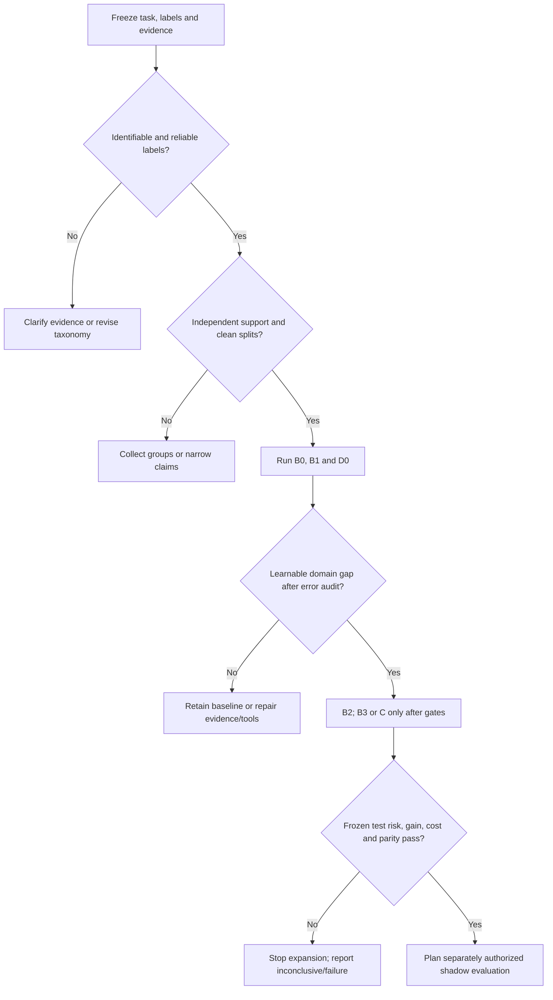

# Fine-tuning multimodal decision models: research and acceptance plan

[简体中文](multimodal-decision-finetuning.zh-CN.md) · [Home](../README.md) · [Selection guide](selection-guide.md#image-intent-adaptation) · [Evidence ledger](evidence.md)

Sources reviewed: 2026-10-18. This is a testable research design for general multimodal customer-support intent recognition. No model was trained and no production benefit was demonstrated here. Public implementations, author reports and proposed experiments are distinguished below. Image understanding, intent, calibration and abstention policy are separate questions.

**Research question.** Given domain images and the dialogue visible at decision time, how much intent recognition can be accepted under predefined consequential-error risk and complete-cost limits, while clarifying or handing off evidence-insufficient cases? Fine-tuning a decision model is one possible means, not the research goal. The scenario owner must set numerical risk, cost and minimum-useful-gain criteria before model/threshold selection; no universal pass line is assumed.

<a id="quick-route"></a>
## One-page experiment route

Use this route to test whether domain post-training improves a defined decision. **No candidate is a proven winner, and adaptation can reduce quality.** The [reading list](#reading-list) separates peer-reviewed methods, preprints and engineering assets.

| Gate | Concrete deliverable before continuing | Continue / stop |
| --- | --- | --- |
| 1. Contract and split | Evidence available at decision time, independent label agreement, labels/unknowns/error costs/rights; train, development, calibration and final test split by group/time/duplicate family. See [data](#3-resolve-data-and-label-uncertainty-first). | Resolve label ambiguity and leakage before training; future context never enters an earlier input. |
| 2. Baselines and candidate gates | Frozen zero/few-shot VLM, VLM with available page guidance/retrieval, D3/Intern inference where supported, text-only and OCR+text; record label access and total budget. See [comparisons](#1-freeze-the-question-and-comparisons) and [candidate gates](#candidate-gates). | Missing evidence calls for retrieval/clarification; select trainable paths by verified support, not an assumed quality ranking. |
| 3. Small learning check | Actual trainable parameters/gradients, tiny-subset fit, image removal/swaps, token/readout alignment. See [visual path](#4-verify-the-visual-path-and-objective-before-training). | Fix failed paths first; tiny-fit success is not generalization. |
| 4. Controlled adaptation | B2 short-label SFT versus B3 candidate scoring on the same exact base/data/visual processing/budget; finite dev search and learning curves. See [order](#5-experiment-order-and-stopping-rules). | Cross-backbone comparisons answer system selection; retain normal replay and generic regression cases. |
| 5. Calibration and rejection | Separate calibration, actual routing/selection policy, unknown/OOS and clarification; freeze gate/temperature/thresholds. See [acceptance](#6-accept-quality-risk-and-cost-together). | A probability/confidence field is not a risk guarantee; use only a method whose assumptions match the target risk. |
| 6. Frozen acceptance | Paired grouped test results/uncertainty, consequential errors, coverage, full cost and train/export/serving parity. | Continue only for a predefined coverage gain over the strongest frozen baseline within critical-risk/cost limits; otherwise correct evidence/data/engineering or stop. |

Record each gate's artifacts in a versioned experiment manifest. This is a design to implement after rights and runtime verification, not an untested command sequence.

<a id="six-principles"></a>
### Six principles translated into experiments

| Principle | Concrete experiment / artifact |
| --- | --- |
| Intent depends on evidence, not the screenshot category alone. | Independent annotation of visible facts, contemporaneous intent and sufficiency; same-image/different-context cases. |
| Typed outputs and direct logits are mechanisms, not accuracy guarantees. | D0 inference comparator; B2/B3 with the exact same base and explicit normalization/readout. |
| Domain supervision must add useful information. | Strong B0/B1 baselines first; grouped learning curves and one-factor adaptation, including ordinary replay. |
| More reasoning cannot supply missing evidence. | Deterministic arithmetic/rules; optional frozen hard-case AutoThink comparison only on evidence-complete inputs. |
| Probability, calibration and an acceptable policy differ. | Separate development/calibration/test roles, error costs and risk–coverage; no universal confidence cutoff. |
| Deployment is part of the model being evaluated. | Image/token/template, concurrent request, precision/device/calibrator regression and complete cost on the same frozen policy. |

Start at the [data schema](#data-schema), [split protocol](#split-protocol) and [minimal matrix](#experiment-matrix); finish with the [result template](#result-template) and [decision tree](#decision-tree). These are proposed procedures for a small domain-screenshot dataset, not a released dataset or an experimental result.

## 1. Freeze the question and comparisons

The task is intent recognition from domain images and contemporaneous dialogue, with clarification or human handoff when evidence cannot identify the request. Compare to the strongest frozen baseline under predefined risk/cost conditions; post-training, short labels and direct candidate scoring are candidate means whose effects must be tested.

Label **visible facts**, **the user's intent given contemporaneous context**, and **evidence sufficiency** separately. One screenshot can accompany different requests. Image categories are not automatically intent labels. Allow multiple intents, unknown, out-of-scope and clarification. Versioned page guidance/retrieval can supply background available at decision time; it cannot invent a missing user goal.

### Preregister falsifiable hypotheses

Start with identifiability and independent annotator agreement, then the strongest OCR/VLM/page-guidance/retrieval baseline. Only test adaptation after diagnosing a remaining domain-learning bottleneck. Predeclare the endpoint, group unit, splits, model-search budget, candidate policies and stop rules. Use development data for model/template/learning choices, independent calibration data for probability/policy fitting, and final testing only for acceptance.

| Hypothesis / paper-to-test link | Test that could refute it | Decision |
| --- | --- | --- |
| H1: images plus visible dialogue identify the intended labels; MIRE/EcomMIR and MIntRec2.0 motivate scene/intent/OOS separation. | Independent label disagreement or genuinely ambiguous same-image contexts remain after improving the contract; page guidance/retrieval does not supply the missing user intent. | Revise labels/evidence or clarify; do not scale training to hide non-identifiability. |
| H2: domain adaptation adds useful coverage over the strongest frozen baseline at critical-risk/cost limits; EcomMIR supplies a worked adaptation example, not this outcome. | Paired held-out coverage differences and uncertainty do not meet the predefined useful gain, or consequential errors/cost worsen. | Retain the stronger baseline or stop; include existing decision checkpoints as candidates only after their training path is verified. |
| H3: candidate scoring improves a declared quality/calibration/cost target versus short-label SFT; the readout/objective comparison motivates B2/B3. | Same exact base/data/scale/budget B2/B3 shows no useful benefit; a cross-backbone result does not answer this hypothesis. | Choose the simpler/stronger validated system; do not credit a readout for base/training-history changes. |
| H4: the selected policy uses image evidence and generalizes to new UI/time/language/OOS; visual feedback/judge papers and calibration/selective-risk work motivate checks. | Image-essential ablations, frozen shift sets or actual-policy risk/coverage/cost fail; judge agreement masks visual errors. | Fix evidence/path/data/thresholds or stop; a missing-evidence response is itself evaluated, not automatically safe. |

The primary endpoint is the change in accepted intent-label coverage relative to the strongest baseline under the predefined critical-risk constraint, accompanied by uncertainty, per-class errors and complete cost. Improved offline F1, easier implementation or lower calibration error alone does not establish success. The paper links propose mechanisms and tests; peer review is not evidence of success in this scenario.

**Engineering support and demonstrated quality are separate.** Qwen3.5 or another supported VLM with SFT/LoRA is a candidate experimental baseline, not a recommendation established to outperform D3. The primary sources reviewed here do not establish a direct multimodal comparison with the same task, data, scale and training/inference budget. Easier implementation is not effectiveness evidence. Keep D3 as a serious inference comparator on the same held-out image/context inputs; report any unequal target-label access or adaptation budget.

For mechanism attribution, B2 and B3 must start from the same exact backbone checkpoint and hold data, scale, visual processing and budget fixed. Comparing a newly adapted Qwen VLM with a released D3 model tests the complete systems under their disclosed conditions; it cannot isolate the benefit of a different readout, objective or training recipe. The B0/B1/B2/B3 sequence is an evaluation plan, not a quality ranking or a requirement to choose only Qwen3.5.

<a id="experiment-matrix"></a>
### Minimal matrix: required first pass, then gated extensions

Run the first five rows on one frozen task/split. Complete their comparisons and finite selection within Train/Dev first; only predeclared frozen baselines and final candidates enter one final-test protocol. Do not choose a model while viewing Test. A zero-shot arm may see label names/definitions, not labeled demonstrations; few-shot examples come only from Train and get a separate run ID. Match evidence, nominal scale/memory and allowed budget where feasible; disclose unmatched base pretraining, precision, label access and inference effort. This is a system comparison, not a claim of equal prior training or a ranking.

| Arm | First-pass configuration | Comparison / decision |
| --- | --- | --- |
| B0-T | Contemporaneous text only; TF-IDF or another ordinary supervised classifier, features fitted on Train only | Establish label separability and a low-cost floor. |
| B0-O | Same classifier plus OCR from the same screenshot; freeze OCR/version | B0-T versus B0-O isolates the OCR evidence addition; include OCR errors/time. |
| B1 | One fixed general VLM, image + contemporaneous text, zero-shot structured short labels | Freeze schema/template, image budget and failures; page guidance/retrieval is a separate one-factor arm. |
| D0 | One disclosed D3 size, zero-shot typed decisions on the same image/text and candidates | Serious specialized-model inference comparator; compare complete systems, not readout alone. |
| B2 | Comparable-scale Qwen or other supported VLM, language-side LoRA with short-label SFT | Compare with its exact unadapted B1 checkpoint. Finite Dev search; verify the visual path and retain ordinary cases. |
| B3-CE, conditional | Same exact B2 base/data/processor/LoRA budget; candidate-subset CE with fixed readout | Isolate a specified scoring formulation. B2/B3 differ in readout/normalization; do not attribute their entire difference to loss alone. |
| B3-Brier, conditional | Same B3-CE implementation/initialization/budget; only add the declared Brier term | Compare against B3-CE to test the extra objective. Tune its weight on Dev, not Test or threshold-certification data. |
| C, conditional | Continue the exact D0 or an Intern checkpoint only after image training/export gates pass | Compare with that checkpoint's unadapted version at a declared budget; Vis text-only code is not a multimodal C run. |

Optional Intern inference gets its own I0 row; it is not required before the first B2 run. Optional AutoThink gets R0 with its licensed checkpoint/backend, a hard-case gate selected on Dev, fixed reasoning budget and complete latency. Evaluate the **whole routed population** as well as the predeclared hard subset, including gate errors and extra calls. Do not select that subset from final-test mistakes or assume reasoning helps. Arithmetic, date comparisons and explicit constraints keep deterministic-tool baselines.

After B0/B1/D0 diagnose a learnable domain gap, try B2 before B3/C. Add one factor at a time; reuse development split/seed/budget across paired arms and record failed attempts. Train on nested, group-preserving subsets to check whether additional domain examples help; do not call different random duplicates independent data gains. A short generated label may use only a few tokens, so direct scoring need not reduce complete latency.

## 2. What the public evidence supports

| Source and fixed revision | Inspected finding | Limit |
| --- | --- | --- |
| [MIRE official repository](https://github.com/liujunwen23/MIRE/tree/d101287af90d114c5bf0cbfbd56fe9c52358e3bb) | WWW 2025 challenge covers image scenes and multi-turn intent; the [Qwen2-VL-7B baseline configuration](https://github.com/liujunwen23/MIRE/blob/d101287af90d114c5bf0cbfbd56fe9c52358e3bb/mire_baseline/configs/qwen2_vl_full_sft.yaml) uses full SFT | No evidence for a decision readout or LoRA effect; public accessibility does not establish commercial dataset rights |
| [EcomMIR author paper](https://zhoushengisnoob.github.io/papers/WWWComp.pdf), [DOI](https://doi.org/10.1145/3701716.3718371) | CN-CLIP scene classification and MiniCPM-V 2.6 intent LoRA, plus cleaning, hierarchical labels, confident pseudo-labels, augmentation and scene model soup | [E28](evidence.md#e28): Round 2 intent F1 0.9420 and scene F1 0.8278 are author-reported combined-system results, not a LoRA-only ablation or a claim of 1,000-example-only training with untouched evaluation-round data |
| [ezjev training code](https://github.com/everettjf/ezjev/tree/8b3d88957c0795bea160c8fbc9c6d2a54b051136) | Separate text prompt per question, option-letter CE + Brier, hard/ordinary replay and development-set temperature fitting | Tokenizer, input IDs and attention mask are used without an image processor/visual training tensors; loading a multimodal class alone does not establish image fine-tuning |
| [Intern-Decision training configuration](https://github.com/InternLM/Intern-Decision/blob/3572c8a68b5df5dafe02d0e093989ba8ec0183bc/configs/training/qwen35.py) and [compiler](https://github.com/InternLM/Intern-Decision/blob/3572c8a68b5df5dafe02d0e093989ba8ec0183bc/src/inputs/schema.py) | Actual multimodal input path; frozen vision tower/projector, language-backbone training, masked answer-token CE | Configuration is not an existing LoRA recipe; original full training data are unavailable; multiple fields do not imply logical consistency |
| [Decision 3.0 wrapper](https://huggingface.co/vllm-sr/d3/blob/225be8b1e2270becab69c5fe05b26f99cbbdd66b/modeling_d3.py) | Official wrapper `train(True)` raises an inference-only error; custom readout/noncausal attention | Generic Trainer/PEFT cannot simply be assumed to work. Its 255 answer codes are not 255 fixed business classes or evidence of a public multimodal LoRA recipe |
| [Vis Decisions 0.6.1 text training](https://github.com/Blockether/vis-decisions/blob/d73768e3c18d89d11f6b9a774b87d64ccd55f27d/src/blockether/vis_decisions/_d3_trainer.py) | Separate D3 text-model implementation; full text-backbone training or LoRA adapters **plus a trainable 255-code readout**, candidate CE and merged FP32/ONNX export code | Edge/Lite guide; code also accepts Nano. `from_local` keeps text weights and discards vision; only token IDs enter the model. This establishes an inspectable text adaptation path, not out-of-box multimodal training or an independently reproduced result |
| [decision-pacman training](https://github.com/grapeot/decision-pacman/blob/593ed1f59f4f97ad0bda7287ff304e9667360089/training/train.py) and [report](https://github.com/grapeot/decision-pacman/blob/593ed1f59f4f97ad0bda7287ff304e9667360089/README.md) | Textual game state, teacher/simulator labels and option-distribution LoRA distillation; author reports specialization gains alongside generic-task decline | No screenshot-training or support-domain transfer evidence; teacher-only future simulation must not enter student inference; complete data are absent from the inspected code |

The official inference wrapper is a packaging boundary, not proof that D3 cannot be fine-tuned. [Vis code](https://github.com/Blockether/vis-decisions/blob/d73768e3c18d89d11f6b9a774b87d64ccd55f27d/src/blockether/vis_decisions/_d3.py) reconstructs a separate `Qwen3_5TextModel`; its training path has no image/video tower or visual tensors. A proposed image adaptation must retain or restore the matching visual path/processor, verify pixels and grid metadata, and recheck gradients, readout and multimodal export/serving parity. Source inspection here did not run training/export; community speed or quality claims are not imported.

The newer [Intern-Decision paper v1](https://arxiv.org/html/2610.22131v1) reports 17,880 training samples, including 5,500 image-bearing samples, with full language-backbone tuning and frozen vision/projector. This is evidence of image-bearing training, not a LoRA quality result. Its seven-suite numerical comparison is on text tasks; visual demonstrations are qualitative, public Jevbench informed development, and matched-data ablations are missing. The reviewed paper does not provide a matched multimodal D3 comparison or establish release of the full raw training data.

The [October 17 mechanism review](decision-readout-and-reasoning.md) adds StartLux v1.1: a public inference/server package and archived v1 text LoRA example, not a verified complete multimodal v1.1/RLCD² training recipe. The weights are non-commercial; use it as a conditional comparator after checking rights and the exact runtime.

ezjev's MIT code license does not license its weights or training data. Its [model card](https://huggingface.co/everettjf/ezjev-4b-s3/blob/a2faa581dc5e48c0c41ce388d056fed8e8fa6b4d/README.md) warns that some training sources are non-commercial or have unstated terms. Historical author compute spending is not a current training quote. Likewise, reading MIRE/EcomMIR does not replace checking dataset, base, code and weight rights separately. All entries above are source reviews, not reproductions.

<a id="candidate-gates"></a>
### Candidate adaptation gates

| Candidate | Currently inspected starting point | Gate before image adaptation |
| --- | --- | --- |
| D3 | Official multimodal inference comparator; separate Vis Edge/Lite text full/LoRA path, with Nano additionally accepted in code. | Vis drops vision. Restore/retain the actual image path, verify gradients and multimodal export, then test quality; this is separate engineering, not an architectural ban on fine-tuning. |
| Intern-Decision | Image-bearing full-language training and masked answer-token code path; frozen vision/projector. | Exact checkpoint/template/backend identity; full-parameter budget versus separately validated LoRA targets; paper text results do not validate image-domain effectiveness. |
| Qwen3.5 / another supported VLM | Candidate short-label generative SFT/LoRA baseline; model/processor/trainer support must be verified. | B2/B3 share the exact starting checkpoint and evidence. Easier tooling does not demonstrate superiority to a decision-tuned D3 or Intern model. |

## 3. Resolve data and label uncertainty first

<a id="data-schema"></a>
### A minimal local data schema

The following is invented notation, not a real record, usable prompt or public-data upload request. Store actual assets, text, identities and labels in an authorized local/private system; opaque IDs alone do not anonymize screenshots. Keep the label taxonomy/candidate definitions in a versioned sidecar. Separate annotation-only later outcomes from model-visible evidence, and verify evidence timestamps before feature extraction.

```json
{
  "record_id": "synthetic-001",
  "image_ref": "LOCAL_ONLY",
  "visible_text": "SYNTHETIC_PLACEHOLDER",
  "evidence_cutoff": "SYNTHETIC_TIMESTAMP",
  "guidance_version": null,
  "conversation_group": "GROUP_A",
  "user_group": "GROUP_B",
  "near_duplicate_group": "DUP_A",
  "leakage_component": "COMPONENT_A",
  "ui_family": "UI_A",
  "ui_version": "v0",
  "language": "und",
  "label_schema_version": "labels-v1",
  "task_mode": "single_intent",
  "intents": ["INTENT_A"],
  "evidence_status": "sufficient",
  "unknown_reason": null,
  "annotation_status": "independently_reviewed_and_adjudicated",
  "rights_status": "LOCAL_REVIEW_REQUIRED",
  "split": "unassigned"
}
```

Audit readability at the actual inference resize/crop/compression, not just the original resolution: can annotators read the decisive text and distinguish the UI state, and does OCR retain it? Separate blur/small text/missing regions/redaction loss from semantic confusion. Freeze permissible preprocessing; a crop or flip that removes evidence or reverses a UI relation is not label-preserving augmentation.

Define `task_mode` before modeling. Single-intent uses an agreed primary-label tie rule; multi-intent uses a set target and per-label precision/recall (plus exact-set score when useful), not an exclusive softmax. `unknown` means the taxonomy cannot assign a known class; `out_of_scope` means a known scope mismatch; `insufficient`/`needs_clarification` concerns missing evidence. They may coexist with a partial intent. State their precedence and annotation/output rules explicitly. A model's low-confidence abstention is a **policy output**, not automatically one of these gold labels.

Have at least two annotators independently assess an agreed audit subset, enriched with ambiguous/rare cases and a separate representative sample. Record label-wise agreement, disagreements and adjudication, rather than only a pooled agreement score. Expand the audit where disagreement concentrates. Historical operator actions and teacher labels are provisional evidence, not automatic gold. If the same visible image/text admits multiple plausible intents, request context or revise the contract before training.

<a id="split-protocol"></a>
### Leakage-resistant split protocol

1. **Inventory before allocation.** Count usable images and independent conversations/users, exact/near duplicates, UI/template families, dates, labels and missing evidence. Audit exact hashes plus visual/OCR similarity and manually inspect suspicious pairs; a perceptual hash alone neither proves identity nor catches every near duplicate. Record excluded/corrupt assets and reasons.
2. **Form leakage components.** Link records sharing the chosen independence unit (same conversation/user) or an actual duplicate/near-identical rendered instance; take connected components so transitive links cannot cross partitions. Derived crops, augmentations and paraphrases inherit the parent's component and split. A giant component is a limitation to resolve, not a reason to break the grouping rule. Keep abstract UI family separate from instance-duplicate grouping.
3. **Declare populations.** For expected traffic, keep representative prevalence with no component overlap. Also freeze a later-time and/or previously unseen UI/page-family holdout when those generalization claims matter; report it separately, not as a representative mixture. A familiar-UI split cannot demonstrate new-page generalization. Enriched rare/error stress sets have their own denominators. Temporal splits do not automatically enforce user/duplicate isolation: check both constraints.
4. **Lock roles and membership.** A data steward may use labels to allocate per-class support before model selection, then hide final-test labels/content from prompt/model/hard-case development. Train fits weights/features/augmentation; Dev selects checkpoint, schema, prompt, rank, learning rate, epochs, Brier weight and routing design. Cal fits the frozen model's probability mapping/policy; Test measures frozen acceptance once. No test content or errors feed retrieval examples, pseudo-labels, synthetic hard cases, calibration or model selection.
5. **Use CV only inside development.** When a fixed Dev split is unstable, use group-aware folds (optionally stratified when feasible), or forward-time folds if the target is future traffic; never sacrifice group/time isolation for label balance. Keep outer Test and final Cal untouched. Preprocessing and generated examples are fitted within each training fold. Report fold/group counts, missing classes and selection variability. OOF predictions from several models are not automatically a valid calibrator for a refitted model; recalibrate the final artifact or use a justified cross-fitting procedure. See [official grouped/time CV guidance](https://scikit-learn.org/stable/modules/cross_validation.html).
6. **Version changes.** Fix split IDs/hashes and a leakage audit before the first comparison. If a Dev hard case moves into Train, retire that development measurement and replace/version Dev. Inspect final-test errors only after freezing/reporting acceptance; once those errors guide changes, that test is development history and a new untouched acceptance set is needed.

Retain a predeclared separate stress set: rare/confusable intents, same image with different text, missing/wrong images, tiny text/blur, unseen UI/languages, negation/exceptions/contradictions, all-wrong candidates and malicious instructions embedded in images. Adjudicate expected behavior per case. Enrichment is not traffic prevalence, and final-test errors never generate training hard cases.

<a id="sample-size"></a>
### Small-sample support and uncertainty

Do not select a fixed percentage from image count alone. Plan from independent groups, number of labels, rare-label prevalence, desired uncertainty and annotation budget. Publish an internal count table **before training**, one row per class/unknown/OOS and relevant UI/time group:

| Label / group | Train records / independent groups | Dev records / groups | Cal records / groups | Test positives / groups | Uncertainty / limitation |
| --- | --- | --- | --- | --- | --- |
| Each declared class | fill counts | fill counts | fill counts | fill counts | Recall numerator/denominator and interval method |
| Unknown / OOS / insufficient | count separately | count separately | count separately | count separately | Separate recognition and policy-rejection errors |

Rare classes may have no independent positive examples in a partition. Mark their recall as not estimable, report a fixed label list and the rule for undefined metrics, and do not imply coverage of every class from macro-F1. Collect targeted **independent** labels or restrict the conclusion; merging classes requires semantic justification and a new taxonomy version. Group-aware bootstrap intervals are useful for paired system differences when enough groups exist; too few groups make uncertainty itself unstable.

For an explicitly **fictional iid example**, recall 8/10 is 80%, but its two-sided 95% Wilson interval is about 49.0–94.3%. At a pre-fixed policy with zero errors among 20 independent accepted cases, the exact one-sided 95% binomial upper error bound is `1 - 0.05^(1/20)`, about 13.9%; even zero among 60 gives about 4.9%. These arithmetic illustrations follow [binomial interval methods](https://www.itl.nist.gov/div898/handbook/prc/section2/prc241.htm), not model results. Correlated screenshots, adaptive threshold selection or multiple subgroup claims cannot inherit those simple iid bounds. There may be too little data for any useful risk certificate; report that outcome instead of relaxing the budget after seeing results.

For calibration, first freeze checkpoint/template/candidate reduction. Fit temperature/probability mapping on Cal-fit and certify thresholds on independent Cal-policy, or use a valid method accounting for their joint selection. When support cannot sustain this separation, label the policy exploratory and collect more data; do not advertise an untouched certificate. Cal is not a second Dev set. Final calibration quality is measured on the frozen Test, not asserted from the same data used to fit it.

## 4. Verify the visual path and objective before training

An image reference is not an image feature. Use the checkpoint's matching processor/chat template; inspect actual `pixel_values`, grid/position metadata, visual tokens and attention masks reaching the correct model. Check whether truncation removes decisive evidence. Frozen visual parameters still require visual encoding. Compare image removal, image swaps and text-only ablations; unchanged outputs may mean either the question needs no image or the image path is broken, so diagnose the cause.

A possible single-choice objective is:

\[
p_\theta(k\mid x,C)=\frac{\exp(z_k/T)}{\sum_{j\in C}\exp(z_j/T)},\quad
L=-\log p_\theta(y\mid x,C)+\lambda\sum_{k\in C}(p_\theta(k)-\mathbf{1}[k=y])^2.
\]

This is an objective to test, not an established optimum. Brier weight, temperature and training budget need development/calibration protocols. Probabilities or a Brier term do not establish empirical calibration. A single positive temperature preserves argmax for the same candidate set and cannot repair label ordering. Multilabel tasks require their own target/output specification rather than a mutually exclusive softmax.

Distinguish candidate-subset CE, full-vocabulary answer-token CE and a separate classification head: normalization, competing outputs and export paths differ. Intern-Decision's reviewed configuration uses standard XTuner CE with supervision retained only at answer-code positions: full-vocabulary answer-token training, unlike ezjev's candidate-subset CE. Its compiler places `<decision>` placeholders in the input; target codes enter labels only. Later causal fields see preceding placeholders, not preceding predictions/gold answers. This is neither an autoregressive chain of completed answers nor proof of field independence.

Check answer-code tokenization in the actual complete prompt, answer positions, legal candidates and padding. Remap labels when shuffling options and test order sensitivity. B2 supervises the agreed answer portion; B3 computes loss at its agreed readout. Do not leak targets or silently discard overlength inputs, broken images or unmappable labels.

<a id="preflight"></a>
### Training preflight: retain a pass/fail record

- Freeze task/labels/rights and split hashes; verify zero group/duplicate overlap and no later-context/target leakage. Record per-class support and the primary risk/cost/useful-gain limits before scores.
- Pin model/weight identity, processor/template, code, trainable module names/counts, dtype/device and optimizer settings. Inspect which LoRA/readout parameters actually receive gradients; frozen vision must still supply image features.
- Decode several training batches with image dimensions, visual grids/token counts, answer positions/masks and label-to-code mapping; targets must be in supervision only. Report length distribution and every truncation/exclusion instead of silently dropping difficult examples.
- Fit a tiny Train subset as a debugging check; compare image removal/swaps on adjudicated image-essential examples, option permutations with label remapping, padding and unknowns. Tiny-fit success does not establish generalization or a correct visual path by itself.
- Predeclare finite search/seed/step/token/compute budgets, early-stopping rule, development metric and regression cases. Keep augmentation label-preserving and inside Train; record ordinary-versus-hard sampling rather than optimizing only selected hard cases.
- Confirm a supported multimodal training/merge/serving path. Failure at the D3/Intern gate means retain inference baseline or stop C; do not bypass an inference-only wrapper by assumption. No commands in this document have been tested as a training recipe.

<a id="evidence-ablations"></a>
### Evidence ablations before architecture expansion

On the same predeclared groups, compare image only, contemporaneous text only, OCR + text, and image + text. Keep class definitions/allowed guidance fixed and count preprocessing cost. Image-only retains label definitions but removes dialogue; OCR is derived visual evidence, not a no-image-information control. Mark whether each reduced input still identifies intent: a justified clarification on an underdetermined input is evaluated under the sufficiency contract, not forced to guess the original label. Add wrong/missing-image controls only where their expected consequence is adjudicated. A graph/second encoder/reasoning branch is justified by a diagnosed residual error, not by a desire to combine every technique.

## 5. Experiment order and stopping rules

1. **Freeze versions and budgets.** Record base/weights, processor, template, code commits, dependencies, resolution, precision, candidates, context, seeds, training tokens/examples and budget. A model-repository revision need not change weights or training.
2. **Check learnability on a tiny batch.** Inspect loss, gradients, actual trainable parameters, visual inputs and answer positions. Overfit a tiny training subset as pipeline diagnosis, not generalization evidence.
3. **Test language-side LoRA as a starting hypothesis.** Freezing vision/projector reduces trainable parameters but requires verification of the exact class, target modules and gradients. This is a proposed experiment; Intern's full-language-parameter configuration must not be relabeled as LoRA. Select rank, learning rate and epochs through finite development search and explicit early stopping, not copied defaults.
4. **Attribute errors before adding data.** Separate OCR/vision, missing context, ambiguous taxonomy, rule bypasses, template/readout, knowledge, calibration and permission failures. Combine hard examples with ordinary replay and plot learning curves by data/budget to detect narrow overfitting.
5. **Distill only after demonstrated value.** Specify teacher evidence, label provenance and filtering; generate within the training pool and audit hard labels/soft distributions by intent/language. Preserve generic and boundary regression sets because specialization can reduce generality.
6. **Verify export and serving.** Compare training, merged/exported artifact and serving outputs on identical inputs: code mapping, logits, temperature, near ties, image processing and failure behavior. A small adapter still needs its backbone at inference. For image tasks, keep D3 as an inference comparator until the image training/export path is verified; the separate Vis text adaptation path does not validate image training.

Preference/feedback learning is an optional later arm only if residual errors concern visual factuality or candidate preference and auditable pair labels are available. Borrow RLAIF-V/LLaVA-Critic ideas conditionally, compare against supervised adaptation with the same base/evidence/budget, and audit teacher/judge errors. Keep feedback generation inside the training pool and check source/image overlap with evaluation data. A preference model is not a replacement for the intent contract or human-adjudicated final labels.

<a id="serving-regression"></a>
### Serving regression after every trained/exported/backend change

| Case | Frozen comparison and failure rule |
| --- | --- |
| Isolated versus concurrent requests | Interleave deliberately different state/questions/options; compare each request with its isolated output at a prespecified numeric tolerance. Check answer-token offsets, row order and cache isolation; another request must never alter option identity. |
| Short/long and image/text mixtures | Verify processor, pixels/grid, truncation side and actual retained evidence; batch padding, missing/corrupt images and near-limit inputs must have explicit counted outcomes. |
| Train/eager, merged/exported and serving artifacts | Same cases/candidate mapping; record logits/probability and label differences, especially near ties. Never assume an adapter merge/export preserves the visual/readout path. |
| Device/precision/quantization/backend | Record each combination independently; dtype/kernel changes can change logits. Revalidate its matched calibrator/policy rather than reusing a temperature silently. |
| Calibration/gates | Pin calibrator ID, fit population, candidate set, entropy/max-probability definition, rejection and reasoning policy; reject mismatched artifacts. |
| Load and failures | Record concurrency/batch/context/image budgets, cold/warm cache, sample count, p50/p95, throughput, memory, timeout/invalid-output rate and retries. Include failures/clarifications in the population and complete cost. |

The [Oct18 runtime review](../updates/2026-10-18-weekly-review.md) documents why request-local offsets and serving/eval preparation matter. This checklist is proposed regression coverage, not a claim that any listed backend passes it. Small timing samples give unstable p95; report counts and workload, not a universal speedup.

## 6. Accept quality, risk and cost together

| Dimension | Predefined reporting |
| --- | --- |
| Task quality | Macro-F1, per-class precision/recall, critical confusions and high-risk false negatives; separate multi-intent/unknown |
| Automation policy | Coverage and accepted-set error at a frozen threshold, clarification/handoff burden; unknown labels versus system abstention |
| Uncertainty | Paired comparisons and intervals at conversation/user independence units; no winner from insufficient samples; natural and stress populations separate |
| Probability quality | Fit on independent Cal; report frozen-policy Test NLL/Brier and ECE with bins/temperature scope/freeze time; no self-reported confidence substituted for probabilities |
| Shift and groups | Time, language, source, UI, rare intents, missing evidence and failure rates |
| System economics | OCR/retrieval/preprocessing, model, queue, retries, review and correction; hardware, concurrency, cache, cold/warm behavior, P50/P95, throughput and timeouts |

A possible primary target is useful coverage under a predefined misrouting risk and uncertainty constraint, with additional limits on consequential false negatives and complete handling cost. Observed finite-sample error is not a statistical upper bound. Risk-control guarantees need their own [assumption checks](methodology.md#what-to-measure). Include correction cost per request instead of comparing token prices alone.

Stop scaling training when taxonomy is unstable, intent is not identifiable from the evidence, the visual path fails, serving templates disagree, critical errors persist or gains do not cover maintenance cost. Report offline F1, teacher agreement, schema validity, conversion parity and actual handling outcomes separately. Successful offline acceptance still requires a separately authorized shadow evaluation, human sampling and rollback design. No deployment or real-request processing was performed for this plan.

Treat calibration, error ranking and classification quality as separate measurements. [Guo et al.](https://proceedings.mlr.press/v70/guo17a.html) fit temperature on held-out calibration data; a common positive temperature preserves the fixed-candidate argmax. The [UAI 2024 confidence study](https://proceedings.mlr.press/v244/cattelan24a.html) motivates separate risk–coverage/AURC evaluation, but its ImageNet score choices are not validated defaults for dynamic-candidate VLMs. D3/API `confidence >= 0.9` does not imply error <= 10% on accepted domain cases; check the actual statistic and returned policy.

The [pinned D3 package](https://huggingface.co/vllm-sr/d3/blob/225be8b1e2270becab69c5fe05b26f99cbbdd66b/d3_runtime.py) defines choice/score confidence as one minus normalized entropy for multiple candidates, not an estimated probability that the selected label is correct. Other backends can use different definitions. Separate probability-map fitting from threshold certification, or use a procedure accounting for adaptive choices; repeatedly choosing models, temperatures and gates on one calibration set does not inherit an untouched-calibration guarantee.

[Conformal Risk Control](https://proceedings.iclr.cc/paper_files/paper/2024/hash/f3549ef9b5ff520a7e41ff3cc306ab2b-Abstract-Conference.html) controls expected risk under exchangeability and bounded monotone-loss conditions. It is not a per-item or arbitrary fixed-calibration-set high-probability guarantee. Accepted-set error can be non-monotone in a threshold, so standard CRC cannot be attached automatically. Choose a method matching the risk definition and data dependence; validate again after routing, candidate reduction or distribution shift.

For final comparisons, pair the same conversation/request groups and report the quality/coverage/cost differences with group-aware uncertainty. Freeze model, policy and thresholds before looking at final outcomes; record all attempted development arms. State a minimum useful gain and allowed consequential-error/cost limits beforehand. A noisy mean gain, lower calibration error alone or ONNX parity alone is insufficient to continue.

The Oct14 [risk-budgeted System One preprint](https://arxiv.org/html/2610.19811v1) studies binary policies: score `s(X)` predicts a positive event, Action 0 on `s(X) < tau` has `FOR = P(Y=1 | s(X)<tau)`, and Action 1 is the conservative fallback. Its fixed-sequence LTT result requires a frozen scorer/ordered threshold family derived from Fit independently of iid Cal from the same deployment population. With error level delta, the probability over calibration samples of certifying a population-risk-violating policy is bounded by delta. This is not each answer's probability of correctness, a promise that every finite test estimate stays below budget, or an automatic multiclass/image/shift guarantee. No certificate means fallback for the policy, distinct from per-input abstention. Six English-text datasets/single seed are author evidence; no local replication or numeric gain is claimed.

## 7. Minimum research deliverables

Retain preregistered hypotheses, owner-defined risk/cost/useful-gain limits, task/label specification, source and usage-right inventory, grouped splits and deduplication, versions/budgets, experimental arms, image ablations, per-class errors, calibration/thresholds, full cost and stopping decision. Shared artifacts must use explicitly publishable material; real data and execution authority remain under their own governance. Write training/evaluation scripts after validating the chosen implementation rather than presenting untested commands as a reproduction recipe.

Source identities and review scope are in the [register](sources.md); EcomMIR measurements and protocol limitations are in [E28](evidence.md#e28). This page releases no dataset, model weights or training results.

<a id="result-template"></a>
### Copyable experiment/result record

One row per run and population; fill planned fields before running, leave unmeasured values blank, and retain rejected/failed arms. All placeholders below are generic; store real artifacts privately unless explicitly publishable.

| Field | Required content |
| --- | --- |
| Identity / plan | Run ID, hypothesis, parent comparator, sole changed factor, intended population, owner-set maximum critical risk/complete cost, minimum useful coverage gain, stop rule and search budget |
| Data / labels | Local manifest/split hashes, label version/mode/definitions, evidence cutoff, rights, group/duplicate audit, per-partition class/group counts and annotation disagreements |
| Artifacts / training | Exact base/weights/code/processor/template/readout; trainable modules, LoRA rank, loss/Brier normalization/weight, seed, optimizer/LR/steps/examples/tokens, sampling/replay and used label access |
| Policy / calibration | Frozen candidate order/reduction, probability/confidence definition, Cal-fit/Cal-policy membership, calibrator/gate/threshold IDs and fit time; assumptions and certificate status (or no certificate) |
| Quality | Macro-F1 with label list/undefined rule; each class TP/FP/FN/support/recall interval, confusion matrix; multilabel/unknown/OOS/insufficient and critical errors separately; format/timeouts included |
| Selective behavior | Accepted errors / accepted count, accepted / all eligible requests, clarification/handoff and failure fractions; grouped paired difference and interval versus the frozen baseline; representative/stress/shift results separate |
| Probability | Test NLL/Brier conventions/ECE bins; if an arm lacks usable class probabilities, mark not available rather than fabricate them from its verbal confidence |
| Cost / regression | Hardware/dtype/device/backend, batch/concurrency/image/context budgets; complete p50/p95/throughput/cost/memory/counts, queue/retries/OCR/review; serving-regression pass/fail and parity tolerance |
| Outcome / limits | Predefined pass/fail/inconclusive decision, limiting classes/groups, failed checks, next single-factor change, review date and new holdout requirement after test-guided changes |

Cost per request includes inference and evidence processing plus retries/review/correction; show the observed counts and unit prices used rather than importing a universal price. Report both offline intent recognition and the frozen accept/clarify policy: higher macro-F1 alone does not prove a coverage gain within the critical-risk budget. Keep seed/fold variation distinct from sampling uncertainty; a confidence interval is not a deployment guarantee.

<a id="decision-tree"></a>
### Continue, collect, repair or stop



Training stops early for leakage, ambiguous targets, broken visual/readout paths, non-finite loss or serving mismatch. Expansion stops when the preregistered useful-gain/risk/cost criteria fail or are not estimable. After the finite Dev search, do not keep trying models on Test until one passes. If B2 adds no useful gain, retain the stronger baseline; B3, C, distillation and reasoning are optional hypotheses, not an obligation to keep increasing complexity.

<a id="reading-list"></a>
## 8. Layered reading list and what to borrow

Publication status and evidence strength are separate axes. Peer review does not make results independent of model authors or prove transfer to this domain. This repository reviewed sources and did not run these models. Use the papers for testable design choices, not a combined leaderboard.

### Peer-reviewed papers

| Formal title / venue | Useful implementation question | Evidence boundary |
| --- | --- | --- |
| [EcomMIR: Towards Intelligent Multimodal Intent Recognition in E-Commerce Dialogue Systems](https://doi.org/10.1145/3701716.3718371) — WWW Companion 2025 (Companion Proceedings of the ACM Web Conference 2025), four-page challenge solution | CN-CLIP scene classification with Greedy Soup; MiniCPM-V 2.6 intent LoRA, hierarchical labels/cleaning and pseudo-label selection. | Author combined-system competition report, not a WWW main research-track study or isolated LoRA effect. Round 1 unlabeled test inputs enter training: a transductive component, not a 1,000-example-only supervised protocol. This does not establish Round 2 leakage. See [E28](evidence.md#e28). |
| [MIntRec2.0: A Large-scale Benchmark Dataset for Multimodal Intent Recognition and Out-of-scope Detection in Conversations](https://openreview.net/forum?id=nY9nITZQjc) — ICLR 2024; [official repository](https://github.com/thuiar/MIntRec2.0) | Intent/OOS labels and multi-party, multi-turn text/audio/video context; in-scope and outlier-exposure objectives. | Television conversations are not support screenshots or a LoRA experiment. Repository body inspected; OpenReview verification blocked full-paper access in this review. |
| [RLAIF-V: Open-Source AI Feedback Leads to Super GPT-4V Trustworthiness](https://openaccess.thecvf.com/content/CVPR2025/html/Yu_RLAIF-V_Open-Source_AI_Feedback_Leads_to_Super_GPT-4V_Trustworthiness_CVPR_2025_paper.html) — CVPR 2025 | Visual factuality checks, AI preference construction and DPO-style preference learning; audit teacher feedback before distillation. | Author alignment results concern visual response trustworthiness, not domain intent utility. Later repository LoRA support does not make every paper result LoRA. Dataset NC/research-use notices and base/API terms require review. |
| [LLaVA-Critic: Learning to Evaluate Multimodal Models](https://openaccess.thecvf.com/content/CVPR2025/html/Xiong_LLaVA-Critic_Learning_to_Evaluate_Multimodal_Models_CVPR_2025_paper.html) — CVPR 2025 | Fine-tune LLaVA-OneVision with pointwise/pairwise critic instructions and CE over judgments/justifications; inspect GPT-4o-assisted label bias. | A generative visual critic is not a direct candidate-logit classifier or domain-outcome validator. Do not infer uninspected adapter/full-parameter settings or use its own teacher agreement as gold. |
| [VL-RewardBench: A Challenging Benchmark for Vision-Language Generative Reward Models](https://openaccess.thecvf.com/content/CVPR2025/html/Li_VL-RewardBench_A_Challenging_Benchmark_for_Vision-Language_Generative_Reward_Models_CVPR_2025_paper.html) — CVPR 2025 | Check whether a judge detects visual evidence failures on curated, human-verified preference cases. | A benchmark, not a training recipe. Source pools include RLAIF-V/RLHF-V: audit example/image/source overlap before treating it as held out. Benchmark-author evaluation is distinct from this repository reproducing it. |
| [On Calibration of Modern Neural Networks](https://proceedings.mlr.press/v70/guo17a.html) — ICML 2017 | Fit temperature on separate calibration data and assess probability quality. | Fixed-candidate argmax/top-1 accuracy does not improve from a common positive temperature; deployment/shift calibration remains empirical. |
| [How to Fix a Broken Confidence Estimator: Evaluating Post-hoc Methods for Selective Classification with Deep Neural Networks](https://proceedings.mlr.press/v244/cattelan24a.html) — UAI 2024 | Distinguish accuracy from error ranking and evaluate risk–coverage/AURC. | The 84-ImageNet-classifier study does not establish the best confidence score for dynamic labels or VLMs. |
| [Conformal Risk Control](https://proceedings.iclr.cc/paper_files/paper/2024/hash/f3549ef9b5ff520a7e41ff3cc306ab2b-Abstract-Conference.html) — ICLR 2024 | Match bounded-loss, monotonicity and exchangeability assumptions to a precisely defined risk. | Expected-risk control is not a per-decision correctness promise; arbitrary accepted-set conditional error is not automatically covered. |

### Preprints and engineering assets

| Source / status | What it establishes | Open question |
| --- | --- | --- |
| [Calibration and Risk-Budgeted Decisions with System One Models](https://arxiv.org/html/2610.19811v1) — arXiv v1, 2026-10-14 | Specify binary FOR, fixed scorer/threshold family, independent Fit/Cal/Test and conservative fallback before LTT certification. | Author-reported six English-text datasets/single seed; calibration-sample population-risk control is not per-item correctness or an image/multiclass/shift guarantee. |
| [Intern-Decision: Efficient Multimodal Decision Making with Autoregressive Masked Language Modeling](https://arxiv.org/html/2610.22131v1) — arXiv v1, 2026-10-15 | Image-bearing full-language training and a multi-field causal masked readout, with frozen vision/projector. | Text-suite metrics and qualitative visual examples do not supply a matched D3 multimodal comparison or a LoRA result; full raw training-data release not established. |
| [StartLux-Decision: AutoThink Decision Models with Reinforcement Learning for Calibrated Deliberative Decisions](https://arxiv.org/html/2610.17309v1) — arXiv v1, 2026-10-12 | Candidate probabilities, adaptive reasoning and policy-aware calibration; [mechanism audit](decision-readout-and-reasoning.md). | Public DI development selection, author-built DecisionPivot and NC weights constrain interpretation and use; not a demonstrated domain image-training recipe. |
| [MIRE: Multimodal Intent Recognition for Dialogue Systems challenge baseline](https://github.com/liujunwen23/MIRE/tree/d101287af90d114c5bf0cbfbd56fe9c52358e3bb) — WWW2025 challenge engineering repository | Qwen2-VL-7B **full SFT** baseline for scene/intent tasks. | This is not EcomMIR's implementation, a LoRA result, or a separate peer-reviewed method paper verified here. |
| [Vis Decisions 0.6.1 D3 path](https://github.com/Blockether/vis-decisions/blob/d73768e3c18d89d11f6b9a774b87d64ccd55f27d/src/blockether/vis_decisions/_d3_trainer.py) — third-party engineering | Text full/LoRA plus trainable code head and merged export implementation. | Removed vision tower; not verified multimodal adaptation or an independent benchmark reproduction. |

For experimental allocation and uncertainty, use the [official grouped/time CV documentation](https://scikit-learn.org/stable/modules/cross_validation.html) and [NIST binomial-interval reference](https://www.itl.nist.gov/div898/handbook/prc/section2/prc241.htm) with their stated assumptions; neither establishes this dataset's independence or sufficient size.

Read in order: domain intent adaptation → OOS/clarification → visual feedback → candidate/critic scoring → judge checks → calibration and rejection. Peer-reviewed methods can inform an experiment without proving that fine-tuning will improve its target decision. Review depth, versions and access gaps are in the [source register](sources.md).
