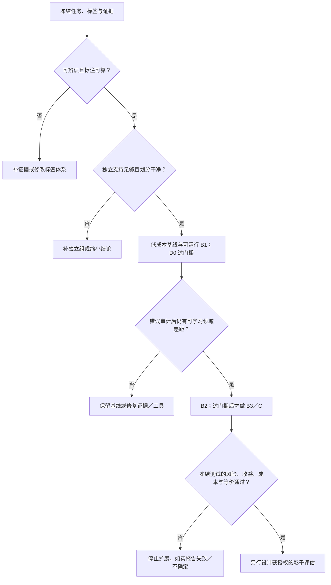

# 多模态决策模型微调：研究与验收方案

[English](multimodal-decision-finetuning.md) · [首页](../README.zh-CN.md) · [选型指南](selection-guide.md#image-intent-adaptation) · [证据台账](evidence.md)

来源核验：2026-10-27（Mac 实施与验收规划；既有证据保留原日期）。本方案面向通用多模态客服意图识别，属于可检验的研究设计；没有执行模型训练或证明生产收益。下面分别标明公开实现、作者报告和建议实验。图像理解、意图判断、概率校准及拒判策略是不同问题。

本页是统一实施入口：[Mac 小样本路线](#mac-implementation)、[同条件矩阵](#experiment-matrix)和[科研证据](#7-最小研究产物)。[10 月 26 日来源核验](../updates/2026-10-26-multimodal-training-and-evidence.md)及 10 月 22 日调研保留历史身份，不另建平行实施报告。

**研究问题：** 在数千条人工标注图片与本地资源约束下，能否降低每案件总决策成本并满足关键风险限制；受控实验又能否区分数据／scorer 收益与新学习机制？下文实施、训练和验收均待执行。

<a id="quick-route"></a>
## 一页实验入口

用以下路线检验领域后训练是否改善明确的决策任务。**候选没有已证实的通用赢家，微调也可能降低质量。** [阅读清单](#reading-list)分开同行评议方法、预印本与工程资产。

| 关卡 | 必需产物与通过条件 | 失败／停止 |
| --- | --- | --- |
| G0 · 契约 | 使用权、可观察输入／标签、独立组、划分清单，负责人预定错误／人审／延迟／算力代价；见[数据](#data-schema)。 | 目标不可辨识、权利未明或独立支持不足：改契约或停止该臂。 |
| G1 · 技术冒烟 | 未来获授权后，用 32–64 条合成／非敏感样本检查管线，含最长输入反向、保存重载；见[Mac 路线](#mac-implementation)。 | 图像证据丢失、mask 错误、梯度异常、内存压力或重载不一致：先修复再扩量。 |
| G2 · 基线与受限适配 | 规则／OCR／冻结特征、一个小型冻结 VLM 及同骨干 frozen-head／QLoRA；有限 Dev 搜索、至少三个预注册种子；见[矩阵](#experiment-matrix)。 | 低成本基线已达目标时，不为研究叙事继续堆模型。 |
| G3 · 冻结验收 | 分开 Cal-fit／Cal-policy，锁定 Test；配对每案件净成本下降超过最小实质收益，且关键风险合格；见[验收](#6-验收任务质量风险与成本一起看)。 | 区间不确定、风险／成本／等价失败或按 Test 挑选：不宣称成功，保留负结果。 |
| G4 · 有条件外部验证 | 仅另获授权后开展影子评估、人工抽检与回滚设计。 | 离线通过不授予部署或处理真实请求的权限。 |

全部关卡均为待执行计划；本页不授权装包、下载权重／样本、训练、上传、真实请求处理或部署。产物和问题未变时，引用已识别的完成记录，不重复验证凑更新。

<a id="six-principles"></a>
### 六点综合如何落到实验

| 原则 | 对应实验／产物 |
| --- | --- |
| 意图依赖证据，不等于截图类别。 | 独立标注可见事实、当时意图及充分性；加入同图不同上下文案例。 |
| 类型化输出与直接 logits 是机制，不保证准确率。 | D0 推理对照；B2／B3 固定精确底座，明示归一化与读出。 |
| 领域监督必须增加有用信息。 | 先建立强 B0／B1；按分组画学习曲线，逐因素适配并保留普通回放。 |
| 更多推理不能补造证据。 | 算术／硬规则用确定性工具；AutoThink 仅作为证据充分难例上的冻结可选对照。 |
| 概率、校准与可接受策略不同。 | 分开开发／校准／测试职责，定义错误代价与风险—覆盖率，不设通用 confidence 线。 |
| 部署是被评测系统的一部分。 | 同一冻结策略检查图像／token／模板、并发、精度／设备／校准器及完整成本。 |

从[数据示意](#data-schema)、[划分协议](#split-protocol)和[最小矩阵](#experiment-matrix)开始，以[结果模板](#result-template)及[决策树](#decision-tree)结束。以下是小样本领域截图的建议流程，不是公开数据集或实验成果。

## 1. 先固定问题和对照

已有数据是**图片＋人工意图标签**，可补历史上下文。主任务明确为业务图文意图识别，image-only 是必要对照。只从业务系统在**判定时点之前可见**的历史构建版本化派生视图，排除后续客服结论、最终处理结果、标签回填和调查后才知道的事实；固定历史长度／截断规则，同会话／案件的全部轮次与图片归同一划分。历史访问、脱敏和拼接仍待实际执行授权，原始记录保留。

有意图标签不代表每张图都足以辨识它。两位标注者独立审核代表性抽样及另行富集的歧义／稀有案例并裁决；可见证据不足时标明限制或补合法的先前上下文，不强贴标签。**尚未提供正确动作与证据不足标签**：可观察证据区域、充分性／冲突原因和策略允许动作属于分阶段可选新增标注，单列成本／权利，不视作已有金标。标签经核实支持时，正常已知类、缺图／上下文、冲突、未知意图与 OOS 分开。

主输出是短标签及明确定义的分数，依据定位与可选简短说明另列；长 CoT 不能代替证据定位。价格／状态／政策等变化事实仍作为带时效的输入，见[学判断方法](#learned-judgment)。

### 预注册可证伪假设

| 问题 | 什么结果可推翻它 | 决定 |
| --- | --- | --- |
| H1：可见输入能确定目标，图像提供增量信息。 | 独立标注仍有不可消除歧义，或上下文／OCR／冻结特征已解释全部有效信号。 | 改目标／证据；不能从图片标签直接声称学会多模态意图。 |
| H2：受限适配改善业务决策。 | 相对最强冻结基线，每独立案件配对净成本下降的置信下界未超过预注册最小实质收益，或关键风险失败。 | 保留基线、补独立证据或停止；F1 提高不独自判成功。 |
| H3：指定读出／训练改动提供独立价值。 | 相同精确底座、标签、视觉处理、优化／搜索预算下增益消失，或 frozen head／更强事后 scorer 已填平差距。 | 报告有用的系统改动，不把它归因于表示突破。 |
| H4，可选科研：语义保持成对监督加必要证据缺失／冲突监督，能否在固定错误风险下提高未见模板／时间的覆盖？ | 等量普通增强、强 scorer／校准或预算匹配的 Rep2Act 迁移臂达到同样效果。 | 仅是待查新颖性的候选；首轮业务／图像学习检查支持后才开启，见[科研证据](#7-最小研究产物)。 |

**业务主终点：** 每独立案件的预期错误／人审／延迟／算力总成本下降，关键风险约束与最低有意义效应在选择前由负责人确定。同风险有效覆盖、macro-F1 和概率质量为支持指标。另设科研终点用受控消融检验 H4；两种目标本次均未证明。

训练支持决定可做哪些实验，不决定谁效果更好。小 VLM 的同检查点适配前后对照检验微调；与已发布 D3／Intern／Clef 比较检验训练经历不同的完整系统。披露标签接触、规模、量化、视觉分辨率及总搜索／推理预算，不能把换骨干的收益记到读出上。

<a id="experiment-matrix"></a>
### 最小矩阵：先做必要对照，再过门槛扩展

使用同一冻结任务／划分，特征、示例与 head 仅用 Train 拟合。Dev 完成有限模型／提示词／scorer 选择，再把预声明冻结基线和最终候选带到同一锁定 Test。先低成本臂，首轮一个小 VLM 足够。补齐历史的同一 cohort 必做 image-only、context-only、OCR＋context、image＋context，并固定历史窗口；视图尚未获准构建前，只能报告 image-only，不能称已测试多模态增益，更不虚构历史。

| 实验臂 | 配置 | 检验什么 |
| --- | --- | --- |
| B0-R／B0-T | 现有确定性规则；有真实文本时的普通监督文本分类器 | 业务低成本底线与目标可分性，计入规则失败。 |
| B0-O | 冻结 OCR 加同一个上下文／文本分类器 | OCR 信息增量；计 OCR 错误与预处理代价。 |
| F0 | 冻结图文编码器特征加正则化线性 head | 不改 VLM 的低成本监督融合；归一化／head 选择仅用 Dev。 |
| B1 | 一个精确 2B 级 VLM，零样本及另列的 Train-only 少样本短标签 | 未适配对照；固定模板、图像像素／token 和非法输出规则。检索／页面说明另设同条件臂。 |
| F1 | 冻结同一 B1 骨干，在核实的特征位置训练小 head | head 是否已经足够；需要独立验证特征／head 实现，不是通用 SFT CLI 已支持。 |
| B2 | 同一量化 B1 底座，图像条件语言侧 QLoRA，completion-only 短标签 SFT | adapter 学习相对 B1／F1 的增量；视觉冻结但仍被使用。至少三个预注册种子，Dev 搜索有上限。 |
| B3-CE／B3-Brier，过门槛后 | B2 的精确底座／数据／processor／adapter 预算；候选子集 CE，再在同一实现加入明示 Brier 项 | 读出／目标归因；前一比较还改变归一化，后一比较才隔离额外损失。 |
| D0／I0／C，过门槛后 | 明示规模的 D3／Intern 推理；平台／图像训练／导出门槛通过后才继续训练 decision checkpoint | 目标资源／隐私预算允许时的严肃系统对照。D3 有小型号，不把全系列当 27B；CUDA 训练不等于现成 Mac 配方。 |

需归因的比较尽量匹配输入、标签接触、量化和图像处理，披露剩余差异及相同有限调参预算。模型输出／特征允许时，为每个已训系统设置预注册的最大 softmax／温度、energy 与 Mahalanobis 类 scorer 对照。质心／协方差仅在 Train 拟合，正则／特征位置在 Dev 选，之后校准冻结，计 scorer 内存和延迟；不能从文字自报置信度编造 energy，也不能跨不同动态候选集直接比较。

运行前记录 seed IDs，保留全部尝试，禁止挑 Test 最好的种子。种子间波动与独立案件抽样不确定性分开；种子和重复截图不是额外独立案件。基线已达业务目标是有效停止结果；AutoThink、蒸馏和 H4 科研分支都是有预算的可选假设，不是首轮要求。

## 2. 公开证据能支持什么

[MIRE竞赛案例](mire-case-study.zh-CN.md#tasks)单独整理完整标签、真实输入输出／代码、[官方最终奖项与线上成绩](mire-case-study.zh-CN.md#finalists)及前三方法边界；这是有来源的案例，不是新领域实验成果。

| 来源与固定版本 | 已核实内容 | 不能由此推出 |
| --- | --- | --- |
| [MIRE 官方仓库](https://github.com/liujunwen23/MIRE/tree/d101287af90d114c5bf0cbfbd56fe9c52358e3bb) | WWW 2025 多模态意图挑战包含图像场景与多轮对话意图；[官方配置](https://github.com/liujunwen23/MIRE/blob/d101287af90d114c5bf0cbfbd56fe9c52358e3bb/mire_baseline/configs/qwen2_vl_full_sft.yaml)是 Qwen2-VL-7B 的全参数 SFT | 不是 decision readout 或 LoRA 的效果证明；公开可访问不等于数据获准商业使用 |
| [EcomMIR 作者论文](https://zhoushengisnoob.github.io/papers/WWWComp.pdf)（[DOI](https://doi.org/10.1145/3701716.3718371)） | CN-CLIP 场景分类与 MiniCPM-V 2.6 LoRA 意图分类；另有清洗、层级标签、高置信伪标签、图像增强及场景 model soup | [E28](evidence.md#e28) 的 Round 2 意图 F1 0.9420、场景 F1 0.8278 是组合系统作者报告；不能归因于 LoRA 单项，也不是“仅 1,000 条训练样本、完全未接触评测轮数据”的证明 |
| [ezjev 训练代码](https://github.com/everettjf/ezjev/tree/8b3d88957c0795bea160c8fbc9c6d2a54b051136) | 每题独立文本 prompt，候选字母 CE＋Brier、难例／普通样本回放和开发集温度拟合 | 代码使用 tokenizer、input IDs 和 attention mask，没有图像处理与视觉张量训练路径；即使加载多模态类，也不能称为图像微调实现 |
| [Intern-Decision 训练配置](https://github.com/InternLM/Intern-Decision/blob/3572c8a68b5df5dafe02d0e093989ba8ec0183bc/configs/training/qwen35.py)与[输入编译器](https://github.com/InternLM/Intern-Decision/blob/3572c8a68b5df5dafe02d0e093989ba8ec0183bc/src/inputs/schema.py) | 有真实多模态处理路径；冻结视觉 tower／projector，训练语言骨干；masked answer-token CE | 配置不是现成 LoRA；完整原始训练数据未公开，不能声称从零完全复现；多个字段并不自动逻辑一致 |
| [Decision 3.0 wrapper](https://huggingface.co/vllm-sr/d3/blob/225be8b1e2270becab69c5fe05b26f99cbbdd66b/modeling_d3.py) | 官方封装的已审阅版本 `train(True)` 明确抛出 inference-only 错误，含定制读出和非因果注意力 | 不能直接套通用 Trainer／PEFT。255 个答码不等于固定 255 个业务类别，也不证明有公开可用的多模态 LoRA 配方 |
| [Vis Decisions 0.6.1 文本训练](https://github.com/Blockether/vis-decisions/blob/d73768e3c18d89d11f6b9a774b87d64ccd55f27d/src/blockether/vis_decisions/_d3_trainer.py) | 独立 D3 文本实现；全语言骨干训练或 LoRA adapter **加可训练的完整 255 答码头**，候选 CE 及合并 FP32／ONNX 导出代码 | 指南列 Edge／Lite，代码还接受 Nano；`from_local` 仅留文本权重、去掉视觉塔，模型只接收 token IDs。可查的文本适配链路不等于开箱即用的多模态训练，也不是独立复现结果 |
| [decision-pacman 训练代码](https://github.com/grapeot/decision-pacman/blob/593ed1f59f4f97ad0bda7287ff304e9667360089/training/train.py)与[报告](https://github.com/grapeot/decision-pacman/blob/593ed1f59f4f97ad0bda7287ff304e9667360089/README.md) | 文本化游戏状态、教师／模拟器标签、候选分布 LoRA 蒸馏；作者同时报告专长提升与通用题下降 | 不是截图训练或客服泛化证明；教师可见的未来模拟只用于制标签，不得混入学生推理输入；完整数据不在已审阅代码中 |

官方推理 wrapper 的限制是封装边界，不能推出 D3 无法微调。[Vis 代码](https://github.com/Blockether/vis-decisions/blob/d73768e3c18d89d11f6b9a774b87d64ccd55f27d/src/blockether/vis_decisions/_d3.py)另建 `Qwen3_5TextModel`，训练路径没有图像／视频塔或视觉张量。若研究图片适配，需保留或恢复匹配的视觉链路／processor，验证 pixels 与 grid 元数据，再核查梯度、读出和多模态导出／服务等价。本次仅阅读源码，未运行训练／导出，也不引入社区速度或质量成绩。

新增 [Intern-Decision 论文 v1](https://arxiv.org/html/2610.22131v1)称训练有 17,880 条样本，其中 5,500 条带图，训练语言骨干、冻结视觉塔／projector。这支持“有带图训练”，不是 LoRA 效果报告。七套定量比较针对文本任务，视觉演示为定性；公开 Jevbench 参与开发，且缺同数据消融。已阅论文没有给出同条件多模态 D3 对照，也不足以确立完整原始训练数据已公开。

[10 月 17 日机制核查](decision-readout-and-reasoning.md)补充 StartLux v1.1：公开推理／服务包及归档 v1 文本 LoRA 示例，不等于已验证的完整多模态 v1.1／RLCD² 训练配方；权重为非商业许可，应核查使用权和精确运行时后再作有条件对照。

ezjev 的 MIT 代码许可证不能覆盖模型与训练数据；[模型卡](https://huggingface.co/everettjf/ezjev-4b-s3/blob/a2faa581dc5e48c0c41ce388d056fed8e8fa6b4d/README.md)明确提醒部分训练来源为非商业许可或未注明许可。其历史训练费用是作者某次实验记录，不能作为新的训练报价。MIRE／EcomMIR 的论文可读性同样不代替数据、底座、代码及权重的逐项使用权核查。所有来源均为阅读核验，未在此复现。

<a id="candidate-gates"></a>
### 候选适配门槛

| 候选 | 当前已核起点 | 图片适配前的门槛 |
| --- | --- | --- |
| 原生 Mac VLM | [固定 MLX-VLM](https://github.com/Blaizzy/mlx-vlm/blob/2ceff4c14b991370a459d14eb49d1bedf4fb9e84/docs/training.md)有本地图像 completion-only SFT 与量化底座语言 adapter。 | G1 先一个 2B 候选，默认冻结视觉；核真实 pixels／mask／梯度、最长输入内存及重载。源码支持不是本机跑通。 |
| D3 经典版／Turbo | 经典 Vis 适配仅文本；Turbo 共享状态、题目独立，官方 wrapper 拒绝训练；D3 还有 nano／mini／flash 等小型号。 | 固定模型／运行时身份；API 别名或推理容量不证明原生 Mac 图像训练配方。 |
| Intern-Decision | CUDA／XTuner 路径有冻结视觉／projector 的全语言参数带图训练。 | 不是现成 Mac LoRA；保留其占位／答码监督合同，移植／导出另验证。 |
| Qwen2／2.5／3-VL 与 Qwen3.5 | QwenVL 官方及独立 ms-swift 配方仍是可查图像训练参考；Mac 使用自身已核 MLX 模型／processor 路径。 | 不能把 CUDA／Transformers 支持迁给 MLX，也不能凭名称把 Qwen3-VL 分派迁给 Qwen3.5；B2／B3 固定同一精确底座与证据。 |
| Decider／Clef | Decider 图像推理与实验 Clef 社区训练分开；[MLX-VLM Clef](https://github.com/Blaizzy/mlx-vlm/blob/2ceff4c14b991370a459d14eb49d1bedf4fb9e84/mlx_vlm/models/clef/README.md)支持图像／视频决策推理。 | Clef [调用合同](https://github.com/Blaizzy/mlx-vlm/blob/2ceff4c14b991370a459d14eb49d1bedf4fb9e84/mlx_vlm/models/clef/clef.py)需 question／option spans 和 qtype；普通 shifted-SFT CLI 不认证 joint head 训练。 |
| mlx-decision／mlx-lm | mlx-decision 训练拒收媒体；mlx-lm 文本支持与 mlx-vlm 范围不同。 | 既不能由此限制推定 MLX-VLM 无图像能力，也不能由文本支持推出图像／head 可训；明确框架、推理与训练路径。 |

## 3. 数据与标签：先消除不确定性

<a id="data-schema"></a>
### 最小本地数据示意

起始字段是图片＋意图，历史上下文待补；证据不足与正确动作需额外标注，不假定已有。以下均为虚构记号，不是真实记录、可直接使用的提示词或公开上传要求。真实图片、文本、身份和标签保存在获授权的本地／私有系统；仅改成匿名 ID 并不能匿名化截图。标签定义／候选说明放入有版本的独立配置。仅供标注的后续结果与模型可见证据分开，提取特征前核对证据时间。

```json
{
  "record_id": "synthetic-001",
  "image_ref": "LOCAL_ONLY",
  "visible_text": "SYNTHETIC_PLACEHOLDER",
  "evidence_cutoff": "SYNTHETIC_TIMESTAMP",
  "guidance_version": null,
  "conversation_group": "GROUP_A",
  "user_group": "GROUP_B",
  "near_duplicate_group": "DUP_A",
  "leakage_component": "COMPONENT_A",
  "ui_family": "UI_A",
  "ui_version": "v0",
  "language": "und",
  "label_schema_version": "labels-v1",
  "task_mode": "single_intent",
  "intents": ["INTENT_A"],
  "observable_evidence": ["SYNTHETIC_REGION_A"],
  "evidence_status": "sufficient",
  "permitted_next_step": null,
  "unknown_reason": null,
  "annotation_status": "independently_reviewed_and_adjudicated",
  "rights_status": "LOCAL_REVIEW_REQUIRED",
  "split": "unassigned"
}
```

以实际推理缩放／裁剪／压缩后的可读性审计，而非只看原图：标注者能否读出关键文字、区分 UI 状态，OCR 是否保留证据？模糊／小字／缺区／脱敏丢失与语义混淆分开。冻结允许的预处理；删除关键证据或颠倒 UI 关系的裁剪／翻转不算标签保持增强。

仅有图片类别的记录，缺失上下文／意图／动作字段应留不可用，合成会话不能冒充金标。建模前定义 `task_mode`。单意图约定主标签冲突规则；多意图使用集合目标与逐标签 precision／recall，必要时加 exact-set，不能用互斥 softmax。`unknown` 表示标签体系无法归入已知类，`out_of_scope` 表示已知范围外，`insufficient`／`needs_clarification` 表示缺证据；可与部分已知意图并存。明示优先级、标注与输出规则。模型低置信拒判属于**策略输出**，不自动等于这些金标。

至少两位标注者独立评审约定的审计子集，既含代表性样本，也另含歧义／稀有类；记录逐类一致性、分歧及裁决，不只报汇总一致率。分歧集中处扩大审计。历史操作与教师标签是待核证据，不自动是真值；同一可见图文仍有多个合理意图时，先补上下文或改契约再训练。

<a id="learned-judgment"></a>
### 学判断方法，把变化事实作为输入证据

首轮监督已有意图；充分性／缺口原因与允许下一步仅在额外标注获准并取得后分别监督和测联合一致性，之前把相应目标／指标标不可用；用户目标、图片类别与缺失事实的猜测不可混为一个标签。独立裁定同图不同诉求、证据可读／不可读、冲突及真实未知意图的配对案例；建议路由标签不授予执行权限。

价格、资格、订单状态、政策生效日与类别说明等变化事实放在带版本和时间的检索／工具证据中。训练如何使用当时证据、识别缺失／过时／冲突并提出有区分力的问题，不以记住变化事实为目标。持出事实值和后续政策版本，比较冻结检索基线与适配。缺事实要取证，缺目标要澄清，未知意图要开放集处理；低置信度本身不能确定是哪种问题。

[Rep2Act／VAD-R](https://arxiv.org/html/2609.32653v1)启发分开检验可答性与实际拒答，[VLTest](https://arxiv.org/html/2610.30794v1)启发图文配对控制并重审答案。现行执行设计统一维护于[§5](#mac-implementation)和[§6](#6-验收任务质量风险与成本一起看)，[10 月 26 日核验](../updates/2026-10-26-multimodal-training-and-evidence.md)保留历史来源范围。

<a id="output-contract"></a>
### 校准之前先定义短标签分数

中文类别名可能多 token 且长度不同，不能只取第一 token 概率，也不能把自由生成的自报 confidence 当类别分数。优先使用映射到版本化标签的固定短 ID，按任务需要明示未知／不足定义；实际核对 tokenizer 和完整模板前缀，不能假定某 ID 必是单 token。无法保证时，定义完整候选序列 log-probability 及是否做长度归一化，在 Dev 比较评分约定，或另实现经验证的分类 head。

约束解码只保证标签格式，不保证 OOS 识别。候选子集 softmax 总会对所列选项归一，必要时另配独立评估的充分性／拒判／距离分数，并校准实际完整策略。短业务输出与证据区域／简短说明分开；普通 completion-only SFT 的金标只出现在被监督的续写部分，Intern marker-only labels 和 Clef schema spans 各有训练合同，不能直接复制到 shifted SFT。

<a id="split-protocol"></a>
### 防泄漏划分协议

1. **分配前盘点。** 统计可用图片与独立会话／用户、完全／近重复、UI／模板家族、时间、标签和缺证据。结合精确哈希、视觉／OCR 相似度及人工核对；感知哈希既不能独自证明同一，也不能捕捉所有近重复。损坏／排除样本记录原因。
2. **建立泄漏连通组。** 按选定独立单位（同会话／用户）及真实重复／近同渲染实例连边，取连通分量，防止传递关系跨集合。裁剪、增强、改写继承父样本组与划分。巨型连通组是待处理限制，不能为了比例好看拆组。抽象 UI 家族与实例重复分组分开存。
3. **声明目标总体。** 常规流量集保留自然比例且连通组不交叉；若要声称未来或新页面泛化，另冻结后续时间及／或未见 UI／页面家族留出并单独报告，不混作自然流量。熟悉 UI 划分不证明新页面泛化；富集稀有／错误压力集另计分母。时间切分不会自动隔离用户／重复，必须同时检查。
4. **锁定职责和成员。** 数据管理者可在选模型前利用标签规划逐类支持，之后最终测试标签／内容不进入提示词、模型或难例开发。Train 拟合权重／特征／增强；Dev 选择检查点、schema、模板、rank、学习率、轮数、Brier 权重及路由设计；Cal 拟合冻结模型的概率映射／策略；Test 只验收冻结版本。测试内容／错题不能进入检索示例、伪标签、合成难例、校准或模型选择。
5. **CV 只在开发范围内。** 固定 Dev 太不稳定时使用分组折，条件允许再分层；目标为未来流量时用前向时间折，不能为类平衡牺牲分组／时间隔离。外层 Test 与最终 Cal 保持未触碰。预处理和生成样本只能在各训练折拟合；报告折／组数、缺失类别与选择波动。多模型 OOF 预测并不自动适配重训后的单模型校准；应对最终产物重校准或采用有依据的 cross-fitting。见[官方分组／时间 CV 指引](https://scikit-learn.org/stable/modules/cross_validation.html)。
6. **变更版本化。** 首次比较前冻结 split ID／哈希与泄漏审计。Dev 难例移入 Train 时，原开发成绩失效，须替换／更新 Dev。最终验收冻结并报告后才分析 Test 错误；一旦据此调整，旧 Test 就成为开发历史，需要新的未触碰验收集。

保留预声明的独立压力集：稀有／易混意图、同图不同文本、缺图／错图、小字／模糊、未见 UI／语言、否定／例外／矛盾、候选全错及图中恶意指令；逐例裁决预期行为。不将富集比例当自然流量，也不从最终测试错题生成训练难例。

<a id="sample-size"></a>
### 小样本数量与区间

数千条人工标注图片，先数独立案件／会话／用户、类别、重复家族及真正可观察的目标；图片张数不等于独立样本量。下表是**纯虚构的 3,000 条标注预算示例**，不是强制比例，更不证明每类／每种风险都有足够支持：

| 职责 | 示例条数 | 唯一用途 |
| --- | --- | --- |
| Train | 1,500 | 拟合特征／head／adapter；原始组分配后才派生增强。 |
| Dev | 300 | 有限模型／提示词／超参／scorer 选择与早停。 |
| Cal-fit | 300 | 对最终冻结产物拟合概率映射。 |
| Cal-policy | 300 | 仅在有限预注册策略／阈值族内，用适用的多重检验／风险程序选择。 |
| Locked Test | 600 | 一次确认冻结对照；不搜索检查点、种子、提示词、scorer 或阈值。 |

整组分配，不逐图抽签。同案件／会话、近重复实例及全部派生裁剪／改写归同区，传递连边形成泄漏组。新客户、未见模板与后续时间是不同目标，分别定义测试总体／数量。抽象模板键不必把所有案件连成巨组，不能先全连再硬拆；类平衡不能凌驾独立性／时间。Dev 太小时只在开发范围做分组 CV，不能代替独立锁定测试，也不能假定 OOF 分数自动适配重训模型。[泄漏与复现研究](https://arxiv.org/html/2207.07048v1)支持填写模型／数据信息表，不证明此划分已安全。

训练前形成五个职责的逐类／独立组数表，分开已知／未知／OOS／证据不足／冲突以及声明的漂移总体。无正例的 recall 标为不可估，合并类须有语义理由；富集压力集不估业务频率。独立支持不足时缩小结论、补独立标注或只报探索性结果，固定比例解决不了问题。

**风险分母检查，仅虚构 iid 算术：** 对一个预先冻结的策略，在相关风险总体中 `n` 个独立接受案件零错误，单侧 95% 精确二项上界为 `1 - 0.05^(1/n)`。`n=100` 时约 2.95%；上界低于 1% 至少需要 299 个零错接受机会，低于 0.1% 至少需要 2,995 个。分母不是全部 600 条 Test，也不是多种子重复预测，而是适用的独立接受子群。聚类相关、已选择阈值、多子群声明和分布漂移下不能直接套此简化算例；零错误仍可能无法认证。见[区间方法](https://www.itl.nist.gov/div898/handbook/prc/section2/prc241.htm)。

Cal-fit 前冻结检查点／模板／候选处理，Cal-policy 不能变第二个 Dev。支持量无法维持分离时，只采用计入联合选择且有依据的方法，或把策略标成探索性；最终概率质量与策略结果仍在未触碰 Test 上测。

## 4. 训练前验证视觉路径与损失

图像引用并不是图像特征。用同一 checkpoint 配套 processor／chat template，检查实际 `pixel_values`、grid／位置元数据、视觉 token 和 attention mask 是否进入正确模型，图像证据是否因截断丢失。冻结视觉参数仍需要执行视觉编码器；冻结不是关闭视觉输入。做去图、错图替换与纯文本消融，并检查输出差异是否符合题目需要；没有差异可能来自题目无需看图，也可能是路径失效，须区分原因。

单选候选评分可写成：

\[
p_\theta(k\mid x,C)=\frac{\exp(z_k/T)}{\sum_{j\in C}\exp(z_j/T)},\quad
L=-\log p_\theta(y\mid x,C)+\lambda\sum_{k\in C}(p_\theta(k)-\mathbf{1}[k=y])^2.
\]

这是可测试的目标，不是本仓库推荐的最优配方。Brier 系数、温度与训练预算需要开发／校准协议；概率输出或加入 Brier 不会自动保证校准。单个正温度保持同一候选集上的 argmax，无法修复标签排序错误。多标签任务需要另定义目标和输出约束，不能套用互斥单选 softmax。

必须区分：候选集合内 CE、完整词表上的 answer-token CE、独立分类 head；它们的归一化、训练竞争项和导出路径不同。Intern-Decision 的已审阅配置采用 XTuner 标准 CE、仅在答码位置保留监督，属于完整词表 answer-token 训练，而不是 ezjev 的候选子集 CE。输入编译器始终放 `<decision>` 占位符，目标答码只进入 labels；因果读取中，后续字段看见先前占位符而非先前预测／金标，不能把它当自回归答案链或独立字段证明。

在实际完整提示下检查答码 tokenization、答案位置、每个候选的合法性及 padding。交换选项时同步重映射标签，测试顺序敏感性。B2 只监督约定的答案部分，B3 只在约定的读出位置计算损失；不要泄漏目标，也不要静默丢弃超长、损坏图片或无法映射的标签。

<a id="preflight"></a>
### 训练前逐项留存通过／失败记录

- 冻结任务／标签／使用权和 split 哈希；验证分组／重复零交叉、无未来上下文／目标泄漏。在看到成绩前记录逐类支持及主要风险／成本／实质收益限制。
- 固定模型／权重标识、processor／模板、代码、可训练模块名称／数量、dtype／设备与优化设置；检查真正收到梯度的 LoRA／读出参数，冻结视觉仍须传递图像特征。
- 解码若干训练 batch，核图像尺寸、视觉 grid／token 数、答案位置／mask、标签到答码映射；目标只进入监督。报告长度分布和每次截断／排除，不静默丢难例。
- 极小 Train 子集拟合仅作调试；在人工确认图像必要的案例上做去图／换图，另测选项重排后的标签映射、padding 和未知。拟合成功不独自证明泛化或视觉链路正确。
- 预定有限搜索／种子／步数／token／算力预算、early stopping、开发指标及回归集；增强须保持标签且仅限 Train。记录普通／难例采样比，不只优化被选出的难例。
- 确认受支持的多模态训练／合并／服务链路；D3／Intern 门槛失败就保留推理基线或停止 C，不能假定可绕过 inference-only 封装。本文没有已测试可直接运行的训练命令。

<a id="evidence-ablations"></a>
### 扩展架构前先做证据消融

在同一预声明独立组和获准历史视图上，必须比较 image-only、context-only、OCR＋context 与 full image＋context；各臂固定判定截止、历史长度及截断，缺历史另报切片。固定候选定义／说明和预处理预算；OCR 是视觉派生证据，不是无视觉信息对照。经人工语义核实再去除／改变 logo、模板捷径；改动区域若是必要证据，要重标充分性／意图，不能要求不变。

视觉改变／文字改变的四格对照逐格裁定原始、仅改图、仅改文和联合编辑。随机换图可能改变正确答案，不得盲目继承标签；语义保持与语义／证据改变分开。加入缺失／冲突模态、自然未知／OOS、跨模板／时间挑战及分组训练量曲线。自然频率 Test 与刻意富集 stress 集分开算分母和成本，合成黑块不能代表全部证据缺失。

先做这些检查，再考虑图结构、第二编码器、推理或 H4 科研分支；产物未变时复用有效控制，只补真正新组合。输出对图像不敏感可能是任务无需看图，也可能是链路坏了，使用经裁定图像必需样本区分。

## 5. 实验顺序与停止条件

<a id="mac-implementation"></a>
### MacBook M5 Pro 48 GB：先做一个小模型的图像条件适配

计划目标明确为 **MacBook M5 Pro、48 GB 统一内存**；这是已确认的规划配置，本次没有在该机运行训练。首轮一个 2B 级 4-bit 模型、每例单图、microbatch 1 加梯度累积，先保留必要图像／上下文证据，再考虑加 batch。只有仍有业务／科研理由，且代表性最长输入反向／保存重载实测有余量，才升级 4B；不保证 8B 可训或固定完工时间。记录峰值内存、pressure／swap 与 step／墙钟时间，不由文件大小推算。

[Apple 规格](https://www.apple.com/macbook-pro/specs/)还列有按芯片变体选择的 24／64 GB 配置，其他配置读者须重新过资源关；它们不是本 48 GB 方案的并行首轮路线。

首个实现候选是 `Qwen3-VL-2B-Instruct` 的 MLX 4-bit 转换；`Qwen3.5-2B` 仅在明确失效／资源问题值得另做一臂时作为第二候选。**同时**固定原始与转换仓库、processor／模板／config 和代码；仓库 revision 标识来源／产物快照，不代表独立逐字节核验权重：

| 候选 | 原始 HF revision | MLX 4-bit HF revision |
| --- | --- | --- |
| Qwen3-VL-2B-Instruct | [89644892…](https://huggingface.co/Qwen/Qwen3-VL-2B-Instruct/tree/89644892e4d85e24eaac8bacfd4f463576704203) | [9c4f5209…](https://huggingface.co/mlx-community/Qwen3-VL-2B-Instruct-4bit/tree/9c4f5209e57b31f4b9dfba735de3fb983739c9cc) |
| Qwen3.5-2B | [15852e8c…](https://huggingface.co/Qwen/Qwen3.5-2B/tree/15852e8c16360a2fea060d615a32b45270f8a8fc) | [674aaa72…](https://huggingface.co/mlx-community/Qwen3.5-2B-4bit/tree/674aaa7240b91e8012fcad5d791b7dfe5ba90207) |

所阅四份元数据均声明 Apache-2.0；[MLX-VLM 代码](https://github.com/Blaizzy/mlx-vlm/blob/2ceff4c14b991370a459d14eb49d1bedf4fb9e84/LICENSE)为 MIT，实际产物／依赖／数据权利仍分别核对。固定 MLX-VLM `2ceff4c14b991370a459d14eb49d1bedf4fb9e84`（2026-10-26 23:23:46 UTC）的[入口](https://github.com/Blaizzy/mlx-vlm/blob/2ceff4c14b991370a459d14eb49d1bedf4fb9e84/mlx_vlm/train.py)是 `python -m mlx_vlm.train`，不照搬旧 `lora.py` 示例；[当前训练指南](https://github.com/Blaizzy/mlx-vlm/blob/2ceff4c14b991370a459d14eb49d1bedf4fb9e84/docs/training.md)描述本地图像 JSONL、completion-only SFT 与 LoRA／量化底座 adapter。

已阅链路是图像感知 [`VisionDataset`](https://github.com/Blaizzy/mlx-vlm/blob/2ceff4c14b991370a459d14eb49d1bedf4fb9e84/mlx_vlm/trainer/vlm/sft/dataset.py) → processor pixels／grid → [`vlm_sft_loss`](https://github.com/Blaizzy/mlx-vlm/blob/2ceff4c14b991370a459d14eb49d1bedf4fb9e84/mlx_vlm/trainer/vlm/sft/runtime.py) 的 shifted 输入／assistant mask → [Qwen 视觉 embeddings](https://github.com/Blaizzy/mlx-vlm/blob/2ceff4c14b991370a459d14eb49d1bedf4fb9e84/mlx_vlm/models/qwen3_vl/qwen3_vl.py) 注入语言模型 → [`nn.value_and_grad`](https://github.com/Blaizzy/mlx-vlm/blob/2ceff4c14b991370a459d14eb49d1bedf4fb9e84/mlx_vlm/trainer/common/engine.py)。[默认 adapter 准备](https://github.com/Blaizzy/mlx-vlm/blob/2ceff4c14b991370a459d14eb49d1bedf4fb9e84/mlx_vlm/trainer/peft/utils.py)冻结全底座、选择语言 transformer 层，故称**冻结视觉塔的图像条件语言侧适配**，不是纯文本训练，也不是视觉塔微调。本次没有测梯度或容量；普通 shifted SFT 不实现 Intern 占位监督或 Clef schema head。

| 阶段 | 待执行工作与必留产物 | 通过／失败／停止 |
| --- | --- | --- |
| G0 | 权利／任务／标注审计、独立组与成本清单；见[划分](#sample-size)和[输出合同](#output-contract)。 | 目标歧义／不可得或权利未明：处理样本前停该臂。 |
| G1 | 获执行授权后，32–64 条非敏感合成／获授权样本做管线冒烟，另以 16–32 条 Train 样本做过拟合排错；保存 batch／mask／梯度及重载记录。 | 非零视觉输入及预期看图敏感行为；loss／梯度有限，adapter 变化、冻结权重不变、重载等价。排错样本不证明业务收益。 |
| G2 | B0／F0、B1／F1 与有限 B2，至少三个固定种子；分组学习曲线和错误分析。 | 没有可学残差或无实质收益：留基线／停止，首轮不同时实现全部科研分支。 |
| G3 | Dev 固定选择，再做 Cal-fit／Cal-policy 和一次锁定 Test；输出配对业务／风险报告。 | 成本增益置信下界超过 `delta_cost`、关键风险和等价合格才通过，否则失败／不确定。 |
| G4 | 仅另获授权后，对自然流量做含真实人审成本、未回复及失败计数的影子评估。 | 离线通过不授予实时数据／部署权限。 |

**以下仅为未执行的 G1 示例。** `/local/...` 均为预先固定本地产物的虚构路径，不包含安装、下载或上传指令。`validation.jsonl` 只放 Train／Dev 范围获准的冒烟子集或 Dev，不放 Cal／Test。下例稳定标签 ID 是合成记号，选用前仍需在精确完整提示中核对 tokenization。

```json
{"images":["images/synthetic-status.png"],"messages":[{"role":"user","content":"Infer intent from this synthetic image and the pre-decision message: Please check this status. Labels: L0=status inquiry; L1=other."},{"role":"assistant","content":"L0"}]}
```

```sh
python -m mlx_vlm.train \
  --model /local/pinned-model --data /local/derived-data \
  --train-type lora --train-on-completions --seed 0 \
  --batch-size 1 --gradient-accumulation-steps 4 \
  --lora-rank 8 --lora-alpha 16 --learning-rate 1e-5 \
  --grad-checkpoint --max-seq-length 2048 --iters 100 \
  --cache-size 4 --steps-per-eval 25 --val-batches -1 \
  --adapter-file /local/run/weights.safetensors
```

这些是技术冒烟起点，不是最优超参或现成专用分类 head trainer。此版本 `iters` 计 microsteps，100 次、累积 4 次对应 25 次 optimizer 更新；梯度累积不会降低单个 microbatch 峰值。应用 2048 上限前核实视觉 token、保留文字与 completion target，不能为塞进内存把关键小字降没。代表性最长输入的反向／保存重载须测 MLX／进程峰值、memory pressure／swap、step／墙钟时间；4-bit 文件大小不等于训练内存，均值会掩盖长度极端值。

保存模型／processor／模板身份、依赖 lock、split／数据 hash、seed、可训练模块列表及 adapter 的 `adapter_config.json`。本版续训恢复权重、**新建 optimizer 且不保存 RNG state**，不能叫 exact resume。同产物重载后按预定容差比较分数／输出；改量化、fuse、export 或后端后另过等价／校准关。难例回放、蒸馏和反馈只在错误归因支持收益并核权利后作为后续选项。

<a id="serving-regression"></a>
### 每次训练／导出／后端变更后的服务回归

| 案例 | 冻结比较及失败规则 |
| --- | --- |
| 单请求与并发 | 交错明显不同的状态／问题／选项，按预设数值容差与各自独立输出比较；核答案 token 偏移、行顺序和缓存隔离，另一请求绝不能改变选项身份。 |
| 长短与图文混合 | 验 processor、pixels／grid、截断方向及实际保留证据；batch padding、缺图／坏图及近上限输入须有明确且计数的结果。 |
| 训练／eager、合并／导出及服务产物 | 相同案例／候选映射，记录 logits／概率及标签差异，特别是近似平局；不能假定合并／导出保留视觉与读出。 |
| 设备／精度／量化／后端 | 各组合独立记录；dtype／kernel 可改 logits，重验匹配的校准器／策略，不能静默沿用温度。 |
| 校准及门槛 | 固定 calibrator ID、拟合总体、候选集、熵／max-probability 定义、拒判与推理策略，拒用不匹配产物。 |
| 负载及失败 | 记录并发／batch／上下文／图片预算、冷暖缓存、样本数、p50／p95、吞吐、内存、超时／非法输出率与重试；失败／澄清计入总体及完整成本。 |

[10 月 18 日运行时核查](../updates/2026-10-18-weekly-review.md)说明为何要核每请求偏移与服务／评测准备。本表是建议的回归覆盖，不声称已验证任一后端通过；少量耗时样本的 p95 不稳定，应报数量和负载而非通用倍数。

## 6. 验收：任务质量、风险与成本一起看

业务主指标是每独立案件的预期总成本：错误严重度／纠错、人审、等待／延迟与算力，约定明确单位／权重并避免重复计费。在配对案件上定义 `Delta_cost = mean(C_baseline - C_candidate)`，负责人预注册最低实质收益 `delta_cost` 和关键风险限制。只有 `Delta_cost` 的置信下界超过 `delta_cost`，**且**各项必需高风险约束通过，才算业务成功。人审质量／成本或下游结果若是假设而非实测，要报告敏感性情景，并称离线成本代理，不称已证明生产收益。

| 维度 | 预先约定的记录 |
| --- | --- |
| 业务，主指标 | 每案件错误／人审／延迟／算力成本分量；相对最强冻结基线的配对净下降及区间，最低实质收益与停止决定。 |
| 任务，次指标 | macro-F1、逐类精召、关键混淆；仅额外金标可用时测意图／充分性／动作联合正确；多意图／未知／OOS／不足分开。 |
| 选择策略 | 成本／风险覆盖曲线、同关键风险上限的有效覆盖、接受错误数／独立接受数、误拒及人审／澄清负担。 |
| 不确定性 | 支持允许时按预注册案件／会话／用户单元做 paired cluster bootstrap；种子间波动另报，不合并成独立案件。 |
| 概率／OOS | 冻结 Test 的 Brier／NLL／ECE 及分箱、OOS AUROC／工作点与 scorer 成本；概率拟合与策略选择独立。 |
| 漂移／系统 | 新客户、模板、时间、语言与证据条件分别报；完整 P50／P95、峰值内存／压力／swap、失败／重试、冷热缓存与硬件／batch。 |

至少三个预注册训练种子暴露不稳定性；单个可部署候选或固定 ensemble 均须在校准前用 Dev 决定，不挑 Test 最好的种子。系统间共用配对案件重采样；种子、改写和重复截图不能放大样本量。预声明主对比、区间水平和有限探索性比较族，对确认性多比较作相应控制或明确标探索性。报告稀有组支持及聚类选择敏感性；均值成本的 bootstrap 区间不自动认证高风险尾部或漂移总体。

Cal-fit 只拟合冻结产物概率，Cal-policy 只选择有限预注册策略／阈值族，锁定 Test 一次确认。[Learn then Test v5](https://arxiv.org/html/2110.01052v5)把风险控制化为有效假设检验及族错误率控制，前提是匹配的损失／风险定义、有效 p-value、独立性／数据假设和计入的选择过程；不是任意搜索阈值的许可，也不认证未来模板／时间漂移。方法和失败回退在看 Test 前确定。[零错数量示例](#sample-size)只是支持量检查，不是校准证书。

目标／权利未明、视觉／标签链失效、等价失败、关键风险无支持或成本增益不足时，停止扩大训练，保留负面／不确定结果。后续影子评估或部署另需授权及运行协议；本次没有处理真实请求。

校准、错误排序与分类质量分别测量。[Guo 等](https://proceedings.mlr.press/v70/guo17a.html)在独立校准数据拟合温度；共同正温度不改变固定候选的 argmax。[UAI 2024 置信度研究](https://proceedings.mlr.press/v244/cattelan24a.html)支持另测风险—覆盖率／AURC，但 ImageNet 上的分数选择不是动态候选 VLM 的已验证默认。D3／API 的 `confidence >= 0.9` 不意味着领域接收案例的错误率不超过 10%；须检查真实统计量与返回策略。

[固定 D3 包](https://huggingface.co/vllm-sr/d3/blob/225be8b1e2270becab69c5fe05b26f99cbbdd66b/d3_runtime.py)在多候选 choice／score 中将 confidence 定义为一减归一化熵，衡量分布集中度，不是所选标签正确的估计概率；其他后端可有不同定义。概率映射拟合与阈值认证应分开留出，或采用计入自适应选择的有效程序；在同一校准集反复挑模型、温度和门槛后，不能继承未考虑选择的保证。

[Conformal Risk Control](https://proceedings.iclr.cc/paper_files/paper/2024/hash/f3549ef9b5ff520a7e41ff3cc306ab2b-Abstract-Conference.html)在交换性及有界单调损失等条件下控制期望风险，不是逐样本、也不是对任意固定校准集的高概率保证。接受集错误率可能随阈值非单调，不能自动套标准 CRC；需选择匹配风险定义和数据依赖的方法，并在路由、候选归约或分布变化后重新验证。

最终对照遵循上述每案件净成本主终点及风险约束；较低 ECE、ONNX 等价或某个有利种子都不独自构成验收。

10 月 14 日的[风险预算 System One 预印本](https://arxiv.org/html/2610.19811v1)研究二元策略：`s(X)` 预测正事件，`s(X) < tau` 区域执行 Action 0，风险为 `FOR = P(Y=1 | s(X)<tau)`，其余执行保守回退 Action 1。固定序列 LTT 要求评分器与有序阈值族由 Fit 冻结，并与来自部署同一总体的 iid Cal 独立；以 delta 为错误水平时，对校准集抽样而言，认证出总体风险超预算策略的概率不超过 delta。这不是逐题正确率、每次有限测试估计必不超预算，也不自动覆盖多类／图像／漂移。无证书意味着策略回退，区别于单输入拒答。六个英文文本集／单种子属于作者证据，本轮未复现或引入数值增益。

## 7. 最小研究产物

分三层记录：**工程复现**要求指定代码／产物及视觉／梯度／重载链路实际跑通；**严谨应用证据**要求锁定、防泄漏、同条件业务提升及不确定性和失败披露；**潜在机制贡献**还需查新与更强受控证据。LoRA 拟合成功本身不证明后两层，本方案不承诺论文或突破。

首轮确认图像／适配有独立收益后，才开一个候选问题：**同 backbone、标注与优化步数预算下，语义保持成对监督加必要证据缺失／冲突监督，能否在固定错误风险上限下提高未见模板／时间覆盖，并优于普通 LoRA 加强事后评分／校准以及预算匹配的 Rep2Act 迁移臂？** 这是可证伪、待查新颖性的提案，不是已成立创新。

对照等量普通增强、仅语义保持、仅证据改变、二者结合。先划原始组，所有派生继承父分区。必要证据缺失会改变充分性／动作目标，也可能改变意图可辨识性，必须裁定，不能要求保留旧标签。不能把所有缺失都用黑块制造，让模型只学黑块；使用自然缺口／冲突和多种经审计变换。固定 scorer 换训练法，冻结表示换 scorer；若距离评分填平优势，不称表示突破。

[Rep2Act／VAD-R](https://arxiv.org/html/2609.32653v1)已有可答性 head／LoRA 及动作对齐，[VLTest](https://arxiv.org/html/2610.30794v1)提供四格扰动控制思路。[10 月 12 日文本意图个性化预印本](https://arxiv.org/html/2610.20652v1)报告 OOS 拒答受损及依赖 scorer 的恢复，因此技术上适用时必须在同适配骨干加温度／energy／Mahalanobis 对照；文本结果不能外推 VLM 数值。[EMNLP 2025 分解工作](https://aclanthology.org/2025.emnlp-main.949/)已有结构化交互摘要后接小模型意图提取，分解流水线本身不构成新颖性。与既有[查新协议](multimodal-decision-research-protocol.md)比较，但静态研究不必同时实施其交互／因果分支。

保留预注册、权利与独立组／划分清单、标注分歧、精确模型／代码／模板、依赖 lock、全部种子／搜索尝试、学习曲线、消融、分数、区间、完整成本及停止决定。公开范围限方案／协议、非敏感合成示例及特别获准的聚合结果；图片、标注、日志和 adapter 都可能暴露敏感内容，不默认上传。本页不发布数据集、权重或结果，[E01–E36](evidence.md)仍为历史来源声明。

<a id="result-template"></a>
### 可直接填写的实验／结果记录

每个 run 和目标总体单独一行，运行前填计划字段，未测值留空，保留被否决／失败的实验臂。以下均为通用占位；真实产物除非明确可发布，否则保持私有。

| 字段 | 必须记录 |
| --- | --- |
| 身份／计划 | Run ID、假设、父对照、唯一关键改动、目标总体、负责人指定的关键风险／完整成本上限、最低净成本下降与支持性覆盖目标、停止规则及搜索预算 |
| 数据／标签 | 本地清单／split 哈希、标签版本／模式／定义、证据截止、使用权、分组／重复审计、逐划分类别／组数及标注分歧 |
| 产物／训练 | 精确底座／权重／代码／processor／模板／读出；可训练模块、LoRA rank、损失／Brier 归一化／权重、种子、优化器／学习率／步数／样本／token、采样／回放与标签使用 |
| 策略／校准 | 冻结候选顺序／归约、概率／confidence 定义、Cal-fit／Cal-policy 成员、校准器／门槛／阈值 ID 及拟合时间；假设与证书状态，含无证书 |
| 质量 | Macro-F1 的标签列表／未定义规则；逐类 TP／FP／FN／支持数／recall 区间、混淆矩阵；多意图／unknown／OOS／证据不足及关键错误分开，计格式错误／超时 |
| 选择性行为 | 接收错误数／接收数、接收数／全部合格请求、澄清／转人工及失败比例；相对冻结基线的分组配对差值及区间；自然／压力／漂移总体分开 |
| 概率 | Test NLL／Brier 定义与 ECE 分箱；缺少可用类别概率的实验臂标不可用，不能把文字自报置信度编成概率 |
| 成本／回归 | 硬件／dtype／设备／后端、batch／并发／图像／上下文预算；完整 p50／p95／吞吐／费用／内存／数量、排队／重试／OCR／复核；服务回归结果及等价容差 |
| 结论／限制 | 按预定标准判通过／失败／不确定，受限类别／分组、失败检查、下个单因素改动、审核日期，以及 Test 指导改动后的新留出要求 |

先把全部图片／轮次、模型调用、证据处理及重试／复核／纠错聚合到独立案件再比总成本，同案件多次错误的计费规则提前固定。实测数量／单价与假设成本敏感性分开；意图质量与冻结接受／澄清策略分别报，macro-F1 更高不独自证明业务净增益。种子／折间波动与案件抽样不确定性分开，区间不是部署保证。

<a id="decision-tree"></a>
### 继续、补数、修复或停止



发现泄漏、目标歧义、视觉／读出失效、非有限损失或服务不一致时，训练提前停止。预注册实质收益／风险／成本标准不满足或不可估时，停止扩展；有限 Dev 搜索结束后，不能继续在 Test 换模型直到过线。B2 无实质收益就保留较强基线；B3、C、蒸馏和推理都是可选假设，不是不断加复杂度的义务。

<a id="reading-list"></a>
## 8. 分层阅读清单与可借鉴方法

发表层级与证据强度是两个维度。同行评议不使结果自动独立于模型作者，也不证明可迁移到当前领域。本仓库仅核查资料，未运行这些模型；以下用于形成可检验设计，不拼总榜。

### 同行评议论文

| 正式标题／venue | 可借鉴的实施问题 | 证据边界 |
| --- | --- | --- |
| [组织方竞赛综述](https://doi.org/10.1145/3701716.3719642) — WWW Companion 2025 | 任务／资源定义、三队技术概述及综合获奖表；现已阅读全文。 | 组织方报告，不是独立消融；精确线上值来自对应阶段官方榜，不推断最终综合总分。 |
| [EcomMIR: Towards Intelligent Multimodal Intent Recognition in E-Commerce Dialogue Systems](https://doi.org/10.1145/3701716.3718371) — WWW Companion 2025（Companion Proceedings of the ACM Web Conference 2025），四页竞赛方案 | CN-CLIP＋Greedy Soup 场景分类；MiniCPM-V 2.6 LoRA 意图分类；层级标签、清洗及伪标签筛选。 | 作者组合系统竞赛报告，不是 WWW 主会研究轨或 LoRA 单项消融。Round 1 无标签测试输入进入训练，含 transductive 成分，不能称仅 1,000 样本纯监督；这也不能证明 Round 2 泄漏。见 [E28](evidence.md#e28)。 |
| [MIntRec2.0: A Large-scale Benchmark Dataset for Multimodal Intent Recognition and Out-of-scope Detection in Conversations](https://openreview.net/forum?id=nY9nITZQjc) — ICLR 2024；[官方仓库](https://github.com/thuiar/MIntRec2.0) | 意图／OOS 标签、多方多轮文本／音频／视频上下文；域内与 outlier-exposure 目标。 | 电视剧会话不是客服截图，也不是 LoRA 实证；本轮读到仓库正文，OpenReview 验证阻止全文访问。 |
| [RLAIF-V: Open-Source AI Feedback Leads to Super GPT-4V Trustworthiness](https://openaccess.thecvf.com/content/CVPR2025/html/Yu_RLAIF-V_Open-Source_AI_Feedback_Leads_to_Super_GPT-4V_Trustworthiness_CVPR_2025_paper.html) — CVPR 2025 | 视觉事实检查、AI 偏好构造及 DPO 式偏好学习；蒸馏前核查教师反馈。 | 作者对齐结果针对视觉回答可信度，不是领域意图效用；仓库后来支持 LoRA 不代表论文所有结果为 LoRA。数据 NC／研究用途及底座／API 条款须核查。 |
| [LLaVA-Critic: Learning to Evaluate Multimodal Models](https://openaccess.thecvf.com/content/CVPR2025/html/Xiong_LLaVA-Critic_Learning_to_Evaluate_Multimodal_Models_CVPR_2025_paper.html) — CVPR 2025 | 用 pointwise／pairwise critic 指令微调 LLaVA-OneVision，对判断及解释做 CE；核 GPT-4o 辅助标签偏差。 | 生成式视觉评审器不等于直接候选 logits 分类器或领域结果验证器；不猜未核实的 adapter／全参设置，不把教师一致率当金标。 |
| [VL-RewardBench: A Challenging Benchmark for Vision-Language Generative Reward Models](https://openaccess.thecvf.com/content/CVPR2025/html/Li_VL-RewardBench_A_Challenging_Benchmark_for_Vision-Language_Generative_Reward_Models_CVPR_2025_paper.html) — CVPR 2025 | 用筛选、人工复核的视觉偏好案例检查评审器是否识别视觉证据失误。 | 是基准，不是训练配方；来源含 RLAIF-V／RLHF-V，须检查样本／图像／来源重叠。基准作者原评测与本仓库复现分开。 |
| [On Calibration of Modern Neural Networks](https://proceedings.mlr.press/v70/guo17a.html) — ICML 2017 | 在独立校准集拟合温度并评估概率质量。 | 共同正温度不提高固定候选 argmax／top-1；部署及分布变化下仍须实测校准。 |
| [How to Fix a Broken Confidence Estimator: Evaluating Post-hoc Methods for Selective Classification with Deep Neural Networks](https://proceedings.mlr.press/v244/cattelan24a.html) — UAI 2024 | 将准确率与错误排序分开，评估风险—覆盖率／AURC。 | 84 个 ImageNet 分类器的研究不能证明动态标签或 VLM 上最好的 confidence 分数。 |
| [Conformal Risk Control](https://proceedings.iclr.cc/paper_files/paper/2024/hash/f3549ef9b5ff520a7e41ff3cc306ab2b-Abstract-Conference.html) — ICLR 2024 | 先精确定义风险，再匹配有界损失、单调性及交换性假设。 | 期望风险控制不是逐决策正确保证；任意接受集条件错误率不自动适用。 |
| [Small Models, Big Results: Achieving Superior Intent Extraction through Decomposition](https://aclanthology.org/2025.emnlp-main.949/) — EMNLP 2025 | 结构化交互摘要后接小模型意图提取已有先例，不把分解本身称创新。 | 本次审阅元数据／摘要，UI 轨迹不同于单截图；不导入数值或完整产物审计结论。 |

### 预印本与工程资产

| 来源／状态 | 已支持什么 | 尚未支持什么 |
| --- | --- | --- |
| [Calibration and Risk-Budgeted Decisions with System One Models](https://arxiv.org/html/2610.19811v1) — arXiv v1，2026-10-14 | LTT 认证前定义二元 FOR、冻结评分器／阈值族、独立 Fit／Cal／Test 与保守回退。 | 作者六个英文文本集／单种子；校准抽样下的总体风险保证不是逐题正确率或图像／多类／漂移保证。 |
| [Intern-Decision: Efficient Multimodal Decision Making with Autoregressive Masked Language Modeling](https://arxiv.org/html/2610.22131v1) — arXiv v1，2026-10-15 | 带图的全语言参数训练、多字段因果 masked 读出，视觉／projector 冻结。 | 文本套件成绩与定性视觉示例没有提供同条件 D3 多模态对照或 LoRA 效果；完整原始训练数据公开未确立。 |
| [StartLux-Decision: AutoThink Decision Models with Reinforcement Learning for Calibrated Deliberative Decisions](https://arxiv.org/html/2610.17309v1) — arXiv v1，2026-10-12 | 候选概率、按需推理及策略条件校准，见[机制核查](decision-readout-and-reasoning.md)。 | 公共 DI 开发选择、作者 DecisionPivot 与 NC 权重限制结论／使用范围，不是已验证领域图片训练配方。 |
| [MIRE: Multimodal Intent Recognition for Dialogue Systems challenge baseline](https://github.com/liujunwen23/MIRE/tree/d101287af90d114c5bf0cbfbd56fe9c52358e3bb) — WWW2025 挑战工程仓库 | 场景／意图任务的 Qwen2-VL-7B **全参数 SFT** 基线。 | 不是 EcomMIR 实现或 LoRA 结果；本轮未核得独立的同行评议方法论文。 |
| [Vis Decisions 0.6.1 D3 路径](https://github.com/Blockether/vis-decisions/blob/d73768e3c18d89d11f6b9a774b87d64ccd55f27d/src/blockether/vis_decisions/_d3_trainer.py) — 第三方工程 | 文本 full／LoRA＋可训练答码头及合并导出实现。 | 去掉视觉塔，不能证明多模态适配或独立评测复现。 |
| [Learn then Test](https://arxiv.org/html/2110.01052v5) — v5，2022-09-29 | 校准前冻结风险／损失、有效检验和有限策略族。 | 已阅相关方法；保证依赖假设及多重性控制，不覆盖任意漂移。 |
| [Leakage and the Reproducibility Crisis in ML-based Science](https://arxiv.org/html/2207.07048v1) — v1，2022-07-14 | 审计独立性、未来信息、开发选择并填写模型／数据信息表。 | 方法参考，不是本拟议数据／划分已验证。 |
| [Does Personalization Break Trust?](https://arxiv.org/html/2610.20652v1) — v1，2026-10-12 | 固定 scorer 换适配，再冻结表示换 scorer，分离评分与表示效应。 | 文本意图作者研究，伪 OOS／遗忘及恢复不完全限制外推；未导入 VLM 数值、本地运行或代码许可核验。 |

实验划分与区间可参考[官方分组／时间 CV 文档](https://scikit-learn.org/stable/modules/cross_validation.html)及 [NIST 二项区间](https://www.itl.nist.gov/div898/handbook/prc/section2/prc241.htm)，但它们不证明当前数据独立或数量足够。

阅读顺序：领域意图适配 → OOS／澄清 → 视觉反馈 → 候选／评审评分 → 评分器检查 → 校准与拒判。同行评议方法能帮助设计实验，不能保证微调改善目标决策；阅读深度、版本与访问缺口见[来源登记](sources.md)。
