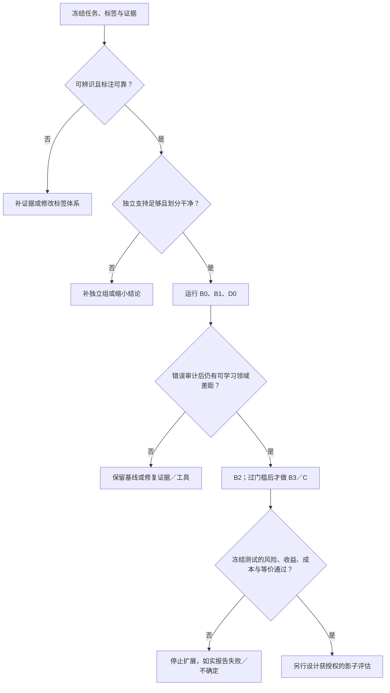

# 多模态决策模型微调：研究与验收方案

[English](multimodal-decision-finetuning.md) · [首页](../README.zh-CN.md) · [选型指南](selection-guide.md#image-intent-adaptation) · [证据台账](evidence.md)

来源核验：2026-10-18。本方案面向通用多模态客服意图识别，属于可检验的研究设计；没有执行模型训练或证明生产收益。下面分别标明公开实现、作者报告和建议实验。图像理解、意图判断、概率校准及拒判策略是不同问题。

**研究问题：** 给定领域图片和决策时可见的对话，怎样在预先约定的关键错误风险与完整成本限制下，提高可接受的意图识别覆盖率，并对证据不足案例澄清或转人工？微调 decision model 只是可能的手段，不是研究目的。数值风险、成本与最小实质收益标准须由场景负责人在模型／阈值选择之前确定，不设通用达标线。

<a id="quick-route"></a>
## 一页实验入口

用以下路线检验领域后训练是否改善明确的决策任务。**候选没有已证实的通用赢家，微调也可能降低质量。** [阅读清单](#reading-list)分开同行评议方法、预印本与工程资产。

| 关卡 | 继续之前应有的具体产物 | 继续／停止条件 |
| --- | --- | --- |
| 1. 契约与留出 | 决策当时的证据、独立标注一致性、标签／未知、错误代价与使用权；按分组、时间、近重复家族划分训练／开发／校准／最终测试。见[数据](#3-数据与标签先消除不确定性)。 | 先解决标签歧义与泄漏；未来上下文不得进入更早输入。 |
| 2. 基线与候选门槛 | 冻结零／少样本 VLM、带可用页面说明／检索的 VLM、运行时支持的 D3／Intern 推理、纯文本及 OCR＋文本；记录标签使用与总预算。见[对照](#1-先固定问题和对照)及[候选门槛](#candidate-gates)。 | 缺证据先取证／澄清；按核实的工程支持选择训练路径，不预设效果排名。 |
| 3. 小批学习检查 | 真实可训练参数／梯度、极小子集拟合、去图／换图、token 与读出位置对齐。见[视觉路径](#4-训练前验证视觉路径与损失)。 | 先修复链路；小批拟合成功不是泛化证据。 |
| 4. 受控适配 | 同一个精确底座、数据、视觉处理和预算下做 B2 短标签 SFT／B3 候选评分；有限开发搜索与学习曲线。见[实验顺序](#5-实验顺序与停止条件)。 | 跨底座比较只回答系统选型；保留普通回放与通用回归集。 |
| 5. 校准与拒判 | 独立校准、实际选择／路由策略、未知／OOS 与澄清；冻结门槛、温度和阈值。见[验收](#6-验收任务质量风险与成本一起看)。 | 概率／confidence 字段不是风险保证，只使用假设适合目标风险的方法。 |
| 6. 冻结验收 | 配对分组测试与不确定性、关键错误、覆盖率、完整成本及训练／导出／服务等价。 | 仅在满足关键风险／成本限制且覆盖率相对最强冻结基线有预先约定的实质收益时继续；否则改证据、数据、工程或停止。 |

每关产物记录到有版本的实验清单；这是一套在核验使用权和运行时之后实施的设计，不是未经验证的命令集合。

<a id="six-principles"></a>
### 六点综合如何落到实验

| 原则 | 对应实验／产物 |
| --- | --- |
| 意图依赖证据，不等于截图类别。 | 独立标注可见事实、当时意图及充分性；加入同图不同上下文案例。 |
| 类型化输出与直接 logits 是机制，不保证准确率。 | D0 推理对照；B2／B3 固定精确底座，明示归一化与读出。 |
| 领域监督必须增加有用信息。 | 先建立强 B0／B1；按分组画学习曲线，逐因素适配并保留普通回放。 |
| 更多推理不能补造证据。 | 算术／硬规则用确定性工具；AutoThink 仅作为证据充分难例上的冻结可选对照。 |
| 概率、校准与可接受策略不同。 | 分开开发／校准／测试职责，定义错误代价与风险—覆盖率，不设通用 confidence 线。 |
| 部署是被评测系统的一部分。 | 同一冻结策略检查图像／token／模板、并发、精度／设备／校准器及完整成本。 |

从[数据示意](#data-schema)、[划分协议](#split-protocol)和[最小矩阵](#experiment-matrix)开始，以[结果模板](#result-template)及[决策树](#decision-tree)结束。以下是小样本领域截图的建议流程，不是公开数据集或实验成果。

## 1. 先固定问题和对照

任务是根据领域图片与当时可见对话识别意图，无法辨识时澄清或转人工；在预定风险／成本条件下与最强冻结基线比较。后训练、短标签和直接候选评分都是待检验效果的手段。

将**可见事实**（图片显示什么）、**用户意图**（结合当时文本想解决什么）及**证据充分性**分开标注。同一截图可以对应不同诉求，图像类别不能自动成为意图标签；允许多意图、未知、超出范围和澄清。版本化页面说明／检索可提供决策当时可用的背景，不能补造缺失的用户诉求。

### 预注册可证伪假设

先确认可辨识性与独立人工标注一致性，再建立最强 OCR／通用 VLM／页面说明／检索基线；确认剩余瓶颈属于可学习的领域适配后才训练。预先声明终点、分组单位、划分、模型搜索预算、候选策略和停止规则；开发集用于模型／模板／学习选择，独立校准集用于概率／策略拟合，最终测试只做验收。

| 假设／论文到实验的对应 | 什么结果可推翻它 | 决定 |
| --- | --- | --- |
| H1：图片＋可见对话可辨识标签；MIRE／EcomMIR 与 MIntRec2.0 提示分开场景、意图和 OOS。 | 完善契约后独立标注仍持续分歧，或同图不同上下文确实歧义；页面说明／检索不能补造缺失的用户诉求。 | 改标签／证据或澄清，不扩大训练掩盖不可辨识。 |
| H2：领域适配在关键风险／成本限制下相对最强冻结基线增加有效覆盖；EcomMIR 提供适配实例，不证明本场景收益。 | 配对留出覆盖差值及区间不满足预定实质收益，或关键错误／成本变差。 | 保留较强基线或停止；已有 decision checkpoint 仅在训练链路核实后纳入继续训练臂。 |
| H3：候选评分相对短标签 SFT 改善声明的质量／校准／成本目标；读出／目标比较对应 B2／B3。 | 同精确底座、数据、规模、预算对照没有实质收益；跨底座结果不能检验此假设。 | 选较简单／较强且已验收的系统，不把底座／训练经历变化算作读出收益。 |
| H4：实际策略使用图像证据，并泛化到新 UI／时间／语言／OOS；视觉反馈／评审及校准拒判论文对应这些检查。 | 图像必要案例消融、冻结漂移集或真实策略风险／覆盖／成本失败，评审一致率掩盖视觉错误。 | 修证据、链路、数据、阈值或停止；证据不足响应本身也要评估，不等于自动安全。 |

主要终点是在预定关键风险约束下，相对最强基线的可接受意图标签覆盖率变化，并报告区间、每类错误与完整成本。离线 F1 提升、实现更容易或校准误差单独下降，都不能独立判定成功；论文提供机制和检验思路，同行评议不等于当前场景成功。

**工程支持与已验证效果分开。** Qwen3.5 或其他受支持 VLM 的 SFT／LoRA 是候选实验基线，不是已证明优于 D3 的推荐。在本页已核的一手来源中，尚未确立同任务、数据、规模及训练／推理预算的直接多模态对照；实现更容易不等于效果更好。D3 应保留为相同保留集图像／上下文输入上的实质推理对照，并披露目标标签使用及适配预算是否相同。

若要归因机制，B2 与 B3 必须从同一个精确骨干检查点出发，固定数据、规模、视觉处理和预算；新适配 Qwen VLM 与已发布 D3 的比较，只能检验已披露条件下的完整系统，不能把换底座／训练经历的差异归因于读出、目标函数或配方。B0／B1／B2／B3 是评测设计，不是效果排名，也不要求只选 Qwen3.5。

<a id="experiment-matrix"></a>
### 最小矩阵：先做必要对照，再过门槛扩展

前五行使用同一个冻结任务／划分。 先在 Train／Dev 范围完成前五行比较及有限选择；只将预声明的冻结基线和最终候选带到同一次最终测试协议，不边看 Test 边挑模型。零样本可看到标签名称与定义，不能看到带标签示例；少样本示例仅取 Train，另记 run ID。尽可能匹配证据、名义规模／内存与预算，披露底座预训练、精度、标签使用及推理开销差异；这是系统比较，不声称先验训练相同或已有排名。

| 实验臂 | 首轮配置 | 比较／决定 |
| --- | --- | --- |
| B0-T | 仅决策时可见文本；TF-IDF 等普通监督分类器，特征只在 Train 拟合 | 标签可分性及低成本基线。 |
| B0-O | 相同分类器加同图 OCR，冻结 OCR／版本 | B0-T 与 B0-O 只改变 OCR 证据；计入 OCR 错误与耗时。 |
| B1 | 一个固定通用 VLM，图片＋当时文本，零样本结构化短标签 | 冻结 schema／模板、图像预算及失败处理；页面说明／检索另设单因素臂。 |
| D0 | 一个明示规模的 D3，同图／文本／候选上的零样本类型化判断 | 保留专用模型的实质推理对照；比较完整系统，不归因于读出单项。 |
| B2 | 同量级 Qwen 或其他受支持 VLM，语言侧 LoRA＋短标签 SFT | 与其精确 B1 未适配检查点比较；有限 Dev 搜索，核视觉链路并保留普通样本。 |
| B3-CE，条件扩展 | 与 B2 相同精确底座／数据／processor／LoRA 预算，固定读出做候选子集 CE | 检验指定评分形式；B2／B3 的读出／归一化也变了，不能把全部差异归因于损失。 |
| B3-Brier，条件扩展 | 与 B3-CE 相同实现／初始化／预算，仅增加明示 Brier 项 | 对照 B3-CE 检验额外目标；权重在 Dev 选，不在 Test 或阈值认证数据上选。 |
| C，条件扩展 | 图像训练／导出门槛通过后，继续训练精确 D0 或 Intern 检查点 | 在声明预算下与同一未适配检查点比较；Vis 仅文本代码不能算多模态 C。 |

可选 Intern 推理单列 I0，不是首轮 B2 的前置要求。可选 AutoThink 单列 R0，固定获准使用的检查点／后端、Dev 选出的难例门槛及推理预算，计完整耗时；既评估预定难例，也评估**完整路由总体**，包含门槛错路由和额外调用。不能从最终测试错题挑子集，也不预设推理有益；算术、日期比较和显式约束保留确定性工具基线。

B0／B1／D0 确认存在可学习领域差距后，先 B2，再决定 B3／C。每次只改一个关键因素；配对实验复用开发划分／种子／预算，失败尝试也记录。学习曲线使用嵌套且保留分组的训练子集，不把重复截图的随机变化当独立数据收益。短标签生成可能只有数个 token，直接评分不必然降低完整延迟。

## 2. 公开证据能支持什么

[MIRE竞赛案例](mire-case-study.zh-CN.md#tasks)单独整理完整标签、真实输入输出／代码、[官方最终奖项与线上成绩](mire-case-study.zh-CN.md#finalists)及前三方法边界；这是有来源的案例，不是新领域实验成果。

| 来源与固定版本 | 已核实内容 | 不能由此推出 |
| --- | --- | --- |
| [MIRE 官方仓库](https://github.com/liujunwen23/MIRE/tree/d101287af90d114c5bf0cbfbd56fe9c52358e3bb) | WWW 2025 多模态意图挑战包含图像场景与多轮对话意图；[官方配置](https://github.com/liujunwen23/MIRE/blob/d101287af90d114c5bf0cbfbd56fe9c52358e3bb/mire_baseline/configs/qwen2_vl_full_sft.yaml)是 Qwen2-VL-7B 的全参数 SFT | 不是 decision readout 或 LoRA 的效果证明；公开可访问不等于数据获准商业使用 |
| [EcomMIR 作者论文](https://zhoushengisnoob.github.io/papers/WWWComp.pdf)（[DOI](https://doi.org/10.1145/3701716.3718371)） | CN-CLIP 场景分类与 MiniCPM-V 2.6 LoRA 意图分类；另有清洗、层级标签、高置信伪标签、图像增强及场景 model soup | [E28](evidence.md#e28) 的 Round 2 意图 F1 0.9420、场景 F1 0.8278 是组合系统作者报告；不能归因于 LoRA 单项，也不是“仅 1,000 条训练样本、完全未接触评测轮数据”的证明 |
| [ezjev 训练代码](https://github.com/everettjf/ezjev/tree/8b3d88957c0795bea160c8fbc9c6d2a54b051136) | 每题独立文本 prompt，候选字母 CE＋Brier、难例／普通样本回放和开发集温度拟合 | 代码使用 tokenizer、input IDs 和 attention mask，没有图像处理与视觉张量训练路径；即使加载多模态类，也不能称为图像微调实现 |
| [Intern-Decision 训练配置](https://github.com/InternLM/Intern-Decision/blob/3572c8a68b5df5dafe02d0e093989ba8ec0183bc/configs/training/qwen35.py)与[输入编译器](https://github.com/InternLM/Intern-Decision/blob/3572c8a68b5df5dafe02d0e093989ba8ec0183bc/src/inputs/schema.py) | 有真实多模态处理路径；冻结视觉 tower／projector，训练语言骨干；masked answer-token CE | 配置不是现成 LoRA；完整原始训练数据未公开，不能声称从零完全复现；多个字段并不自动逻辑一致 |
| [Decision 3.0 wrapper](https://huggingface.co/vllm-sr/d3/blob/225be8b1e2270becab69c5fe05b26f99cbbdd66b/modeling_d3.py) | 官方封装的已审阅版本 `train(True)` 明确抛出 inference-only 错误，含定制读出和非因果注意力 | 不能直接套通用 Trainer／PEFT。255 个答码不等于固定 255 个业务类别，也不证明有公开可用的多模态 LoRA 配方 |
| [Vis Decisions 0.6.1 文本训练](https://github.com/Blockether/vis-decisions/blob/d73768e3c18d89d11f6b9a774b87d64ccd55f27d/src/blockether/vis_decisions/_d3_trainer.py) | 独立 D3 文本实现；全语言骨干训练或 LoRA adapter **加可训练的完整 255 答码头**，候选 CE 及合并 FP32／ONNX 导出代码 | 指南列 Edge／Lite，代码还接受 Nano；`from_local` 仅留文本权重、去掉视觉塔，模型只接收 token IDs。可查的文本适配链路不等于开箱即用的多模态训练，也不是独立复现结果 |
| [decision-pacman 训练代码](https://github.com/grapeot/decision-pacman/blob/593ed1f59f4f97ad0bda7287ff304e9667360089/training/train.py)与[报告](https://github.com/grapeot/decision-pacman/blob/593ed1f59f4f97ad0bda7287ff304e9667360089/README.md) | 文本化游戏状态、教师／模拟器标签、候选分布 LoRA 蒸馏；作者同时报告专长提升与通用题下降 | 不是截图训练或客服泛化证明；教师可见的未来模拟只用于制标签，不得混入学生推理输入；完整数据不在已审阅代码中 |

官方推理 wrapper 的限制是封装边界，不能推出 D3 无法微调。[Vis 代码](https://github.com/Blockether/vis-decisions/blob/d73768e3c18d89d11f6b9a774b87d64ccd55f27d/src/blockether/vis_decisions/_d3.py)另建 `Qwen3_5TextModel`，训练路径没有图像／视频塔或视觉张量。若研究图片适配，需保留或恢复匹配的视觉链路／processor，验证 pixels 与 grid 元数据，再核查梯度、读出和多模态导出／服务等价。本次仅阅读源码，未运行训练／导出，也不引入社区速度或质量成绩。

新增 [Intern-Decision 论文 v1](https://arxiv.org/html/2610.22131v1)称训练有 17,880 条样本，其中 5,500 条带图，训练语言骨干、冻结视觉塔／projector。这支持“有带图训练”，不是 LoRA 效果报告。七套定量比较针对文本任务，视觉演示为定性；公开 Jevbench 参与开发，且缺同数据消融。已阅论文没有给出同条件多模态 D3 对照，也不足以确立完整原始训练数据已公开。

[10 月 17 日机制核查](decision-readout-and-reasoning.md)补充 StartLux v1.1：公开推理／服务包及归档 v1 文本 LoRA 示例，不等于已验证的完整多模态 v1.1／RLCD² 训练配方；权重为非商业许可，应核查使用权和精确运行时后再作有条件对照。

ezjev 的 MIT 代码许可证不能覆盖模型与训练数据；[模型卡](https://huggingface.co/everettjf/ezjev-4b-s3/blob/a2faa581dc5e48c0c41ce388d056fed8e8fa6b4d/README.md)明确提醒部分训练来源为非商业许可或未注明许可。其历史训练费用是作者某次实验记录，不能作为新的训练报价。MIRE／EcomMIR 的论文可读性同样不代替数据、底座、代码及权重的逐项使用权核查。所有来源均为阅读核验，未在此复现。

<a id="candidate-gates"></a>
### 候选适配门槛

| 候选 | 当前已核起点 | 图片适配前的门槛 |
| --- | --- | --- |
| D3 | 官方多模态推理对照；独立 Vis Edge／Lite 文本 full／LoRA 路径，代码另接受 Nano。 | Vis 去掉视觉；须恢复／保留真实图片链路，核梯度与多模态导出后再测效果。这是独立工程，不是架构禁止微调。 |
| Intern-Decision | 带图的全语言参数训练及 masked answer-token 路径，视觉／projector 冻结。 | 固定检查点／模板／后端；区分全参预算与另行验证的 LoRA 目标模块；论文文本成绩不能认证图片领域效果。 |
| Qwen3.5／其他受支持 VLM | 候选短标签生成式 SFT／LoRA 基线，先核模型／processor／trainer 支持。 | B2／B3 共用精确起始检查点和证据；工具链更容易不证明优于已做决策训练的 D3／Intern。 |

## 3. 数据与标签：先消除不确定性

<a id="data-schema"></a>
### 最小本地数据示意

以下均为虚构记号，不是真实记录、可直接使用的提示词或公开上传要求。真实图片、文本、身份和标签保存在获授权的本地／私有系统；仅改成匿名 ID 并不能匿名化截图。标签定义／候选说明放入有版本的独立配置。仅供标注的后续结果与模型可见证据分开，提取特征前核对证据时间。

```json
{
  "record_id": "synthetic-001",
  "image_ref": "LOCAL_ONLY",
  "visible_text": "SYNTHETIC_PLACEHOLDER",
  "evidence_cutoff": "SYNTHETIC_TIMESTAMP",
  "guidance_version": null,
  "conversation_group": "GROUP_A",
  "user_group": "GROUP_B",
  "near_duplicate_group": "DUP_A",
  "leakage_component": "COMPONENT_A",
  "ui_family": "UI_A",
  "ui_version": "v0",
  "language": "und",
  "label_schema_version": "labels-v1",
  "task_mode": "single_intent",
  "intents": ["INTENT_A"],
  "evidence_status": "sufficient",
  "unknown_reason": null,
  "annotation_status": "independently_reviewed_and_adjudicated",
  "rights_status": "LOCAL_REVIEW_REQUIRED",
  "split": "unassigned"
}
```

以实际推理缩放／裁剪／压缩后的可读性审计，而非只看原图：标注者能否读出关键文字、区分 UI 状态，OCR 是否保留证据？模糊／小字／缺区／脱敏丢失与语义混淆分开。冻结允许的预处理；删除关键证据或颠倒 UI 关系的裁剪／翻转不算标签保持增强。

建模前定义 `task_mode`。单意图约定主标签冲突规则；多意图使用集合目标与逐标签 precision／recall，必要时加 exact-set，不能用互斥 softmax。`unknown` 表示标签体系无法归入已知类，`out_of_scope` 表示已知范围外，`insufficient`／`needs_clarification` 表示缺证据；可与部分已知意图并存。明示优先级、标注与输出规则。模型低置信拒判属于**策略输出**，不自动等于这些金标。

至少两位标注者独立评审约定的审计子集，既含代表性样本，也另含歧义／稀有类；记录逐类一致性、分歧及裁决，不只报汇总一致率。分歧集中处扩大审计。历史操作与教师标签是待核证据，不自动是真值；同一可见图文仍有多个合理意图时，先补上下文或改契约再训练。

<a id="split-protocol"></a>
### 防泄漏划分协议

1. **分配前盘点。** 统计可用图片与独立会话／用户、完全／近重复、UI／模板家族、时间、标签和缺证据。结合精确哈希、视觉／OCR 相似度及人工核对；感知哈希既不能独自证明同一，也不能捕捉所有近重复。损坏／排除样本记录原因。
2. **建立泄漏连通组。** 按选定独立单位（同会话／用户）及真实重复／近同渲染实例连边，取连通分量，防止传递关系跨集合。裁剪、增强、改写继承父样本组与划分。巨型连通组是待处理限制，不能为了比例好看拆组。抽象 UI 家族与实例重复分组分开存。
3. **声明目标总体。** 常规流量集保留自然比例且连通组不交叉；若要声称未来或新页面泛化，另冻结后续时间及／或未见 UI／页面家族留出并单独报告，不混作自然流量。熟悉 UI 划分不证明新页面泛化；富集稀有／错误压力集另计分母。时间切分不会自动隔离用户／重复，必须同时检查。
4. **锁定职责和成员。** 数据管理者可在选模型前利用标签规划逐类支持，之后最终测试标签／内容不进入提示词、模型或难例开发。Train 拟合权重／特征／增强；Dev 选择检查点、schema、模板、rank、学习率、轮数、Brier 权重及路由设计；Cal 拟合冻结模型的概率映射／策略；Test 只验收冻结版本。测试内容／错题不能进入检索示例、伪标签、合成难例、校准或模型选择。
5. **CV 只在开发范围内。** 固定 Dev 太不稳定时使用分组折，条件允许再分层；目标为未来流量时用前向时间折，不能为类平衡牺牲分组／时间隔离。外层 Test 与最终 Cal 保持未触碰。预处理和生成样本只能在各训练折拟合；报告折／组数、缺失类别与选择波动。多模型 OOF 预测并不自动适配重训后的单模型校准；应对最终产物重校准或采用有依据的 cross-fitting。见[官方分组／时间 CV 指引](https://scikit-learn.org/stable/modules/cross_validation.html)。
6. **变更版本化。** 首次比较前冻结 split ID／哈希与泄漏审计。Dev 难例移入 Train 时，原开发成绩失效，须替换／更新 Dev。最终验收冻结并报告后才分析 Test 错误；一旦据此调整，旧 Test 就成为开发历史，需要新的未触碰验收集。

保留预声明的独立压力集：稀有／易混意图、同图不同文本、缺图／错图、小字／模糊、未见 UI／语言、否定／例外／矛盾、候选全错及图中恶意指令；逐例裁决预期行为。不将富集比例当自然流量，也不从最终测试错题生成训练难例。

<a id="sample-size"></a>
### 小样本数量与区间

不能只按图片张数套固定比例。依据独立组数、类别数、稀有类比例、期望区间宽度与标注预算规划。**训练前**形成内部计数表，每个类别、unknown／OOS 及重要 UI／时间组一行：

| 标签／分组 | Train 条数／独立组数 | Dev 条数／组数 | Cal 条数／组数 | Test 正例数／组数 | 区间／限制 |
| --- | --- | --- | --- | --- | --- |
| 每个声明类别 | 填实际计数 | 填实际计数 | 填实际计数 | 填实际计数 | recall 分子／分母及区间方法 |
| Unknown／OOS／证据不足 | 分开计数 | 分开计数 | 分开计数 | 分开计数 | 分开识别错误与策略拒判错误 |

稀有类在某集合可能没有独立正例；其 recall 标成不可估，报告固定标签列表与未定义指标处理规则，不能用 macro-F1 暗示所有类均被验证。补充有针对性的**独立**标注或缩小结论；合并类别须有语义理由并更新标签版本。独立组足够时，可对配对系统差值做分组 bootstrap；组数过少时，区间本身也不稳定。

仅作**虚构 iid 算例**：recall 8/10 为 80%，但双侧 95% Wilson 区间约为 49.0–94.3%。预先固定策略在 20 个独立接收案例中零错误，精确单侧 95% 二项错误率上界为 `1 - 0.05^(1/20)`，约 13.9%；60 个零错误也约为 4.9%。这些是[二项区间方法](https://www.itl.nist.gov/div898/handbook/prc/section2/prc241.htm)的算术示意，不是模型成绩。相关截图、自适应选阈值或多子组声明不能直接继承简单 iid 上界。样本可能不足以产生任何有用风险证书，应如实报告，不能看到结果后放宽预算。

校准前先冻结检查点／模板／候选归约；概率映射／温度用 Cal-fit，阈值认证用独立 Cal-policy，或使用计入联合选择的有效方法。支持量无法维持分离时，应标为探索策略并补数据，不能宣传未触碰认证。Cal 不是第二个 Dev；最终校准质量在冻结 Test 上测，不以拟合它的同一批数据证明。

## 4. 训练前验证视觉路径与损失

图像引用并不是图像特征。用同一 checkpoint 配套 processor／chat template，检查实际 `pixel_values`、grid／位置元数据、视觉 token 和 attention mask 是否进入正确模型，图像证据是否因截断丢失。冻结视觉参数仍需要执行视觉编码器；冻结不是关闭视觉输入。做去图、错图替换与纯文本消融，并检查输出差异是否符合题目需要；没有差异可能来自题目无需看图，也可能是路径失效，须区分原因。

单选候选评分可写成：

\[
p_\theta(k\mid x,C)=\frac{\exp(z_k/T)}{\sum_{j\in C}\exp(z_j/T)},\quad
L=-\log p_\theta(y\mid x,C)+\lambda\sum_{k\in C}(p_\theta(k)-\mathbf{1}[k=y])^2.
\]

这是可测试的目标，不是本仓库推荐的最优配方。Brier 系数、温度与训练预算需要开发／校准协议；概率输出或加入 Brier 不会自动保证校准。单个正温度保持同一候选集上的 argmax，无法修复标签排序错误。多标签任务需要另定义目标和输出约束，不能套用互斥单选 softmax。

必须区分：候选集合内 CE、完整词表上的 answer-token CE、独立分类 head；它们的归一化、训练竞争项和导出路径不同。Intern-Decision 的已审阅配置采用 XTuner 标准 CE、仅在答码位置保留监督，属于完整词表 answer-token 训练，而不是 ezjev 的候选子集 CE。输入编译器始终放 `<decision>` 占位符，目标答码只进入 labels；因果读取中，后续字段看见先前占位符而非先前预测／金标，不能把它当自回归答案链或独立字段证明。

在实际完整提示下检查答码 tokenization、答案位置、每个候选的合法性及 padding。交换选项时同步重映射标签，测试顺序敏感性。B2 只监督约定的答案部分，B3 只在约定的读出位置计算损失；不要泄漏目标，也不要静默丢弃超长、损坏图片或无法映射的标签。

<a id="preflight"></a>
### 训练前逐项留存通过／失败记录

- 冻结任务／标签／使用权和 split 哈希；验证分组／重复零交叉、无未来上下文／目标泄漏。在看到成绩前记录逐类支持及主要风险／成本／实质收益限制。
- 固定模型／权重标识、processor／模板、代码、可训练模块名称／数量、dtype／设备与优化设置；检查真正收到梯度的 LoRA／读出参数，冻结视觉仍须传递图像特征。
- 解码若干训练 batch，核图像尺寸、视觉 grid／token 数、答案位置／mask、标签到答码映射；目标只进入监督。报告长度分布和每次截断／排除，不静默丢难例。
- 极小 Train 子集拟合仅作调试；在人工确认图像必要的案例上做去图／换图，另测选项重排后的标签映射、padding 和未知。拟合成功不独自证明泛化或视觉链路正确。
- 预定有限搜索／种子／步数／token／算力预算、early stopping、开发指标及回归集；增强须保持标签且仅限 Train。记录普通／难例采样比，不只优化被选出的难例。
- 确认受支持的多模态训练／合并／服务链路；D3／Intern 门槛失败就保留推理基线或停止 C，不能假定可绕过 inference-only 封装。本文没有已测试可直接运行的训练命令。

<a id="evidence-ablations"></a>
### 扩展架构前先做证据消融

在同一预声明分组上比较仅图、仅当时文本、OCR＋文本、图像＋文本；固定类别定义／允许使用的说明，计预处理成本。仅图仍保留标签定义但移除对话；OCR 来自图像，不能算无视觉信息对照。标明各删减输入是否仍可辨识意图：信息不足时合理澄清按充分性契约评价，不强迫猜原标签。换错图／缺图控制仅用于预期后果经裁决的案例；只有残余错误支持时才增加图结构、第二编码器或推理分支，不为组合所有技术而扩架构。

## 5. 实验顺序与停止条件

1. **锁定版本和预算。** 记录底座／权重、processor、模板、代码提交、依赖、图像分辨率、精度、候选、上下文、种子、训练 token／样本及预算。单次模型仓库修订不等于权重或训练改变。
2. **先做小批量可学习性检查。** 验证 loss、梯度、实际可训练参数、视觉输入和答案位置；检查极小训练子集能否拟合，仅作管线诊断，不报泛化成绩。
3. **以语言侧 LoRA 为待测起点。** 冻结视觉 tower／projector可减少训练参数，但须验证精确模型类、目标模块及梯度。它是新实验建议，不能把 Intern 的全语言参数配置改名为 LoRA。rank、学习率和 epoch 用有限开发搜索选择，不照搬其他模型；明确早停规则。
4. **错误归因后再加数据。** 分开统计 OCR／视觉、上下文不足、标签歧义、规则绕过、模板／读出、领域知识、校准与权限错误。难例与普通样本回放同时保留；绘制按数据量／预算的学习曲线，防止仅对难例过拟合。
5. **有收益才做蒸馏。** 教师输入、标签来源与筛选逻辑明确；训练池内生成，人工抽检错误及软分布，按意图／语言查看偏差。小模型可能提升专长却丢失通用能力，应保留通用和边界回归集。
6. **验证导出与服务。** 同一输入比较训练端、合并／导出产物和服务端的答码映射、logits、温度、近似平局、图像处理与错误处理。适配器体积小不代表推理可以省掉大骨干。对图片任务，先将 D3 作推理对照，直到图像训练／导出链路另行验证；Vis 的独立文本适配路径不能代替图像训练验证。

只有剩余错误确属视觉事实或候选偏好、且能形成可审计成对标签时，才另设反馈／偏好学习臂。有条件借鉴 RLAIF-V／LLaVA-Critic，在同底座／证据／预算下与监督适配比较，抽检教师／评审错误；反馈生成限制在训练池，核查与评测集的来源／图片重叠。偏好模型不能替代意图契约或人工裁定的最终标签。

<a id="serving-regression"></a>
### 每次训练／导出／后端变更后的服务回归

| 案例 | 冻结比较及失败规则 |
| --- | --- |
| 单请求与并发 | 交错明显不同的状态／问题／选项，按预设数值容差与各自独立输出比较；核答案 token 偏移、行顺序和缓存隔离，另一请求绝不能改变选项身份。 |
| 长短与图文混合 | 验 processor、pixels／grid、截断方向及实际保留证据；batch padding、缺图／坏图及近上限输入须有明确且计数的结果。 |
| 训练／eager、合并／导出及服务产物 | 相同案例／候选映射，记录 logits／概率及标签差异，特别是近似平局；不能假定合并／导出保留视觉与读出。 |
| 设备／精度／量化／后端 | 各组合独立记录；dtype／kernel 可改 logits，重验匹配的校准器／策略，不能静默沿用温度。 |
| 校准及门槛 | 固定 calibrator ID、拟合总体、候选集、熵／max-probability 定义、拒判与推理策略，拒用不匹配产物。 |
| 负载及失败 | 记录并发／batch／上下文／图片预算、冷暖缓存、样本数、p50／p95、吞吐、内存、超时／非法输出率与重试；失败／澄清计入总体及完整成本。 |

[10 月 18 日运行时核查](../updates/2026-10-18-weekly-review.md)说明为何要核每请求偏移与服务／评测准备。本表是建议的回归覆盖，不声称已验证任一后端通过；少量耗时样本的 p95 不稳定，应报数量和负载而非通用倍数。

## 6. 验收：任务质量、风险与成本一起看

| 维度 | 预先约定的记录 |
| --- | --- |
| 任务质量 | macro-F1、每类精召、关键混淆、高风险漏检；多意图和 unknown 单列 |
| 自动化策略 | 固定阈值的覆盖率、接受集错误、澄清／转人工负担；区分未知类别和系统拒判 |
| 不确定性 | 以会话／用户等独立分组做配对比较和区间；样本不足时不宣称胜出，压力集与自然分布分别报 |
| 概率质量 | 独立 Cal 拟合；冻结策略在 Test 测 NLL／Brier、ECE，并说明分箱／温度范围／冻结时间；自报 confidence 不能代替概率 |
| 漂移与公平性 | 时间、语言、来源、界面、稀有意图、缺证据分组表现及失败率 |
| 系统成本 | OCR／检索／预处理、推理、队列、重试、复核和纠错的完整耗时／费用；硬件、并发、缓存、冷暖启动、P50／P95、吞吐与超时 |

主目标可定义为“在预先指定的错路由风险及其不确定性约束下的有效覆盖率”，同时约束高风险漏检和处理成本。有限测试上观察到的错误率不是统计上界；若要使用风险控制保证，应另外验证[方法假设](methodology.md#what-to-measure)。同一错误下的修复代价应进入每个请求的总成本，不能只比 token 单价。

标签体系不稳定、证据无法确定意图、视觉管线失效、服务模板不一致、关键错误不降或收益不能覆盖维护成本时，应暂停扩大训练。离线 F1、教师一致率、格式合法率、转换等价与真实处理成效分别报告。通过离线验收之后仍需另行设计获授权的影子评估、人工抽检和回滚；本方案没有执行部署或处理真实请求。

校准、错误排序与分类质量分别测量。[Guo 等](https://proceedings.mlr.press/v70/guo17a.html)在独立校准数据拟合温度；共同正温度不改变固定候选的 argmax。[UAI 2024 置信度研究](https://proceedings.mlr.press/v244/cattelan24a.html)支持另测风险—覆盖率／AURC，但 ImageNet 上的分数选择不是动态候选 VLM 的已验证默认。D3／API 的 `confidence >= 0.9` 不意味着领域接收案例的错误率不超过 10%；须检查真实统计量与返回策略。

[固定 D3 包](https://huggingface.co/vllm-sr/d3/blob/225be8b1e2270becab69c5fe05b26f99cbbdd66b/d3_runtime.py)在多候选 choice／score 中将 confidence 定义为一减归一化熵，衡量分布集中度，不是所选标签正确的估计概率；其他后端可有不同定义。概率映射拟合与阈值认证应分开留出，或采用计入自适应选择的有效程序；在同一校准集反复挑模型、温度和门槛后，不能继承未考虑选择的保证。

[Conformal Risk Control](https://proceedings.iclr.cc/paper_files/paper/2024/hash/f3549ef9b5ff520a7e41ff3cc306ab2b-Abstract-Conference.html)在交换性及有界单调损失等条件下控制期望风险，不是逐样本、也不是对任意固定校准集的高概率保证。接受集错误率可能随阈值非单调，不能自动套标准 CRC；需选择匹配风险定义和数据依赖的方法，并在路由、候选归约或分布变化后重新验证。

最终比较应配对同一会话／请求分组，报告质量、覆盖与成本差值及分组不确定性。查看最终结果之前冻结模型、策略和阈值，记录所有开发实验臂；预先声明最小实质收益与关键错误／成本限制。均值的小幅波动、校准误差单独降低或 ONNX 等价，均不足以判定继续。

10 月 14 日的[风险预算 System One 预印本](https://arxiv.org/html/2610.19811v1)研究二元策略：`s(X)` 预测正事件，`s(X) < tau` 区域执行 Action 0，风险为 `FOR = P(Y=1 | s(X)<tau)`，其余执行保守回退 Action 1。固定序列 LTT 要求评分器与有序阈值族由 Fit 冻结，并与来自部署同一总体的 iid Cal 独立；以 delta 为错误水平时，对校准集抽样而言，认证出总体风险超预算策略的概率不超过 delta。这不是逐题正确率、每次有限测试估计必不超预算，也不自动覆盖多类／图像／漂移。无证书意味着策略回退，区别于单输入拒答。六个英文文本集／单种子属于作者证据，本轮未复现或引入数值增益。

## 7. 最小研究产物

保留预注册假设、负责人确定的风险／成本／实质收益限制、任务／标签规范、来源及使用权清单、分组划分与去重方法、版本和预算、实验臂、图像消融、逐类错误、校准／阈值、完整成本与停止决定。共享产物只使用明确可公开的材料；真实数据与执行权限遵循各自管理边界。训练和评测脚本应在选定实现经验证后再编写，不把不可运行的示例命令包装成复现配方。

本页证据来源及版本见[来源登记](sources.md)；EcomMIR 数值与协议限制见 [E28](evidence.md#e28)。本页不发布数据集、模型权重或训练结果。

<a id="result-template"></a>
### 可直接填写的实验／结果记录

每个 run 和目标总体单独一行，运行前填计划字段，未测值留空，保留被否决／失败的实验臂。以下均为通用占位；真实产物除非明确可发布，否则保持私有。

| 字段 | 必须记录 |
| --- | --- |
| 身份／计划 | Run ID、假设、父对照、唯一关键改动、目标总体、负责人指定的关键风险／完整成本上限、最小覆盖收益、停止规则及搜索预算 |
| 数据／标签 | 本地清单／split 哈希、标签版本／模式／定义、证据截止、使用权、分组／重复审计、逐划分类别／组数及标注分歧 |
| 产物／训练 | 精确底座／权重／代码／processor／模板／读出；可训练模块、LoRA rank、损失／Brier 归一化／权重、种子、优化器／学习率／步数／样本／token、采样／回放与标签使用 |
| 策略／校准 | 冻结候选顺序／归约、概率／confidence 定义、Cal-fit／Cal-policy 成员、校准器／门槛／阈值 ID 及拟合时间；假设与证书状态，含无证书 |
| 质量 | Macro-F1 的标签列表／未定义规则；逐类 TP／FP／FN／支持数／recall 区间、混淆矩阵；多意图／unknown／OOS／证据不足及关键错误分开，计格式错误／超时 |
| 选择性行为 | 接收错误数／接收数、接收数／全部合格请求、澄清／转人工及失败比例；相对冻结基线的分组配对差值及区间；自然／压力／漂移总体分开 |
| 概率 | Test NLL／Brier 定义与 ECE 分箱；缺少可用类别概率的实验臂标不可用，不能把文字自报置信度编成概率 |
| 成本／回归 | 硬件／dtype／设备／后端、batch／并发／图像／上下文预算；完整 p50／p95／吞吐／费用／内存／数量、排队／重试／OCR／复核；服务回归结果及等价容差 |
| 结论／限制 | 按预定标准判通过／失败／不确定，受限类别／分组、失败检查、下个单因素改动、审核日期，以及 Test 指导改动后的新留出要求 |

每请求成本包含推理、证据处理、重试／复核／纠错；列实际数量及采用的单价，不套通用价格。离线意图识别与冻结接收／澄清策略分别报告，macro-F1 更高不独自证明关键风险预算内覆盖增加。种子／折间波动与抽样不确定性分开；区间不是部署保证。

<a id="decision-tree"></a>
### 继续、补数、修复或停止



发现泄漏、目标歧义、视觉／读出失效、非有限损失或服务不一致时，训练提前停止。预注册实质收益／风险／成本标准不满足或不可估时，停止扩展；有限 Dev 搜索结束后，不能继续在 Test 换模型直到过线。B2 无实质收益就保留较强基线；B3、C、蒸馏和推理都是可选假设，不是不断加复杂度的义务。

<a id="reading-list"></a>
## 8. 分层阅读清单与可借鉴方法

发表层级与证据强度是两个维度。同行评议不使结果自动独立于模型作者，也不证明可迁移到当前领域。本仓库仅核查资料，未运行这些模型；以下用于形成可检验设计，不拼总榜。

### 同行评议论文

| 正式标题／venue | 可借鉴的实施问题 | 证据边界 |
| --- | --- | --- |
| [组织方竞赛综述](https://doi.org/10.1145/3701716.3719642) — WWW Companion 2025 | 任务／资源定义、三队技术概述及综合获奖表；现已阅读全文。 | 组织方报告，不是独立消融；精确线上值来自对应阶段官方榜，不推断最终综合总分。 |
| [EcomMIR: Towards Intelligent Multimodal Intent Recognition in E-Commerce Dialogue Systems](https://doi.org/10.1145/3701716.3718371) — WWW Companion 2025（Companion Proceedings of the ACM Web Conference 2025），四页竞赛方案 | CN-CLIP＋Greedy Soup 场景分类；MiniCPM-V 2.6 LoRA 意图分类；层级标签、清洗及伪标签筛选。 | 作者组合系统竞赛报告，不是 WWW 主会研究轨或 LoRA 单项消融。Round 1 无标签测试输入进入训练，含 transductive 成分，不能称仅 1,000 样本纯监督；这也不能证明 Round 2 泄漏。见 [E28](evidence.md#e28)。 |
| [MIntRec2.0: A Large-scale Benchmark Dataset for Multimodal Intent Recognition and Out-of-scope Detection in Conversations](https://openreview.net/forum?id=nY9nITZQjc) — ICLR 2024；[官方仓库](https://github.com/thuiar/MIntRec2.0) | 意图／OOS 标签、多方多轮文本／音频／视频上下文；域内与 outlier-exposure 目标。 | 电视剧会话不是客服截图，也不是 LoRA 实证；本轮读到仓库正文，OpenReview 验证阻止全文访问。 |
| [RLAIF-V: Open-Source AI Feedback Leads to Super GPT-4V Trustworthiness](https://openaccess.thecvf.com/content/CVPR2025/html/Yu_RLAIF-V_Open-Source_AI_Feedback_Leads_to_Super_GPT-4V_Trustworthiness_CVPR_2025_paper.html) — CVPR 2025 | 视觉事实检查、AI 偏好构造及 DPO 式偏好学习；蒸馏前核查教师反馈。 | 作者对齐结果针对视觉回答可信度，不是领域意图效用；仓库后来支持 LoRA 不代表论文所有结果为 LoRA。数据 NC／研究用途及底座／API 条款须核查。 |
| [LLaVA-Critic: Learning to Evaluate Multimodal Models](https://openaccess.thecvf.com/content/CVPR2025/html/Xiong_LLaVA-Critic_Learning_to_Evaluate_Multimodal_Models_CVPR_2025_paper.html) — CVPR 2025 | 用 pointwise／pairwise critic 指令微调 LLaVA-OneVision，对判断及解释做 CE；核 GPT-4o 辅助标签偏差。 | 生成式视觉评审器不等于直接候选 logits 分类器或领域结果验证器；不猜未核实的 adapter／全参设置，不把教师一致率当金标。 |
| [VL-RewardBench: A Challenging Benchmark for Vision-Language Generative Reward Models](https://openaccess.thecvf.com/content/CVPR2025/html/Li_VL-RewardBench_A_Challenging_Benchmark_for_Vision-Language_Generative_Reward_Models_CVPR_2025_paper.html) — CVPR 2025 | 用筛选、人工复核的视觉偏好案例检查评审器是否识别视觉证据失误。 | 是基准，不是训练配方；来源含 RLAIF-V／RLHF-V，须检查样本／图像／来源重叠。基准作者原评测与本仓库复现分开。 |
| [On Calibration of Modern Neural Networks](https://proceedings.mlr.press/v70/guo17a.html) — ICML 2017 | 在独立校准集拟合温度并评估概率质量。 | 共同正温度不提高固定候选 argmax／top-1；部署及分布变化下仍须实测校准。 |
| [How to Fix a Broken Confidence Estimator: Evaluating Post-hoc Methods for Selective Classification with Deep Neural Networks](https://proceedings.mlr.press/v244/cattelan24a.html) — UAI 2024 | 将准确率与错误排序分开，评估风险—覆盖率／AURC。 | 84 个 ImageNet 分类器的研究不能证明动态标签或 VLM 上最好的 confidence 分数。 |
| [Conformal Risk Control](https://proceedings.iclr.cc/paper_files/paper/2024/hash/f3549ef9b5ff520a7e41ff3cc306ab2b-Abstract-Conference.html) — ICLR 2024 | 先精确定义风险，再匹配有界损失、单调性及交换性假设。 | 期望风险控制不是逐决策正确保证；任意接受集条件错误率不自动适用。 |

### 预印本与工程资产

| 来源／状态 | 已支持什么 | 尚未支持什么 |
| --- | --- | --- |
| [Calibration and Risk-Budgeted Decisions with System One Models](https://arxiv.org/html/2610.19811v1) — arXiv v1，2026-10-14 | LTT 认证前定义二元 FOR、冻结评分器／阈值族、独立 Fit／Cal／Test 与保守回退。 | 作者六个英文文本集／单种子；校准抽样下的总体风险保证不是逐题正确率或图像／多类／漂移保证。 |
| [Intern-Decision: Efficient Multimodal Decision Making with Autoregressive Masked Language Modeling](https://arxiv.org/html/2610.22131v1) — arXiv v1，2026-10-15 | 带图的全语言参数训练、多字段因果 masked 读出，视觉／projector 冻结。 | 文本套件成绩与定性视觉示例没有提供同条件 D3 多模态对照或 LoRA 效果；完整原始训练数据公开未确立。 |
| [StartLux-Decision: AutoThink Decision Models with Reinforcement Learning for Calibrated Deliberative Decisions](https://arxiv.org/html/2610.17309v1) — arXiv v1，2026-10-12 | 候选概率、按需推理及策略条件校准，见[机制核查](decision-readout-and-reasoning.md)。 | 公共 DI 开发选择、作者 DecisionPivot 与 NC 权重限制结论／使用范围，不是已验证领域图片训练配方。 |
| [MIRE: Multimodal Intent Recognition for Dialogue Systems challenge baseline](https://github.com/liujunwen23/MIRE/tree/d101287af90d114c5bf0cbfbd56fe9c52358e3bb) — WWW2025 挑战工程仓库 | 场景／意图任务的 Qwen2-VL-7B **全参数 SFT** 基线。 | 不是 EcomMIR 实现或 LoRA 结果；本轮未核得独立的同行评议方法论文。 |
| [Vis Decisions 0.6.1 D3 路径](https://github.com/Blockether/vis-decisions/blob/d73768e3c18d89d11f6b9a774b87d64ccd55f27d/src/blockether/vis_decisions/_d3_trainer.py) — 第三方工程 | 文本 full／LoRA＋可训练答码头及合并导出实现。 | 去掉视觉塔，不能证明多模态适配或独立评测复现。 |

实验划分与区间可参考[官方分组／时间 CV 文档](https://scikit-learn.org/stable/modules/cross_validation.html)及 [NIST 二项区间](https://www.itl.nist.gov/div898/handbook/prc/section2/prc241.htm)，但它们不证明当前数据独立或数量足够。

阅读顺序：领域意图适配 → OOS／澄清 → 视觉反馈 → 候选／评审评分 → 评分器检查 → 校准与拒判。同行评议方法能帮助设计实验，不能保证微调改善目标决策；阅读深度、版本与访问缺口见[来源登记](sources.md)。
